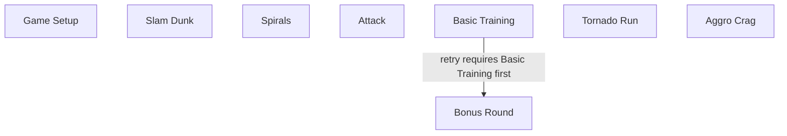
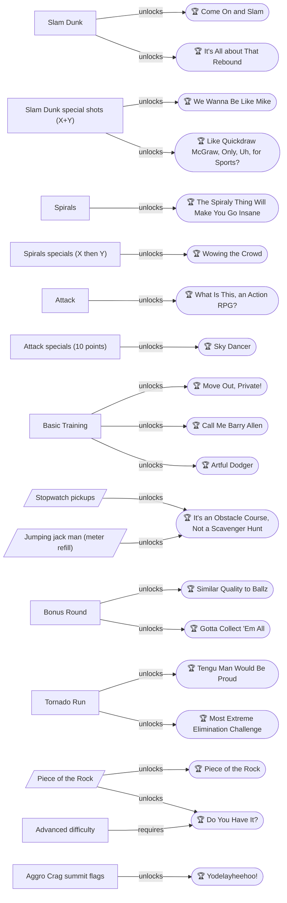
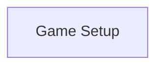
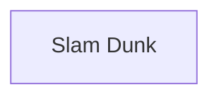
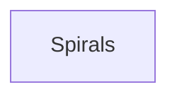
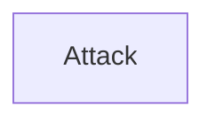
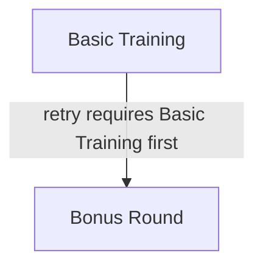
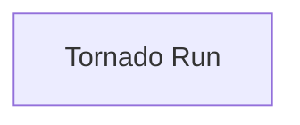
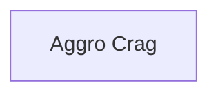

# Nickelodeon Guts — 100% RetroAchievements Walkthrough

## Metadata

- **Platform:** SNES/Super Famicom
- **Developer:** ICOM Simulations | Viacom New Media
- **Publisher:** Viacom New Media
- **Genre:** Sports, Game Show
- **Released:** 1994-11-01
- **Achievements:** 20 (185 points)

> [!NOTE]
> Every instruction in this guide was extracted from the sources listed at the bottom and checked against them (42 facts confirmed by 2+ sources, 94 from a single source). Statements marked 🟡 come from only one source. Anything we could not confirm says **"Unable to verify from collected sources."**

## Game Overview

### Premise

Nickelodeon Guts is the SNES game based on the kids' sports game show. Kids compete in off-the-wall athletic events, and the big finale is a huge mountain called the Aggro Crag, where the winner receives a piece of that "radical rock" 🟡. The game supports two-player play 🟡. This set has 20 achievements worth 185 points.

The events fall into two families:

- **Aerial events:** Slam Dunk, Spirals and Attack. You charge a power meter, jump and shoot at a target. The Bonus Event is also classed as Aerial 🟡.
- **Running events:** Basic Training, Tornado Run and the Aggro Crag. You race a course against the clock and score 1 point for each second you have left.

### Setting up a game

On the opening screen, the options you can set are:

- **Players:** Only 2 can play at once 🟡. A one-player game is not an official game; it is training 🟡.
- **Level:** Beginner or Advanced, with Advanced being harder. Only the Do You Have It? achievement (598955) needs Advanced.
- **Event Setups:** Leave this on. Turning it off hides each event's name, object and scoring 🟡.
- **Game type:** Choose a GUTS Show (4 events) or a Single Event 🟡.
- **Color:** Gives no gameplay advantage 🟡.
- **Character:** Each profile has a favorite sport that may help in events featuring that sport, but this is unproven 🟡. Basketball characters are ideal for It's All about That Rebound 🟡. Character choice made no noticeable difference in the Bonus Round 🟡.
- **Name:** Up to 8 letters 🟡.

### Core mechanics

**Aerial events (Slam Dunk, Spirals, Attack).**
- Hold Down to fill the power meter, release, then press B near the target to shoot 🟡.
- Always hold Down on the way back so you land safely on the padding. If you don't hold it enough, you can stagger or stumble off the padding, which costs time 🟡.
- In Slam Dunk, B is a regular shot. X and Y together make a special shot, which is actually easier than a regular shot 🟡.
- In Attack, regular shots are worth 5 points and specials 10. Specials are harder to hit and need good timing 🟡.
- Spirals plays the same way as Attack. To do a special there, press X and Y close together but not simultaneously.

**Running events (Basic Training, Tornado Run, Aggro Crag).**
- Basic Training scores 1 point for every second left, so 30 seconds left is 30 points.
- Tornado Run is like Basic Training but much more challenging.
- The Aggro Crag is even harder than both 🟡.
- You must be in a perfect position to grab a pole or rope, so keep trying if you cannot climb right away 🟡.
- Press the d-pad toward the side you are climbing to switch sides 🟡.
- Down crouches. Down with Left or Right in one fluid motion slides under obstacles, which works better than pressing Down and then moving 🟡.
- The energy meter only makes you run a little faster when full 🟡. Hard landings, sliding off poles, GUTS bag hits, gaps and running into the course lower it 🟡. Standing still or taking the jumping jack man's item refills it 🟡.
- In Tornado Run, being hit without stamina automatically fails the event 🟡.
- In Basic Training, follow the arrow signs; they won't mislead you 🟡.
- In the Aggro Crag, you must jump on every one of the 6 actuators. Walking over them does not count.

### Hardcore Mode

Play with RetroAchievements Hardcore Mode on. That means no save states, no cheats and no rewinds. Nothing in the collected sources describes a way to save mid-event, so expect to repeat an event from the start if you fail. Retrying the Bonus Round means running through Basic Training again 🟡. Per the community comments, the Bonus Round board order is random 🟡.

### The 700-point rule

> [!WARNING]
> **Missable Achievement Warning:** You need at least 700 points in a show to reach the Aggro Crag. Falling even 1 point short means you miss it. Aggro Crag achievements are not available if a show falls short, so score well in the earlier events. If you fall short, start another show.

### The 100% plan in plain language

1. **Chapter 1 – Game Setup and Options:** Get the options right (Beginner for most of the set, Event Setups on).
2. **Chapters 2–5 – The earlier events:** Slam Dunk, Spirals, Attack, and Basic Training with the Bonus Round. The sources do not say which events a show contains or in what order, so keep playing shows until every event achievement has unlocked. Unable to verify from collected sources.
3. **Chapter 6 – Tornado Run.**
4. **Chapter 7 – The Aggro Crag,** reached only with 700+ points in a show.
5. **Chapter 8 – Advanced GUTS Challenge:** Do You Have It? requires the Advanced level.

Plan on at least two playthroughs. Run Beginner shows (as many as you need) for the event, Bonus Round and Aggro Crag achievements. Then run one show on Advanced for Do You Have It? No source reports achievements that lock each other out.

### Toughest challenge

The hardest achievement is widely regarded to be Gotta Collect 'Em All: knock off every ball in the Bonus Round, finishing with 35 or more seconds left on the clock 🟡. One guide lists a 1:00 time limit for the Bonus Event 🟡, but the mastery comment implies a longer clock (clearing in 55 seconds with 35 left), so go by the on-screen clock 🟡. Knocking off every ball is extremely hard and pays 1 point per second left 🟡. If you miss any ball, you only get 1 point per ball knocked off 🟡.

Basic Training, Tornado Run and the Aggro Crag can be fun to optimize despite the jank movement 🟡.

## Achievement Roadmap

| Chapter | Achievements | Points |
|---|---|---|
| [1. Game Setup and Options](#chapter-1-game-setup-and-options) | What's This Show Called Again? | 1 |
| [2. Slam Dunk](#chapter-2-slam-dunk) | Come On and Slam, We Wanna Be Like Mike, Like Quickdraw McGraw, Only, Uh, for Sports?, It's All about That Rebound | 33 |
| [3. Spirals](#chapter-3-spirals) | The Spiraly Thing Will Make You Go Insane, Wowing the Crowd | 13 |
| [4. Attack](#chapter-4-attack) | What Is This, an Action RPG?, Sky Dancer | 13 |
| [5. Basic Training and the Bonus Round](#chapter-5-basic-training-and-the-bonus-round) | Move Out, Private!, Call Me Barry Allen, It's an Obstacle Course, Not a Scavenger Hunt, Artful Dodger, Similar Quality to Ballz, Gotta Collect 'Em All | 50 |
| [6. Tornado Run](#chapter-6-tornado-run) | Tengu Man Would Be Proud, Most Extreme Elimination Challenge | 15 |
| [7. The Aggro Crag](#chapter-7-the-aggro-crag) | Piece of the Rock, Yodelayheehoo! | 35 |
| [8. Advanced GUTS Challenge](#chapter-8-advanced-guts-challenge) | Do You Have It? | 25 |

## Playthrough Planning

**Playthroughs required:** 2

Plan on at least two GUTS Shows: a Beginner show (or several) for the event, Bonus Round and Aggro Crag achievements, then one on Advanced for Do You Have It? (598955). A GUTS Show has 4 events (gf1-1-3), but the game has five non-Crag events. The sources do not say which events a show contains or in what order, so keep playing shows until every [Guts Show] event achievement (598949-598953) has unlocked. Retrying the Bonus Round means running through Basic Training again (ra-comments-16-8). No source reports achievements that lock each other out.

**Settings:** Hardcore Mode. Level: Beginner or Advanced is set on the options screen (gf1-1-2). Only Do You Have It? (598955) requires Advanced. Event Setups can be left on: turning it off hides each event's name, object and scoring (gf2-2-1). Character choice made no noticeable difference in the Bonus Round (ra-comments-16-11), but basketball characters are ideal for It's All about That Rebound (ra-comments-12-4).

## True 100% In-Game Completion Criteria

This guide covers complete in-game mastery in addition to all RetroAchievements:

| Category | 100% Requirement | Tracking Scope |
|---|---|---|
| **Events Finished in a GUTS Show** | Every event (Slam Dunk, Spirals, Attack, Basic Training, Tornado Run) finished with a score inside a GUTS Show, plus the Aggro Crag summit for a Piece of the Rock. | Per-chapter checkpoint |
| **Event Mastery Challenges** | The per-event skill challenges: special-shot-only scores, 5 specials in a row, 20+ shots, every Basic Training pickup, no-hit and timed finishes, and a fast Aggro Crag climb. | Per-chapter checkpoint |
| **Bonus Round Clear** | Every ball knocked off the wall in the Bonus Round, once with 0:35 or more left on the clock. | Per-chapter checkpoint |
| **Advanced GUTS Challenge** | A full GUTS Show won, Aggro Crag included, on the Advanced level. | Per-chapter checkpoint |

## Missables Summary

| ⚠ Missable | Achievement | Chapter | Must be done before |
|---|---|---|---|
| Similar Quality to Ballz: clear every ball in the Bonus Round 🟡 | Similar Quality to Ballz | [5](#chapter-5-basic-training-and-the-bonus-round) | Before the Bonus Round's 1:00 clock runs out; another attempt means running Basic Training again |
| Gotta Collect 'Em All: clear every ball with 0:35 or more left 🟡 | Gotta Collect 'Em All | [5](#chapter-5-basic-training-and-the-bonus-round) | Every ball must be off the wall with at least 35 seconds left on the Bonus Round clock; another attempt means running Basic Training again |
| Yodelayheehoo!: reach the top of the Aggro Crag in 1:40 or less | Yodelayheehoo! | [7](#chapter-7-the-aggro-crag) | The Aggro Crag is only reached with 700+ points in a GUTS Show; falling even 1 point short skips it |

## Points of No Return

No points of no return were identified in the collected sources.

## Progression Diagrams

### Game Progression

### Achievement Dependencies

## Walkthrough

## Chapter 1: Game Setup and Options

### Area Overview & Preparation

This chapter covers everything you do before your first event: the options screen, the choice between a GUTS Show and a Single Event, picking a color, and picking a character. Nothing here is a combat or exploration area, so there are no chests, enemies, or bosses. The one thing to take away is the 700-point rule for the Aggro Crag, described below.

The game supports 2-player play, but only 2 players can play at once. 🟡

> [!WARNING]
> **Achievement Trigger Warning (Aggro Crag access):** You must have at least 700 points in a show to take on the Aggro Crag. Falling even 1 point short means you miss it. Treat every event in a show as points you cannot afford to waste.

> [!TIP]
> The Aggro Crag's name means "Aggressive Rock." 🟡

### Options Screen

On the opening screen, move up and down to pick an option and press A to change it.

Unable to verify from collected sources: the exact button list for changing options beyond A (one guide says A and Start are the only ones the author knows). 🟡

The options, in order:

1. **Player (1 Player Game / 2 Player Game):** This sets the number of players, and only 2 can play at once. 🟡 A one-player game is not an official game; you are in training. 🟡
2. **Level (Beginner / Advanced):** The screen does not label this "Level." Beginner is better if you are new, and Advanced is the harder setting. If you are going for the Advanced-related achievement, note that the Aggro Crag on Advanced has spots where you cannot see what is ahead off-screen, so take your time there. 🟡
3. **Music (On/Off):** Toggles the menu, in-game, and description music. 🟡 (Unable to verify from collected sources: any achievement effect of this setting.)
4. **Event Setups (On/Off):** With it on, you are shown the event's scoring. Turning it off hides the event's name, object, and scoring. Leave it on while you learn the game. 🟡
5. **Start Game:** Confirms the options and moves on. 🟡

### GUTS Show vs. Single Event

After Start Game you choose between two modes: a GUTS Show, which is 4 events including the Aggro Crag at the end, or a Single Event, where you practice one event. 🟡

The sources do not say whether Single Event attempts count toward the individual event challenges that are not tied to a full show. Unable to verify from collected sources.

In a show, you need 700 points to reach the Aggro Crag.

### Color Selection

Once you have chosen GUTS Show or Single Event, the game asks you to pick a color. 🟡

1. Move to any color you like. There is no advantage to any color; it is just a style choice. 🟡
2. Confirm it. The game then moves on to the character selection screen. 🟡

No achievement depends on the color, so you can keep the same one for every show, including the Advanced show in Chapter 8. 🟡

### Character Selection

Characters are numbered by reading the grid from left to right and top to bottom, starting from the far left with character 1. 🟡 There are 8 characters, 6 female and 2 male, and they have no in-game names. 🟡 Each has a favorite sport that may help in events featuring that sport, but this is unproven. 🟡 You can then enter a name of up to 8 letters. 🟡

Using the numbering from the first guide's chart, with the layout reading left to right and top to bottom: 🟡

| # | Gender | Weight | Height | Favorite Sport | Citation |
|---|---|---|---|---|---|
| 1 | Female | 97 | 5'0" | Gymnastics | 🟡 |
| 2 | Male | 98 | 5'1" | Basketball | 🟡 |
| 3 | Male | 110 | 5'4" | Basketball | 🟡 |
| 4 | Female | 104 | 5'3" | Baseball | 🟡 |
| 5 | Female | 111 | 5'4" | Football | 🟡 |
| 6 | Female | 105 | 5'2" | Soccer | 🟡 |
| 7 | Female | 113 | 5'6" | Football | 🟡 |
| 8 | Female | 108 | 5'4" | Track and Field | 🟡 |

The player names in the source are listed in the order they are mentioned in the ending seen after beating GUTS, not by slot. 🟡 Since the two guides number the grid differently, rely on what you see on the screen rather than the number.

### GUTS Show: The Events

A show runs 4 events. Here is what the collected sources say about each one.

- **Attack** (Aerial, 2:30): Score the most points, 5 per point made. It uses the same controls as Slam Dunk and Spirals: charge the meter, press B to shoot, press Down to return to the padding.
- **Tornado Run** (Gym, 7:00): Reach the finish in the fastest time; each second under 7:00 is worth 1 point. It is like Basic Training but much more challenging.
- **Spirals** (Aerial, 2:30): The same as Attack, no more and no less. Each spiral in the hoop is worth 5 points.
- **Basic Training** (Gym, 6:00): Reach the finish quickly; each second under 6:00 is worth 1 point. Follow the arrow signs, which will not mislead you.
- **Slam Dunk** (Aerial, 2:30): Each made shot is worth 5 points. It is the easiest event in the game.

Detailed strategy for each event appears in the chapters that cover them.

### Achievement: What's This Show Called Again?

> [!ACHIEVEMENT]
> **What's This Show Called Again? (1 Points)**
> 
> *Shout GUTS!*

Its RetroAchievements description is "Shout GUTS!" Unable to verify from collected sources: what triggers it and how to earn it. No guide, RA comment or web page found explains it, so this walkthrough gives no steps for it.

> [!TIP]
> **Before you leave Game Setup:** Choose a GUTS Show, keep Event Setups on, and remember you need 700 points in the show to reach the Aggro Crag.

> [!IMPORTANT]
> ### Chapter 1 Cumulative 100% Checkpoint
> - **Events Finished in a GUTS Show:** 0 / 6 🟡
> - **RetroAchievements Unlocked:** 1 / 20 (1 / 185 points)

### Chapter Checklist

- [ ] Options set (Player, Level, Music, Event Setups)
- [ ] GUTS Show selected, color and character chosen
- [ ] 700-point rule understood
- [ ] Achievement 598947: trigger unverified

---

## Chapter 2: Slam Dunk

### Area Overview & Preparation

Slam Dunk is an Aerial event with a 2:30 time limit. The goal is to score the most points, and every shot you make is worth 5 points 🟡. The guide calls it the easiest event in the game, even though it can feel frustrating at first 🟡. That makes it the best place to pick up the "any Aerial Challenge" achievements as well as the Slam Dunk ones.

This chapter covers four achievements:

- **Come On and Slam** (598949): finish the Slam Dunk Challenge and score, inside a GUTS Show 🟡.
- **We Wanna Be Like Mike** (598959): get 30+ points in Slam Dunk using only special shots 🟡.
- **Like Quickdraw McGraw, Only, Uh, for Sports?** (598957): land 5 specials in a row on any Aerial Challenge 🟡.
- **It's All about That Rebound** (598958): get 20+ successful shots in any Aerial Challenge without tripping off the platform 🟡.

A GUTS Show is made up of 4 events; the other mode is a Single Event 🟡. Come On and Slam is a Guts Show achievement, so Slam Dunk must be played as part of a GUTS Show and you must score. A one-player game is not official: it counts as training 🟡. Unable to verify from collected sources whether training affects achievement unlocking.

Character choice matters slightly for It's All about That Rebound. Two characters have basketball as their favorite sport, which is ideal because they get ready slightly faster after climbing back onto the platform 🟡. Per the character lists, these are character 2 (male, 98 lbs, 5'1") and character 3 or 8 depending on the guide's numbering (male, 110 lbs, 5'4") 🟡. Pick either of the two male basketball players on the selection screen.

> [!TIP]
> There is no advantage to any particular GUTS color; it is only style 🟡.

### Slam Dunk

🗺️ **Map:** [View Slam Dunk Map by zagato blackfist](https://www.vgmaps.com/Atlas/SuperNES/NickelodeonGUTS-SlamDunk.png) 🟡

#### Controls

1. While on the big padding, move left or right across it 🟡.
2. Press and hold Down until the power meter (on the left side of the screen) is filled to your liking, then release Down 🟡.
3. Wait until you are near the basket before pressing B to shoot 🟡.
4. **Hold Down on the way back.** The power meter will move up a little, and if done correctly you land back on the padding safely 🟡. If you skip it or don't hold enough, you may stagger onto the padding or even stumble off, costing valuable time 🟡.

#### Shot types

- **B** makes a regular shot, which is a bit harder than a special 🟡.
- **X and Y together** make a special shot, which is actually easier than the regular shot in this event 🟡.

#### Recommended setup

Move to the extreme left of the platform, then hold Down to about the 4th or 5th notch of the meter, let go of Down, shoot, and let the ball go in 🟡.

### Slam Dunk special shots (X+Y)

Because specials are easier than regular shots here, use X+Y for everything in this chapter 🟡. Elsewhere, specials are harder to hit and need good timing 🟡, so Slam Dunk is the friendliest place to chain them.

#### Plan for the special-focused achievements

1. Start a **GUTS Show** (not a Single Event) so the run also counts for Come On and Slam 🟡.
2. Pick one of the two basketball characters 🟡.
3. Move to the far left and set the 4th/5th notch every time 🟡.
4. Shoot using X+Y only, and always hold Down on the return trip 🟡.

> [!ACHIEVEMENT]
> **Like Quickdraw McGraw, Only, Uh, for Sports? (10 Points)**
> 
> *On any Aerial Challenge, land 5 specials in a row*

Land 5 specials in a row. Because X+Y is easier than B here, simply never use B and repeat the same setup until five consecutive specials go in 🟡.

> [!ACHIEVEMENT]
> **We Wanna Be Like Mike (10 Points)**
> 
> *In Slam Dunk, get 30+ points using only special shots*

For We Wanna Be Like Mike you need 30+ points using only special shots. Each made shot is worth 5 points 🟡, so that is 6 made specials, and you must not use B at all during the attempt 🟡. Using X+Y for the entire event keeps this condition clean. Unable to verify from collected sources whether a special is worth more than 5 points in Slam Dunk.

> [!ACHIEVEMENT]
> **It's All about That Rebound (10 Points)**
> 
> *In any Aerial Challenge, get 20+ successful shots without tripping off the platform*

It's All about That Rebound wants 20+ successful shots without tripping off the platform. The requirement was reduced to 20+, obtainable with any character and still on the tougher side 🟡. The way to stay on the platform is to hold Down on every return, since insufficient holding can make you stumble off 🟡. Speed matters: a community tester found that jumping off without filling the jump meter, discarding the ball as fast as possible and jumping back up barely allows 30 attempts, and that if every attempt must be made and converted, 24 is the most possible 🟡. So 20+ made shots leaves only a small margin; a basketball character helps by roughly 1-2 shots 🟡.

> [!TIP]
> Treat "without tripping off the platform" as an Achievement Trigger Warning, not a missable: if you stumble, simply retry in another run 🟡. Stumbling also wastes time, so a clean run helps every goal here 🟡.

### Finishing the Event

> [!ACHIEVEMENT]
> **Come On and Slam (3 Points)**
> 
> *Finish the Slam Dunk Challenge (must score) [Guts Show]*

Come On and Slam is earned by finishing the Slam Dunk Challenge with a score while playing inside a GUTS Show. Make at least one shot (5 points each) before the 2:30 clock runs out. Finish the event normally rather than quitting out.

> [!TIP]
> **Before you leave Slam Dunk:** check that Quickdraw McGraw, Like Mike and Rebound popped during your run, and that the event was played inside a GUTS Show for Come On and Slam 🟡. If any are missing, retry before moving on; Slam Dunk is the easiest event, so it is the best place to repeat them 🟡.

> [!IMPORTANT]
> ### Chapter 2 Cumulative 100% Checkpoint
> - **Events Finished in a GUTS Show:** 1 / 6 🟡
> - **RetroAchievements Unlocked:** 5 / 20 (34 / 185 points)

### Chapter Checklist

- [ ] Started a GUTS Show (not a Single Event) 🟡
- [ ] Picked a basketball-favorite character 🟡
- [ ] Used X+Y specials from the far left at the 4th/5th notch 🟡
- [ ] Held Down on every return to the padding 🟡
- [ ] 5 specials in a row (598957)
- [ ] 30+ points from specials only (598959)
- [ ] 20+ successful shots without tripping off (598958)
- [ ] Finished Slam Dunk with a score inside a GUTS Show (598949)

---

## Chapter 3: Spirals

### Area Overview & Preparation

Spirals is an Aerial event with a 2:30 time limit. A GUTS Show is made up of 4 events (the other mode being a Single Event) 🟡; the sources do not say whether Spirals is always one of them. The event plays exactly like Attack, with no more and no less. It also borrows the Slam Dunk method: press Down to the point you want on the power meter, then press B at the height of your jump.

The objective is to score the most points. Each spiral that goes through the "hoop" is worth 5 points 🟡. Two achievements are tied to this chapter:

- **The Spiraly Thing Will Make You Go Insane:** finish the Spirals challenge and score, inside a GUTS Show 🟡.
- **Wowing the Crowd:** get 30+ points in Spirals using only specials.

> [!TIP]
> A one-player game is not an official game; it counts as training 🟡. Because the first achievement is flagged as a Guts Show event, play the event inside a GUTS Show and not as a Single Event 🟡.

> [!WARNING]
> **Achievement Trigger Warning:** For Wowing the Crowd, the 30+ points must come from specials only. Do not take regular B shots during the run you are trying to use for this achievement. If you slip, you can simply try again; this is not missable.

### Chapter Items to Collect

There are no chests or collectible items in this chapter. Unable to verify from collected sources.

### Spirals

🗺️ **Map:** [View Spirals Map by zagato blackfist](https://www.vgmaps.com/Atlas/SuperNES/NickelodeonGUTS-Spirals.png) 🟡

#### Basic shot method

1. Remember the Slam Dunk instructions: press Down to the desired point on the power meter, then go along with the ride and press B at the height of your jump.
2. For a reliable setup, go to the far right as far as you can, then push the power meter to the 5th notch, not much above or below it 🟡.
3. When you get close to the basket, release the shot 🟡.
4. Press Down on your way back so you do not fall off the padding 🟡.
5. Repeat this for every shot. Each spiral through the hoop is worth 5 points 🟡.

> [!ACHIEVEMENT]
> **The Spiraly Thing Will Make You Go Insane (3 Points)**
> 
> *Finish the Spirals Challenge (must score) [Guts Show]*

To earn this one, play the event inside a GUTS Show and finish the 2:30 run having scored at least once. Using the far-right, 5th-notch setup above is the recommended way to score 🟡.

### Spirals specials (X then Y)

A special is harder in this event than in Attack, but it can be pulled off with practice. To do a special you must press X and Y together: not at the same instant, but close to it. If Spirals copies Attack's scoring, a special is worth 2 regular shots, or 10 points. Unable to verify from collected sources: the guide states the 10-point value only for Attack, so watch your score after your first special.

#### Wowing the Crowd

1. Set up as for a normal shot (Slam Dunk method with Down on the meter), and keep to the same positioning on the padding.
2. Instead of pressing B, press X and Y close together, but not at the exact same moment.
3. Keep doing specials only. Do not use B. You need 30+ points from specials alone.
4. Press Down on the way back so you stay on the padding and do not waste time 🟡.

> [!ACHIEVEMENT]
> **Wowing the Crowd (10 Points)**
> 
> *In Spirals, get 30+ points using only specials*

> [!TIP]
> **Before you leave Spirals:** Make sure both achievements have popped. The scoring run (The Spiraly Thing) must be done in a GUTS Show, and the specials-only run (Wowing the Crowd) needs 30+ points.

### Cumulative 100% Checkpoint

> [!IMPORTANT]
> ### Chapter 3 Cumulative 100% Checkpoint
> - **Events Finished in a GUTS Show:** 2 / 6 🟡
> - **RetroAchievements Unlocked:** 7 / 20 (47 / 185 points)

### Chapter Checklist

- [ ] Start a GUTS Show (not a Single Event) and reach Spirals
- [ ] Use the far-right, 5th-notch setup and press B at the height of your jump
- [ ] Press Down on the way back each time
- [ ] Finish Spirals with a score (The Spiraly Thing Will Make You Go Insane)
- [ ] Score 30+ points using only specials (Wowing the Crowd)

---

## Chapter 4: Attack

### Area Overview & Preparation

Attack is an Aerial event with a 2:30 time limit. You shoot balls into a square frame with a net in it, using a lacrosse stick (the guide's author is not certain it is lacrosse) 🟡. The goal is to score the most points inside the time limit 🟡.

This chapter has two achievements. **What Is This, an Action RPG?** requires you to finish the Attack Challenge and score, and it must be done inside a GUTS Show 🟡. **Sky Dancer** requires 30+ points in Attack using only special shots 🟡.

> [!WARNING]
> **Achievement Trigger Warning:** A one-player game is not an official game; it is training 🟡. Because the first achievement must be earned inside a GUTS Show, choose "GUTS Show" (4 events) and not "Single Event" on the mode screen 🟡. The Show is the mode with 4 events, the other being a Single Event 🟡. Sky Dancer can be retried in any run of Attack, since it only needs the special-only point total 🟡.

### Scoring and Controls

| Shot type | Button | Points | Citation |
|---|---|---|---|
| Regular shot | B | 5 | 🟡 |
| Special shot | X and Y, pressed close together (see below) | 10 (worth two regular shots) | |

- Attack uses the same controls as Slam Dunk and Spirals: hold Down to charge the meter, press B to shoot, and press Down to get back up on the padding 🟡.
- Specials are harder to hit and need good timing 🟡. If you land one, the announcer calls out a line such as "Awesome!" 🟡.
- Sky Dancer needs 30 points from specials only, which works out to three landed specials at 10 points each 🟡. Regular shots do not count toward this total.

### Attack

🗺️ **Map:** [View Attack Map by zagato blackfist](https://www.vgmaps.com/Atlas/SuperNES/NickelodeonGUTS-Attack.png) 🟡

Attack is a single arena. You stay on the padding, charge the meter, and shoot at the net. There are no chests or items in this event. Two guides offer different shooting positions; try one, and switch to the other if it is not working for you.

#### Option A: Far left, 4th-5th notch

1. Move to the far left of the padding, until your character can't move any farther 🟡.
2. Hold Down until the power meter sits roughly between the 4th and 5th notch. The notches are the long stripes on the meter, which looks like a ruler 🟡.
3. Shoot with B. The guide says you will hit more shots from this spot 🟡.

#### Option B: Far right, full meter at the top of the jump

1. Move to the far right side of the padding 🟡.
2. Hold Down to fill the meter to its maximum 🟡.
3. Shoot at the very top of your jump 🟡.

This was the approach that worked for that guide's author, who notes that you may find something else that works for you 🟡.

#### Getting Back Up

After each shot, press Down to get back up on the padding 🟡. The related Slam Dunk event warns that if you skip this or don't do it enough, you may stagger onto the padding or stumble off, costing valuable time 🟡.

### Attack Specials (10 points)

Specials are the key to Sky Dancer 🟡.

1. Use whichever position above gives you the most consistent hits, because specials are the hardest shots to land and depend on timing 🟡.
2. Your character performs a special move when you throw one 🟡. A successful special is worth 10 points 🟡.
3. Count only the special points. Reach 30 or more from specials alone, which means at least three landed specials 🟡.
4. **Input:** press X and Y close together, but not at the exact same instant. The guide says Spirals is done exactly the same way as Attack, and gives this X-then-Y input for the Spirals special. Do not press B during a Sky Dancer attempt.

You have 2:30 for the whole event, so do not spend too long on a single attempt.

> [!ACHIEVEMENT]
> **Sky Dancer (10 Points)**
> 
> *In Attack, get 30+ points using only special shots*

### Finishing the Event

Make sure you finish the whole 2:30 and end with a score above zero, in a GUTS Show 🟡. Each point made in the contest is worth 5 points 🟡.

> [!ACHIEVEMENT]
> **What Is This, an Action RPG? (3 Points)**
> 
> *Finish the Attack Challenge (must score) [Guts Show]*

> [!TIP]
> **Before you leave Attack:** Confirm that both achievements popped. If Sky Dancer did not, you can retry the event for the special-only total 🟡. Next up is Basic Training and the Bonus Round.

> [!IMPORTANT]
> ### Chapter 4 Cumulative 100% Checkpoint
> - **Events Finished in a GUTS Show:** 3 / 6 🟡
> - **RetroAchievements Unlocked:** 9 / 20 (60 / 185 points)

### Chapter Checklist

- [ ] Selected "GUTS Show" (4 events) rather than Single Event
- [ ] Finished Attack with a score (What Is This, an Action RPG?)
- [ ] Landed 30+ points using only special shots (Sky Dancer)
- [ ] Checkpoint totals match: 3 / 6 events, 9 / 20 achievements (60 / 185 points)

---

## Chapter 5: Basic Training and the Bonus Round

### Area Overview & Preparation

Basic Training is a Gym event with a 6:00 time limit. The goal is to reach the finish line in the fastest time, and every second left under the limit is worth 1 point. It is a slightly easier, shorter version of Tornado Run, but you have less time, so your reflexes matter more. Because of that, this is the best place to earn the "any Track Challenge" achievements: Move Out, Private!, Call Me Barry Allen, It's an Obstacle Course, Not a Scavenger Hunt, and Artful Dodger.

After Basic Training comes the Bonus Round, an Aerial event; one guide lists a 1:00 limit, though see the clock note under Strategy below 🟡. It holds the two missable ball achievements.

This is a GUTS Show chapter. A GUTS Show is 4 events; the other mode is Single Event 🟡. Move Out, Private! must be earned by reaching the finish line during a GUTS Show.

> [!TIP]
> **Hardcore advice:** Practice Basic Training before you commit to a full Show. The 2-player Basic Training differs from the 1-player version, so do your runs in a 1-player game 🟡. A one-player game is training rather than an official game 🟡.

The five Track/Bonus challenges are not documented as combining in a single run. Plan separate attempts: one for finishing quickly, one for a clean run, and Bonus Round attempts afterward. Unable to verify from collected sources.

### Controls for Basic Training

- **Left/Right** move you. On a pole or rope, press the direction toward the side you are climbing to switch sides (press Right to switch to the left side). You jump in the direction you are facing when you leave a rope or pole 🟡.
- **X** jumps 🟡.
- **Up** looks up and climbs poles and ropes 🟡.
- You need an absolutely perfect position to grab a pole or rope, so keep trying if you cannot climb right away 🟡.
- **Down** crouches. Press Down with Left or Right in one fluid motion to slide under obstacles, which works better than pressing Down and then moving 🟡.

### The Energy Meter

The little orange character's meter is an energy meter. When it is full you run a little faster, and not by much 🟡.

The meter goes down from 🟡:
1. Landing too hard on a jump
2. Sliding off a pole (more likely than on a rope)
3. Getting hit by a swinging GUTS bag
4. Falling down a gap
5. Running into the course

The meter refills when you stand still and let your character breathe, or when you take the jumping jack man's item 🟡.

> [!WARNING]
> **Achievement Trigger Warning (not missable):** Artful Dodger needs a finish in 3:20 or less with no bump or hit. The energy-drain list above (hard landings, sliding off poles, GUTS bag hits, gaps, running into the course) is your checklist of things to avoid 🟡. In the related Tornado Run event, being hit without stamina automatically fails the event 🟡. Retry any run that goes wrong.

### Chapter Items to Collect

| Item | Where Found | Action / Requirement | Citation |
|---|---|---|---|
| Stopwatches | Along the Basic Training course | **TAKE** (adds time to the clock) | 🟡 |
| Jumping jack man | Along the Basic Training course | **TAKE** for It's an Obstacle Course (refills the energy meter) | 🟡 |

Unable to verify from collected sources: how many stopwatches exist or the exact spots where they sit.

### Basic Training

🗺️ **Map:** [View Basic Training(Variant1) Map by zagato blackfist](https://www.vgmaps.com/Atlas/SuperNES/NickelodeonGUTS-BasicTraining(Variant1).png)

🗺️ **Map:** [View Basic Training(Variant2) Map by zagato blackfist](https://www.vgmaps.com/Atlas/SuperNES/NickelodeonGUTS-BasicTraining(Variant2).png)

🗺️ **Map:** [View Basic Training(Variant3) Map by zagato blackfist](https://www.vgmaps.com/Atlas/SuperNES/NickelodeonGUTS-BasicTraining(Variant3).png)

🗺️ **Map:** [View Basic Training(Variant4) Map by zagato blackfist](https://www.vgmaps.com/Atlas/SuperNES/NickelodeonGUTS-BasicTraining(Variant4).png)

Four map variants are provided for this course. Compare them to the layout you see.

The only route guidance in the sources is to follow the arrow signs; they will not mislead you 🟡. Room-by-room obstacle positions: Unable to verify from collected sources.

1. Start the course and run in the direction the arrow signs point 🟡.
2. Climb poles and ropes with Up, line yourself up precisely, and switch sides by pressing toward the side you are climbing 🟡.
3. Slide under low obstacles by pressing Down plus Left or Right in one fluid motion 🟡.
4. Jump with X, and avoid landing too hard 🟡.
5. Grab every stopwatch you pass; they give you more time to finish, which can mean more points 🟡.
6. Avoid the swinging GUTS bags and gaps 🟡.
7. If the meter drops, stand still briefly so your character breathes and refills it 🟡.

#### Stopwatch pickups

🗺️ **Map:** Use the Basic Training variant maps above.

Stopwatches are time bonuses that give you more time to complete the course 🟡. Take every one for the pickup achievement.

#### Jumping jack man (meter refill)

The jumping jack man refills the meter, but grabbing him only buys about 5 seconds of faster running before hard jumping drains life again 🟡. For It's an Obstacle Course, Not a Scavenger Hunt you need every pickup, so grab him on a dedicated pickup run 🟡. On a speed run you can skip him 🟡.

#### Achievements in Basic Training

Finish a Basic Training run inside a GUTS Show to unlock the first one:

> [!ACHIEVEMENT]
> **Move Out, Private! (5 Points)**
> 
> *Finish the Basic Training Challenge (must reach finish line) [Guts Show]*

Move Out, Private! requires only reaching the finish line during a GUTS Show.

For the speed achievement, the time limit is 1:45 elapsed. The guide author's best runs of 4:30-4:50 remaining on the 6:00 clock work out to roughly 1:10-1:30 elapsed, well inside that mark 🟡. Take stopwatches along the way 🟡.

> [!ACHIEVEMENT]
> **Call Me Barry Allen (10 Points)**
> 
> *In Basic Training, reach the finish line in 1:45 or less*

For the pickup achievement, collect every pickup in any Track Challenge. The sources name only stopwatches and the jumping jack man, and do not count them per course 🟡.

> [!ACHIEVEMENT]
> **It's an Obstacle Course, Not a Scavenger Hunt (10 Points)**
> 
> *Complete any Track Challenge collecting every pickup*

For the clean-run achievement, finish in 3:20 or less without bumping or getting hit, avoiding every energy-drain source 🟡.

> [!ACHIEVEMENT]
> **Artful Dodger (10 Points)**
> 
> *In any Track Challenge, finish a level in 3:20 or less without bumping or getting hit*

> [!TIP]
> **Before you leave Basic Training:** Make sure you have finished the course inside a GUTS Show, and note which of Barry Allen, Obstacle Course and Artful Dodger are still locked. Each Bonus Round retry requires running through Basic Training again, so use this stage to finish the track achievements 🟡.

### Bonus Round

🗺️ **Map:** [View Bonus Round1 Map by zagato blackfist](https://www.vgmaps.com/Atlas/SuperNES/NickelodeonGUTS-BonusRound1.png)

🗺️ **Map:** [View Bonus Round2 Map by zagato blackfist](https://www.vgmaps.com/Atlas/SuperNES/NickelodeonGUTS-BonusRound2.png)

The Bonus Event is an Aerial event (listed in one guide with a 1:00 limit). You knock "baseballs" off the wall, much like "Off The Wall" from the show. Hold Up to jump, Left and Right to move, and let your out-of-control character knock them off 🟡. Each ball is worth 1 bonus point 🟡. Knocking off every ball is extremely hard and gives 1 point per second left on the clock; otherwise you only get 1 point per ball 🟡.

> [!WARNING]
> **Missable Achievement Warning:** Similar Quality to Ballz (598963) and Gotta Collect 'Em All (598962) must be earned in the Bonus Round before its clock runs out. A failed attempt means running Basic Training again to get another try 🟡. For Gotta Collect 'Em All, every ball must be off the wall with at least 35 seconds left on the clock 🟡.

#### Strategy

- Gotta Collect 'Em All needs 0:35 or more on the Bonus Round clock when the last ball falls. Go by the on-screen clock: one guide lists a 1:00 limit for the Bonus Event 🟡, but a player who mastered the set describes the target as clearing every ball in 55 seconds with 35 or more left, which implies a longer clock 🟡. Unable to verify from collected sources: the Bonus Round's starting time. You need to be efficient from start to finish 🟡.
- The arm hitbox can surprise you when collecting balls, but the achievement is doable 🟡.
- Bounce so you clear each vertical section of balls as you go, constantly moving forward to the next 🟡.
- Leave only a couple of balls in a line on each wall, then jump up into them as you move forward to the next wall 🟡.
- You may not always bounce forward and can end up stopped in a vertical hang, desperately recovering bounce momentum 🟡.
- The smallest board takes 2 swipes, the tall narrow board can take 2 if it is not the first board, and the big boards take at least 3, often 4 🟡.
- Board order is random, which matters at the start because you begin with 0 momentum 🟡. A new draw means running Basic Training again 🟡.
- Character choice made no noticeable difference here 🟡.
- The requirement was raised from 25 to 35 seconds because 25 was too close to the wire. One player cleared it with 39.4 seconds left, so there is some room for error 🟡. A logic problem meant the achievement would not have triggered earlier; it was fixed 🟡.
- Practice teaches ball positions, spacing between ball boards and bounce behavior 🟡.

Clear every ball for the first of the two:

> [!ACHIEVEMENT]
> **Similar Quality to Ballz (5 Points)**
> 
> *Collect all the balls in the bonus round*

Then do it again, or in the same run, with 0:35 or more on the clock:

> [!ACHIEVEMENT]
> **Gotta Collect 'Em All (10 Points)**
> 
> *Collect all the balls in the bonus round with 0:35 seconds or more left on the clock*

Clearing every ball with 35 seconds left also satisfies the clear-all condition, though the sources do not say how the two combine in one attempt 🟡.

> [!TIP]
> **Before you leave the Bonus Round:** Confirm both ball achievements popped. Otherwise you must run Basic Training again for another attempt 🟡.

> [!IMPORTANT]
> ### Chapter 5 Cumulative 100% Checkpoint
> - **Events Finished in a GUTS Show:** 4 / 6
> - **Pickups:** stopwatches and jumping jack man collected 🟡
> - **RetroAchievements Unlocked:** 15 / 20 (110 / 185 points)

### Chapter Checklist

- [ ] Finished Basic Training inside a GUTS Show (Move Out, Private!)
- [ ] Finished Basic Training in 1:45 or less (Call Me Barry Allen)
- [ ] Collected every pickup in a Track Challenge (It's an Obstacle Course, Not a Scavenger Hunt)
- [ ] Finished a Track Challenge in 3:20 or less with no bump or hit (Artful Dodger)
- [ ] Cleared every ball in the Bonus Round (Similar Quality to Ballz)
- [ ] Cleared every ball with 0:35 or more left (Gotta Collect 'Em All)

---

## Chapter 6: Tornado Run

### Area Overview & Preparation

Tornado Run is a Gym event with a 7:00 time limit. It is essentially Basic Training made much harder. The goal is to reach the finish line in the fastest time, and every second under the 7:00 limit is worth 1 point 🟡. Two achievements are tied to this event:

- **Tengu Man Would Be Proud:** finish the Tornado Run challenge by reaching the finish line, inside a GUTS Show 🟡.
- **Most Extreme Elimination Challenge:** reach the end in 2:25 or less.

A GUTS Show is the 4-event mode; the other mode is Single Event 🟡. Choose the Show for the finish-line achievement. One guide calls a one-player game training rather than an official game 🟡; no source says this affects achievements.

> [!TIP]
> **Practice:** The guide says you need to practice this event often to be great at it 🟡. Unless you are a true beginner, you should not run out of time. The 2:25 target is far tighter than the 7:00 limit, so expect to repeat the course.

### Controls

Tornado Run uses Left, Right, Down, Up, X and Y.

- **Left / Right:** move.
- **Up:** grab onto poles.
- **Down:** slide and crouch. To slide, hold the diagonal after you run.
- **X:** a Super Jump, bigger and more wacky than a basic jump.
- **Y:** a basic jump, smaller than the Super Jump but usually giving better foot placement.

A second guide mentions only X for jumping. It also says Down crouches, Left/Right crawl while crouching or run, and Up/Down climb a pole or rope 🟡. If Y does not behave as the first guide describes, rely on X.

### Tornado Run

🗺️ **Map:** [View Tornado Run(Variant1) Map by zagato blackfist](https://www.vgmaps.com/Atlas/SuperNES/NickelodeonGUTS-TornadoRun(Variant1).png)

🗺️ **Map:** [View Tornado Run(Variant2) Map by zagato blackfist](https://www.vgmaps.com/Atlas/SuperNES/NickelodeonGUTS-TornadoRun(Variant2).png)

🗺️ **Map:** [View Tornado Run(Variant3) Map by zagato blackfist](https://www.vgmaps.com/Atlas/SuperNES/NickelodeonGUTS-TornadoRun(Variant3).png)

🗺️ **Map:** [View Tornado Run(Variant4) Map by zagato blackfist](https://www.vgmaps.com/Atlas/SuperNES/NickelodeonGUTS-TornadoRun(Variant4).png)

Four map variants are available for this event. Study them before your attempt. No source describes which variant appears when, or an obstacle-by-obstacle route. Unable to verify from collected sources.

#### Running the course

1. Move with Left and Right, and use Up to grab poles as you meet them.
2. Jump with Y when you want precise footing, and with X when you need the bigger Super Jump.
3. Never get hit with no stamina left. That automatically fails the event 🟡. If your stamina is low, stand still and let your character breathe to refill it, as in Basic Training 🟡.
4. Keep moving toward the finish line. Reaching it inside a GUTS Show is what unlocks the first achievement 🟡.

> [!WARNING]
> **Achievement Trigger Warning:** Being hit while out of stamina fails the event automatically 🟡. You can retry if you fail.

Reach the finish line during a GUTS Show to earn the first achievement 🟡.

> [!ACHIEVEMENT]
> **Tengu Man Would Be Proud (5 Points)**
> 
> *Finish the Tornado Run Challenge (must reach finish line) [Guts Show]*

#### The 2:25 time

To get under 2:25, the sourced advice is limited to the following. Use the Y jump for precise landings and the X Super Jump for bigger gaps, while avoiding hits. Slide by holding the diagonal after you run. Use Up and Down to climb poles and ropes 🟡. Because Tornado Run is much harder than Basic Training, expect many attempts. No source gives a split time or a target route for 2:25. Unable to verify from collected sources.

Finish the course in 2:25 or less to earn the second achievement.

> [!ACHIEVEMENT]
> **Most Extreme Elimination Challenge (10 Points)**
> 
> *In Tornado Run, get to the end in 2:25 or less*

> [!TIP]
> **Before you leave Tornado Run:** Confirm both achievements popped. If you cleared the course but were slower than 2:25, retry the event and practice until you can finish under 2:25 🟡.

> [!NOTE]
> It's an Obstacle Course, Not a Scavenger Hunt and Artful Dodger accept any Track Challenge, so a Tornado Run attempt also counts. Chapter 5 does them in Basic Training because it is the slightly easier, shorter course.

> [!IMPORTANT]
> ### Chapter 6 Cumulative 100% Checkpoint
> - **Events Finished in a GUTS Show:** 5 / 6 🟡
> - **RetroAchievements Unlocked:** 17 / 20 (125 / 185 points)

### Chapter Checklist

- [ ] Started a GUTS Show (4 events) rather than a Single Event
- [ ] Reached the Tornado Run finish line inside a GUTS Show
- [ ] Reached the end in 2:25 or less
- [ ] Never got hit with no stamina left

---

## Chapter 7: The Aggro Crag

### Area Overview & Preparation

The Aggro Crag is the final event of a GUTS Show. It is a Mountain event with a 7:00 time limit. The guide calls it the hardest event in the entire game 🟡. Another guide says it plays like Basic Training and Tornado Run, only harder than both 🟡. This chapter covers the two achievements tied to it: **Piece of the Rock** and **Yodelayheehoo!**.

The objective is to jump on all 6 actuators in the fastest time. Each second under the 7-minute limit is worth 1 point. You must jump on the actuators. Walking over them does not count 🟡. Every actuator must be hit before the last one goes down 🟡.

A show has 4 events. The other mode is a Single Event 🟡. To reach the Aggro Crag you need a GUTS Show, not a Single Event.

One guide calls a one-player game training rather than an official game 🟡, but in Guts Training you are still told you need 700 points to compete on the Aggro Crag. No source says a one-player game blocks the Crag or its achievements.

Hazards on the climb:
- Water spouts are the vertical water things that drain some of your energy 🟡.
- Green rocks take a huge chunk out of your energy 🟡.
- Falling to the bottom of the course means climbing all the way back up 🟡.

> [!WARNING]
> **Missable Achievement Warning:** Yodelayheehoo! (reach the top of the Aggro Crag in 1:40 or less) can be missed if you do not qualify for the Crag. You need at least 700 points in a show. Falling even 1 point short means you miss the Aggro Crag. Count your points through the earlier events of the show before the Crag begins.

### 700 points to reach the Aggro Crag

The qualifying rule is the same everywhere: you must have 700 points in a show to take on the Aggro Crag. The Event Setups option shows scoring for events 🟡. The scoring in the earlier events was covered in earlier chapters, so use it to track your total.

For this chapter, the sourced scoring rules are:
- Gym events give 1 point per second left on the clock, so 30 seconds left scores 30 points.
- On the Aggro Crag itself, each second left also gives 1 point.

Your score from the first events of the show must already reach 700 before the Crag starts. Starting with a GUTS Show, not a Single Event, is required.

> [!TIP]
> Before you start the Crag, check your points. If you are below 700, you will not get the Crag at all. Restart the show and try again rather than hoping for a pass.

### Aggro Crag: The Climb

🗺️ **Map:** [View Aggro Crag(Variant1)(Blue) Map by zagato blackfist](https://www.vgmaps.com/Atlas/SuperNES/NickelodeonGUTS-AggroCrag(Variant1)(Blue).png)

🗺️ **Map:** [View Aggro Crag(Variant1)(Red) Map by zagato blackfist](https://www.vgmaps.com/Atlas/SuperNES/NickelodeonGUTS-AggroCrag(Variant1)(Red).png)

🗺️ **Map:** [View Aggro Crag(Variant2)(Blue) Map by zagato blackfist](https://www.vgmaps.com/Atlas/SuperNES/NickelodeonGUTS-AggroCrag(Variant2)(Blue).png)

🗺️ **Map:** [View Aggro Crag(Variant2)(Purple) Map by zagato blackfist](https://www.vgmaps.com/Atlas/SuperNES/NickelodeonGUTS-AggroCrag(Variant2)(Purple).png)

🗺️ **Map:** [View Aggro Crag(Variant3)(Purple) Map by zagato blackfist](https://www.vgmaps.com/Atlas/SuperNES/NickelodeonGUTS-AggroCrag(Variant3)(Purple).png)

🗺️ **Map:** [View Aggro Crag(Variant3)(Red) Map by zagato blackfist](https://www.vgmaps.com/Atlas/SuperNES/NickelodeonGUTS-AggroCrag(Variant3)(Red).png)

🗺️ **Map:** [View Aggro Crag(Variant4)(Blue) Map by zagato blackfist](https://www.vgmaps.com/Atlas/SuperNES/NickelodeonGUTS-AggroCrag(Variant4)(Blue).png)

🗺️ **Map:** [View Aggro Crag(Variant4)(Red) Map by zagato blackfist](https://www.vgmaps.com/Atlas/SuperNES/NickelodeonGUTS-AggroCrag(Variant4)(Red).png)

Eight maps are listed above, in four variants and several colours. Use whichever one matches the climb you are given.

No source gives a step-by-step route or a split for the 1:40 climb. Unable to verify from collected sources. Only the following tips are sourced:

- Keep a steady head once the music starts. The music is adventurous and dramatic, but do not let the pressure get to you.
- The guide says not to worry about the clock, since 7:00 is a lot of time.
- On Advanced, take your time. A few spots are classic NES/SNES platforming where you cannot see what is ahead of you off the screen 🟡.
- Falling to the bottom when you are halfway up is very painful. The commenter says the timer is pretty generous, so even if you fall a couple of times you should be fine 🟡.

> [!NOTE]
> The 1:40 target for Yodelayheehoo! is far tighter than the 7:00 limit. The "take your time" advice suits Piece of the Rock. For Yodelayheehoo!, expect to need a clean run with no fall to the bottom 🟡. No source provides a faster route.

### Aggro Crag: all 6 actuators

Actuators are GUTS's term for the lights, which in this event look like sewer covers. Rules:

1. **JUMP** onto each of the 6 actuators. Walking over them does not register.
2. Hit every actuator before the last one goes down 🟡.
3. Do not skip one. The guide singles out missing one actuator as a problem, though its sentence is cut off 🟡.

> [!WARNING]
> **Achievement Trigger Warning:** Missing even one actuator changes what you see at the top. Count the lit flags when you arrive, as described below.

### Aggro Crag summit flags

At the top you see a number of lit-up flags. This number is the number of actuators you hit. If 5 of the 6 flags are lit, stomp on the last one and you beat the game.

Steps at the summit:
1. Reach the top of the Crag.
2. Count the lit flags.
3. If 5 of 6 are lit, stomp on the unlit flag.
4. You beat the game and take home a piece of the rock 🟡.

Reaching the top within 1:40 earns Yodelayheehoo!. The route to the top should be a clean climb with all actuators hit.

> [!ACHIEVEMENT]
> **Yodelayheehoo! (10 Points)**
> 
> *Reach the top of the Aggro Crag in 1:40 or less*

The timing requirement is reaching the top in 1:40 or less. Because the clock starts at 7:00 and each second left is worth a point, a fast climb also raises your score. Unable to verify from collected sources: how many points a 1:40 climb scores.

### Piece of the Rock

Piece of the Rock requires completing the Aggro Crag Challenge and the GUTS Challenge. Beating the game gives you a piece of the rock 🟡.

> [!WARNING]
> **Achievement Trigger Warning:** One guide says you still take home a glowing piece of the rock even if you do not reach the top 🟡. Do not count on a failed climb for the achievement. It requires completing the Aggro Crag 🟡. If you fail, retry. There is always a second chance 🟡.

> [!ACHIEVEMENT]
> **Piece of the Rock (25 Points)**
> 
> *Complete the Aggro Crag Challenge and complete the GUTS Challenge*

After you finish, you get to see your piece of the Aggro Crag 🟡. In a 2-player game, whoever has the most points at the end wins 🟡. Two-player Aggro Crag scoring is 725 for 1st place and 325 for 2nd place 🟡. No source says either achievement in this chapter needs a two-player game.

> [!TIP]
> Before you leave the Crag, confirm that both achievements have popped. If Yodelayheehoo! did not unlock, you will need a new show with 700+ points and a faster climb.

> [!IMPORTANT]
> ### Chapter 7 Cumulative 100% Checkpoint
> - **Events Finished in a GUTS Show:** 6 / 6 (the Aggro Crag, the final Mountain event, included)
> - **RetroAchievements Unlocked:** 19 / 20 (160 / 185 points)

### Chapter Checklist

- [ ] Played a GUTS Show, not a Single Event
- [ ] Reached 700+ points before the Crag
- [ ] Jumped on all 6 actuators
- [ ] Reached the summit and stomped the last flag
- [ ] Reached the top in 1:40 or less (Yodelayheehoo!)
- [ ] Completed the Aggro Crag (Piece of the Rock)

---

## Chapter 8: Advanced GUTS Challenge

### Area Overview & Preparation

This final chapter asks you to replay the full game on the harder setting. The Level option offers Beginner or Advanced, and Advanced is the harder of the two. Set Level to Advanced, choose a full GUTS Show instead of a Single Event, and win it, including the Aggro Crag, to earn **Do You Have It?**. A GUTS Show is 4 events, and the other mode is a Single Event 🟡.

**Setup checklist on the opening screen:**

- **Player:** This sets the number of players, and only 2 can play at once 🟡. Play solo for this chapter. Note that a one-player game is treated as training rather than an official game, but the 700-point requirement still applies.
- **Level:** Set it to **Advanced**.
- **Event Setups:** Turning this off hides the event's name, object, and scoring 🟡. Keep it on if you want that information shown.
- **Player name:** You can enter up to 8 letters 🟡.

> [!WARNING]
> **Achievement Trigger Warning:** You must have at least 700 points in a show to reach the Aggro Crag. Falling even 1 point short means you miss the Crag, and this achievement needs the Crag. Do not coast through the earlier events.

### Advanced_Level: Advanced Difficulty

#### Step 1: Configure the game

1. On the opening screen, move up and down to pick options and press A to change them 🟡.
2. Change Level to **Advanced**.
3. Select Start Game, then choose the full GUTS Show rather than a Single Event 🟡.
4. Pick a color, then your character, then enter a name of up to 8 letters 🟡.

#### Step 2: Win the show and bank 700 points

Play all the events in the show and make sure your total reaches 700 or more before the finale. Unable to verify from collected sources: the exact per-event point targets on Advanced.

#### Step 3: The Aggro Crag on Advanced

> [!ACHIEVEMENT]
> **Do You Have It? (25 Points)**
> 
> *Complete the GUTS Challenge on Advanced difficulty*

Beat the Aggro Crag in the full Advanced show to unlock this achievement.

- **Take your time.** On Advanced, a few spots are classic NES/SNES-style platforming where you cannot see what is ahead because it is off-screen 🟡.
- **Falls are costly.** Falling to the bottom when you are halfway up is extremely painful 🟡.
- **The timer is generous.** The commenter says that even if you fall a couple of times you should be fine, so play carefully rather than rushing 🟡.

> [!TIP]
> Before you leave: confirm the show was played on Advanced and that you finished the Aggro Crag. This is the final achievement of the game.

### Chapter 8 Cumulative 100% Checkpoint

> [!IMPORTANT]
> ### Chapter 8 Cumulative 100% Checkpoint
> - **Events Finished in a GUTS Show:** 6 / 6 🟡
> - **RetroAchievements Unlocked:** 20 / 20 (185 / 185 points)

### Chapter Checklist

- [ ] Level set to Advanced
- [ ] Full GUTS Show selected (not Single Event)
- [ ] Reached 700+ points before the Aggro Crag
- [ ] Beat the Aggro Crag on Advanced
- [ ] **Do You Have It?** unlocked

---

## Final Checklist

**1. Game Setup and Options**

- [ ] 🏆 What's This Show Called Again?

**2. Slam Dunk**

- [ ] 🏆 Come On and Slam
- [ ] 🏆 We Wanna Be Like Mike
- [ ] 🏆 Like Quickdraw McGraw, Only, Uh, for Sports?
- [ ] 🏆 It's All about That Rebound

**3. Spirals**

- [ ] 🏆 The Spiraly Thing Will Make You Go Insane
- [ ] 🏆 Wowing the Crowd

**4. Attack**

- [ ] 🏆 What Is This, an Action RPG?
- [ ] 🏆 Sky Dancer

**5. Basic Training and the Bonus Round**

- [ ] ⚠ Similar Quality to Ballz: clear every ball in the Bonus Round (before: Before the Bonus Round's 1:00 clock runs out; another attempt means running Basic Training again)
- [ ] ⚠ Gotta Collect 'Em All: clear every ball with 0:35 or more left (before: Every ball must be off the wall with at least 35 seconds left on the Bonus Round clock; another attempt means running Basic Training again)
- [ ] 🏆 Move Out, Private!
- [ ] 🏆 Call Me Barry Allen
- [ ] 🏆 It's an Obstacle Course, Not a Scavenger Hunt
- [ ] 🏆 Artful Dodger
- [ ] 🏆 Similar Quality to Ballz
- [ ] 🏆 Gotta Collect 'Em All

**6. Tornado Run**

- [ ] 🏆 Tengu Man Would Be Proud
- [ ] 🏆 Most Extreme Elimination Challenge

**7. The Aggro Crag**

- [ ] ⚠ Yodelayheehoo!: reach the top of the Aggro Crag in 1:40 or less (before: The Aggro Crag is only reached with 700+ points in a GUTS Show; falling even 1 point short skips it)
- [ ] 🏆 Piece of the Rock
- [ ] 🏆 Yodelayheehoo!

**8. Advanced GUTS Challenge**

- [ ] 🏆 Do You Have It?

## 100% Completion Verification Checklist

All 20 achievements (185 points).

| ✔ | Achievement | Points | Type | Chapter |
|---|---|---|---|---|
| ☐ | **What's This Show Called Again?** — Shout GUTS! | 1 |  | [1](#chapter-1-game-setup-and-options) |
| ☐ | **Come On and Slam** — Finish the Slam Dunk Challenge (must score) [Guts Show] | 3 | progression | [2](#chapter-2-slam-dunk) |
| ☐ | **The Spiraly Thing Will Make You Go Insane** — Finish the Spirals Challenge (must score) [Guts Show] | 3 | progression | [3](#chapter-3-spirals) |
| ☐ | **What Is This, an Action RPG?** — Finish the Attack Challenge (must score) [Guts Show] | 3 | progression | [4](#chapter-4-attack) |
| ☐ | **Move Out, Private!** — Finish the Basic Training Challenge (must reach finish line) [Guts Show] | 5 | progression | [5](#chapter-5-basic-training-and-the-bonus-round) |
| ☐ | **Tengu Man Would Be Proud** — Finish the Tornado Run Challenge (must reach finish line) [Guts Show] | 5 | progression | [6](#chapter-6-tornado-run) |
| ☐ | **Piece of the Rock** — Complete the Aggro Crag Challenge and complete the GUTS Challenge | 25 | win_condition | [7](#chapter-7-the-aggro-crag) |
| ☐ | **Do You Have It?** — Complete the GUTS Challenge on Advanced difficulty | 25 |  | [8](#chapter-8-advanced-guts-challenge) |
| ☐ | **It's an Obstacle Course, Not a Scavenger Hunt** — Complete any Track Challenge collecting every pickup | 10 |  | [5](#chapter-5-basic-training-and-the-bonus-round) |
| ☐ | **Like Quickdraw McGraw, Only, Uh, for Sports?** — On any Aerial Challenge, land 5 specials in a row | 10 |  | [2](#chapter-2-slam-dunk) |
| ☐ | **It's All about That Rebound** — In any Aerial Challenge, get 20+ successful shots without tripping off the platform | 10 |  | [2](#chapter-2-slam-dunk) |
| ☐ | **We Wanna Be Like Mike** — In Slam Dunk, get 30+ points using only special shots | 10 |  | [2](#chapter-2-slam-dunk) |
| ☐ | **Sky Dancer** — In Attack, get 30+ points using only special shots | 10 |  | [4](#chapter-4-attack) |
| ☐ | **Wowing the Crowd** — In Spirals, get 30+ points using only specials | 10 |  | [3](#chapter-3-spirals) |
| ☐ | **Gotta Collect 'Em All** — Collect all the balls in the bonus round with 0:35 seconds or more left on the clock | 10 | missable | [5](#chapter-5-basic-training-and-the-bonus-round) |
| ☐ | **Similar Quality to Ballz** — Collect all the balls in the bonus round | 5 | missable | [5](#chapter-5-basic-training-and-the-bonus-round) |
| ☐ | **Call Me Barry Allen** — In Basic Training, reach the finish line in 1:45 or less | 10 |  | [5](#chapter-5-basic-training-and-the-bonus-round) |
| ☐ | **Most Extreme Elimination Challenge** — In Tornado Run, get to the end in 2:25 or less | 10 |  | [6](#chapter-6-tornado-run) |
| ☐ | **Artful Dodger** — In any Track Challenge, finish a level in 3:20 or less without bumping or getting hit | 10 |  | [5](#chapter-5-basic-training-and-the-bonus-round) |
| ☐ | **Yodelayheehoo!** — Reach the top of the Aggro Crag in 1:40 or less | 10 | missable | [7](#chapter-7-the-aggro-crag) |

## Sources

This guide was built only from these sources:

- **RetroAchievements** — Nickelodeon Guts — RetroAchievements community comments: [link](https://retroachievements.org/game/23372)
- **GameFAQs** — Nickelodeon GUTS - Guide and Walkthrough by GUTSBlumaroo: [link](https://gamefaqs.gamespot.com/snes/588530-nickelodeon-guts/faqs/41268)
- **GameFAQs** — Nickelodeon GUTS - FAQ by TheEvolution: [link](https://gamefaqs.gamespot.com/snes/588530-nickelodeon-guts/faqs/17721)
- **VGMaps** — Slam Dunk Map by zagato blackfist: [link](https://www.vgmaps.com/Atlas/SuperNES/NickelodeonGUTS-SlamDunk.png)
- **VGMaps** — Basic Training(Variant1) Map by zagato blackfist: [link](https://www.vgmaps.com/Atlas/SuperNES/NickelodeonGUTS-BasicTraining(Variant1).png)
- **VGMaps** — Basic Training(Variant2) Map by zagato blackfist: [link](https://www.vgmaps.com/Atlas/SuperNES/NickelodeonGUTS-BasicTraining(Variant2).png)
- **VGMaps** — Basic Training(Variant3) Map by zagato blackfist: [link](https://www.vgmaps.com/Atlas/SuperNES/NickelodeonGUTS-BasicTraining(Variant3).png)
- **VGMaps** — Basic Training(Variant4) Map by zagato blackfist: [link](https://www.vgmaps.com/Atlas/SuperNES/NickelodeonGUTS-BasicTraining(Variant4).png)
- **VGMaps** — Attack Map by zagato blackfist: [link](https://www.vgmaps.com/Atlas/SuperNES/NickelodeonGUTS-Attack.png)
- **VGMaps** — Tornado Run(Variant1) Map by zagato blackfist: [link](https://www.vgmaps.com/Atlas/SuperNES/NickelodeonGUTS-TornadoRun(Variant1).png)
- **VGMaps** — Tornado Run(Variant2) Map by zagato blackfist: [link](https://www.vgmaps.com/Atlas/SuperNES/NickelodeonGUTS-TornadoRun(Variant2).png)
- **VGMaps** — Tornado Run(Variant3) Map by zagato blackfist: [link](https://www.vgmaps.com/Atlas/SuperNES/NickelodeonGUTS-TornadoRun(Variant3).png)
- **VGMaps** — Tornado Run(Variant4) Map by zagato blackfist: [link](https://www.vgmaps.com/Atlas/SuperNES/NickelodeonGUTS-TornadoRun(Variant4).png)
- **VGMaps** — Spirals Map by zagato blackfist: [link](https://www.vgmaps.com/Atlas/SuperNES/NickelodeonGUTS-Spirals.png)
- **VGMaps** — Aggro Crag(Variant1)(Blue) Map by zagato blackfist: [link](https://www.vgmaps.com/Atlas/SuperNES/NickelodeonGUTS-AggroCrag(Variant1)(Blue).png)
- **VGMaps** — Aggro Crag(Variant1)(Red) Map by zagato blackfist: [link](https://www.vgmaps.com/Atlas/SuperNES/NickelodeonGUTS-AggroCrag(Variant1)(Red).png)
- **VGMaps** — Aggro Crag(Variant2)(Blue) Map by zagato blackfist: [link](https://www.vgmaps.com/Atlas/SuperNES/NickelodeonGUTS-AggroCrag(Variant2)(Blue).png)
- **VGMaps** — Aggro Crag(Variant2)(Purple) Map by zagato blackfist: [link](https://www.vgmaps.com/Atlas/SuperNES/NickelodeonGUTS-AggroCrag(Variant2)(Purple).png)
- **VGMaps** — Aggro Crag(Variant3)(Purple) Map by zagato blackfist: [link](https://www.vgmaps.com/Atlas/SuperNES/NickelodeonGUTS-AggroCrag(Variant3)(Purple).png)
- **VGMaps** — Aggro Crag(Variant3)(Red) Map by zagato blackfist: [link](https://www.vgmaps.com/Atlas/SuperNES/NickelodeonGUTS-AggroCrag(Variant3)(Red).png)
- **VGMaps** — Aggro Crag(Variant4)(Blue) Map by zagato blackfist: [link](https://www.vgmaps.com/Atlas/SuperNES/NickelodeonGUTS-AggroCrag(Variant4)(Blue).png)
- **VGMaps** — Aggro Crag(Variant4)(Red) Map by zagato blackfist: [link](https://www.vgmaps.com/Atlas/SuperNES/NickelodeonGUTS-AggroCrag(Variant4)(Red).png)
- **VGMaps** — Bonus Round1 Map by zagato blackfist: [link](https://www.vgmaps.com/Atlas/SuperNES/NickelodeonGUTS-BonusRound1.png)
- **VGMaps** — Bonus Round2 Map by zagato blackfist: [link](https://www.vgmaps.com/Atlas/SuperNES/NickelodeonGUTS-BonusRound2.png)

Verification: 42 verified · 94 single-source · 0 resolved conflicts · 0 rejected facts.
