# Final Fantasy Adventure — 100% RetroAchievements Walkthrough

## Metadata

- **Platform:** Game Boy
- **Developer:** Square
- **Publisher:** Squaresoft, Sunsoft
- **Genre:** Action RPG
- **Released:** 1991-06-28
- **Achievements:** 50 (480 points)

> [!NOTE]
> Every instruction in this guide was extracted from the sources listed at the bottom and checked against them (239 facts confirmed by 2+ sources, 1379 from a single source). Statements marked 🟡 come from only one source. Anything we could not confirm says **"Unable to verify from collected sources."**

## Game Overview

### Game Overview

Final Fantasy Adventure is a Game Boy action RPG. You fight in real time, you attack with the A button, and a single playthrough earns all 50 achievements (480 points). Nothing in the achievement set is mutually exclusive, and no chapter has to be replayed. The roadmap opens with the escape from Glaive Castle and ends at the Tower of Gemma and the Tree of Mana.

### Controls and Menus

- **D-pad:** moves the hero in four directions only, with no diagonals, and moves the menu cursor 🟡.
- **A button:** attacks with the equipped weapon in the world, and confirms commands in menus 🟡.
- **B button:** uses the equipped Magic or Item in the world, and cancels or exits in menus 🟡.
- **Start:** opens Item, Magic, Equip and Ask 🟡.
- **Select:** opens Save, Map and Status 🟡.

The screen shows HP, MP and Gold 🟡. At zero HP you die, and at zero MP you cannot cast.

To use an item, select it with A twice, then press B outside the menus 🟡. Keys work differently. Equip one and walk into the door 🟡. Most story items trigger on their own 🟡. Gear is changed in Equip by pressing A twice on it.

Take these inventory limits seriously:

- The item list holds 16 slots 🟡.
- Anything put in the Trash Can is gone for good 🟡.
- The game will not let you trash certain weapons needed to finish.
- If a chest will not open because you are full, trash a useless item and try again 🟡.

Do not sell or discard the Zeus Axe 🟡.

The game save works through Select. You can only load from the Continue option on the main menu 🟡. Pressing A, B, Select and Start together resets the game without saving.

### Combat Basics

Touching a monster hurts you. A shield, a higher level than the monster, and the right shield type let you shove it aside instead 🟡.

Equipping a weapon starts the Will meter filling. At full Will, each weapon type does its own special attack 🟡:

- **Swords:** hold A to spin while moving, or press A with a direction to charge 🟡.
- **Axes and spears:** thrown in the direction you face.
- **Sickle, chain and Morning Star:** their reach extends.

You start at level 1 with 19 HP, 6 MP and 50 GP 🟡.

### Magic and Status Ailments

There are eight spells: Cure, Fire, Slep, Heal, Ice, Mute, Lit and Nuke 🟡. Press A on a spell to equip it and B to cast it. It fails if you lack the MP 🟡. Costs are:

| Spell | MP cost | Citation |
|---|---|---|
| Cure | 2 | 🟡 |
| Heal | 1 | |
| Sleep | 1 | 🟡 |
| Mute | 1 | 🟡 |
| Fire | 1 | 🟡 |
| Ice | 2 | |
| Lit | 2 | 🟡 |
| Nuke | 3 | 🟡 |

Ice turns some enemies into snowmen, which you can push onto floor switches. You can steer the iceberg with the D-pad. Puzzle rooms use this a lot.

Status ailments:

- **Poison:** cure with Heal or a Pure Potion.
- **Darkness:** cure with Heal or an Eye Drop.
- **Stone:** cure with Heal or a Soft Potion, and you can still attack in place 🟡.
- **Moogle:** your defense drops to 0.

### Tools That Open the World

Different weapons cut different obstacles:

- Axes cut trees.
- The Sickle cuts bushes and vines.
- Mattocks break rocks and pots, and the Morning Star also smashes floating rocks 🟡.
- The Morning Star can replace Mattocks entirely 🟡.

Buy plenty of Keys and Mattocks before each dungeon so you never get stuck 🟡.

To raise levels and gold quickly, leave one monster alive on a screen, exit and re-enter. The monsters respawn, and you can repeat this as often as you like 🟡.

### Leveling and the Four "Way of" Achievements

Each level-up restores HP and MP and asks you to choose a stat. The stat you pick gains the most and sometimes boosts another a little 🟡. Power, Stamina, Wisdom and Will each give +2 to the chosen stat.

The four stat achievements can be missed if you always pick the same stat 🟡. Spread points evenly, or reaching 50 later will be very hard 🟡. The plan is to alternate Power and Wisdom on level-ups 🟡. The Power and Wisdom choices also raise Stamina and Will by 1 each.

The level-milestone achievements need total experience of 1,101 for Lv10, 16,254 for Lv25 and 128,969 for Lv50 🟡.

### How Hardcore Mode Applies

Hardcore mode turns off save states, rewinds and cheats, so use the game's own save. You can save before any boss and retry 🟡. Inventory swapping feels dated, but it is manageable once you adjust 🟡.

### The 100% Plan

One playthrough is enough: no achievement locks out another, and the only dangers are the timed missables listed here 🟡. These items can be lost if you move on:

- **Fang and the Jadd clue:** the boy next to the Jadd item shop trades his clue "palm trees, and 8" for a Bag of Fang 🟡. Walking a figure 8 around the palm trees opens Medusa's Cave 🟡. It is unconfirmed whether the first Fang always pops the achievement, as some players needed another after Medusa 🟡. Give a Fang before opening the cave and carry spares. If it does not pop, give another after beating Medusa.
- **Were Axe:** this is in Davias's Mansion. Keep either the Were Axe or the Zeus Axe, because without one you must restart to get the axe achievement 🟡.
- **Blood Sword:** this is in the Dark Castle 🟡.
- **Zeus Axe:** you can get it in the Undersea Volcano 🟡. One player killed Iflyte and then went back for it, and missed the Iflyte achievement 🟡. It is unconfirmed whether leaving Iflyte's room before taking the Rusty Sword stops the achievement. Take the Zeus Axe first, then after Iflyte open the chest immediately without leaving the room.
- **Dragon gear:** the Dragon Sword and Dragon Shield are in the Cave of Ruins, and the Dragon Armor is in Dime Tower 🟡.
- **Wendel boy:** it only works after Glaive's attack, and only for the boy in the southwest corner 🟡. It is unconfirmed whether Wendel can be revisited after Dime Tower. Commenters believe not 🟡. Treat it as lost once you enter Dime Tower, and do it in chapter 4.
- **Samurai Armor, Samurai Helm and Aegis Shield:** they come from chest drops in the last dungeon. With your item inventory full but equipment space free, keep trying to open a dropped chest until armor appears 🟡.

Entering Dime Tower means you will not see the world map again, so rest at the Ish inn and buy Keys first 🟡. Making a second save just before the sunken tower in the desert is advised 🟡.

Chapter 13 holds 15 of the 50 achievements. Farm the Samurai Armor and Helmet in the Tower of Gemma before the Mana sanctuary; the Elephants for the Aegis Shield, and the grinding for Level 50, the stats and 50,000 GP, can be done inside the sanctuary before you approach Julius 🟡.

## Achievement Roadmap

| Chapter | Achievements | Points |
|---|---|---|
| [1. Escape from Glaive Castle](#chapter-1-escape-from-glaive-castle) | Fall to Earth | 1 |
| [2. Topple, Bogard and Kett's](#chapter-2-topple-bogard-and-ketts) | Damsel in Distress, Pearl of Wisdom, Rest and Heal Your Wounds | 9 |
| [3. Marsh Cave and the Vampire](#chapter-3-marsh-cave-and-the-vampire) | Mysterious Marsh Man, Hail Hydra!, RIP, Christopher Lee, Squire | 20 |
| [4. Wendel, the Silver Mine and Gaia](#chapter-4-wendel-the-silver-mine-and-gaia) | You Spoony Bard!, War Is Hell, The World Is Mine, I Taste Like (Silver) Chicken | 20 |
| [5. The Airship and Menos](#chapter-5-the-airship-and-menos) | I Believe I Can Fly..., Familiar Feathered Friend | 10 |
| [6. Jadd, the Oasis and Medusa's Cave](#chapter-6-jadd-the-oasis-and-medusas-cave) | To Infinity, and Beyond!, Mercy, Knight | 20 |
| [7. Davias's Mansion](#chapter-7-daviass-mansion) | Kevin's Worst Nightmare, Mystic Tune?! Yeah!, Your Pendant Is in Another Castle | 20 |
| [8. Mt. Rocks and the Golem Cave](#chapter-8-mt-rocks-and-the-golem-cave) | Balls of Steel | 5 |
| [9. Return to Glaive](#chapter-9-return-to-glaive) | Return of the Gemma, Drink the Blood of My Enemies, I Am (Not) Your Father, Glaive Strikes Back | 25 |
| [10. Ish, Lorim and the Ice Cave](#chapter-10-ish-lorim-and-the-ice-cave) | Chocobo 2.0, Defroster | 15 |
| [11. The Lich, the Kraken and the Undersea Volcano](#chapter-11-the-lich-the-kraken-and-the-undersea-volcano) | Meltdown, Who's Your Octo-Daddy Now?, Duck Hunter, Through the Fire and Flames | 40 |
| [12. The Cave of Ruins and Dime Tower](#chapter-12-the-cave-of-ruins-and-dime-tower) | Sierra's Blade, Larc's Leathers, Rise of the Robots, Robots Can't Jump | 40 |
| [13. The Tower of Gemma and the Tree of Mana](#chapter-13-the-tower-of-gemma-and-the-tree-of-mana) | Dragon Slayer, I've Got the Power!, Samurai Style, Poacher, Gemma Knight, The Way of the Warrior, The Way of the Wizard, The Way of the Tank, The Way of the Monk, Wow, You're Rich!, Duel to the Death, The Real Meaning of Power, The End of Everything, Timber!!!, Legacy of Mana | 255 |

## Playthrough Planning

**Playthroughs required:** 1

One playthrough earns all 50 achievements. No achievements are mutually exclusive and no chapter replay is needed; the lockouts are timed missables (Fang, Were Axe, Blood Sword, Zeus Axe before Iflyte, Dragon gear and the Wendel boy before Dime Tower, Samurai/Aegis farming and Level/stat/GP grinding before the Mana sanctuary). Commenters advise a second save just before Dime Tower as a safety net. 🟡

**Settings:** Hardcore mode: no save states. The game's own save is available before every boss. Alternate Power and Wisdom on level-ups so all four stats reach 50.

## True 100% In-Game Completion Criteria

This guide covers complete in-game mastery in addition to all RetroAchievements:

| Category | 100% Requirement | Tracking Scope |
|---|---|---|
| **Magic Spells** | Learn all eight spells: Cure, Fire, Sleep, Heal, Ice, Mute, Lit and Nuke. | Per-chapter checkpoint |
| **Story Bosses** | Defeat every boss from Jackal to the Mana Tree, including all three dragons of the Tower of Gemma. | Per-chapter checkpoint |
| **Allies** | Recruit every companion: the Girl, the mysterious man, Watts, Bogard, the Chocobo/Chocobot, Amanda, Lester and Marcie. | Per-chapter checkpoint |
| **Achievement Equipment** | Obtain and equip the Were Axe, Morning Star, Blood Sword, Zeus Axe, Dragon Sword, Dragon Armor and Shield, Samurai Armor and Helmet, Aegis Shield and Excalibur. | Per-chapter checkpoint |

## Missables Summary

| ⚠ Missable | Achievement | Chapter | Must be done before |
|---|---|---|---|
| The Way of the Warrior/Wizard/Tank/Monk (stats to 50) 🟡 | The Way of the Warrior | [1](#chapter-1-escape-from-glaive-castle) | Every level-up from the first one: alternate Power and Wisdom; over-investing one stat makes the others hard to reach 50 |
| Kill the boy in south-west Wendel 🟡 | War Is Hell | [4](#chapter-4-wendel-the-silver-mine-and-gaia) | After Julius takes the Girl in Wendel (Glaive's attack), and before entering Dime Tower in chapter 12 |
| Give a Fang to the boy in Jadd 🟡 | To Infinity, and Beyond! | [6](#chapter-6-jadd-the-oasis-and-medusas-cave) | While in Jadd in chapter 6, before the Mt. Rocks bridge collapses in chapter 8 |
| Were Axe in Davias's Mansion | Kevin's Worst Nightmare | [7](#chapter-7-daviass-mansion) | Before defeating Davias (his death warps you to Jadd); keep the axe for Timber!!! |
| Blood Sword in the Dark Castle knight room 🟡 | Drink the Blood of My Enemies | [9](#chapter-9-return-to-glaive) | Before defeating the Dark Lord in chapter 9 |
| Zeus Axe in the Undersea Volcano 🟡 | Duck Hunter | [11](#chapter-11-the-lich-the-kraken-and-the-undersea-volcano) | Before fighting Iflyte; never sell it (needed for Timber!!!) |
| Iflyte and the Rusty Sword | Through the Fire and Flames | [11](#chapter-11-the-lich-the-kraken-and-the-undersea-volcano) | Get the Zeus Axe before Iflyte and take the Rusty Sword at once; going back afterwards cost one player this achievement |
| Dragon Sword in the Cave of Ruins 🟡 | Sierra's Blade | [12](#chapter-12-the-cave-of-ruins-and-dime-tower) | Before entering Dime Tower |
| Dragon Shield (Cave of Ruins) + Dragon Armor (Dime Tower) 🟡 | Larc's Leathers | [12](#chapter-12-the-cave-of-ruins-and-dime-tower) | Take the Dragon Shield before entering Dime Tower; equip both together in Dime Tower |
| Samurai Armor and Samurai Helmet drops 🟡 | Samurai Style | [13](#chapter-13-the-tower-of-gemma-and-the-tree-of-mana) | Before passing the first screens of the Mana sanctuary (no way back) |
| Aegis Shield from Elephants 🟡 | Poacher | [13](#chapter-13-the-tower-of-gemma-and-the-tree-of-mana) | Before passing the first screens of the Mana sanctuary (no way back) |
| Final blow on the Mana Tree with an axe 🟡 | Timber!!! | [13](#chapter-13-the-tower-of-gemma-and-the-tree-of-mana) | Keep the Were Axe or Zeus Axe until the final battle; without one you must restart the game |

## Points of No Return

| ⛔ Point of No Return | Chapter | What you lose access to |
|---|---|---|
| Mt. Rocks bridge collapse 🟡 | [8](#chapter-8-mt-rocks-and-the-golem-cave) | Entering the cave past Golem collapses the bridge behind you and you cannot return; you must finish the Glaive Castle events before leaving. Finish the Fang and Were Axe first. |
| Entering Dime Tower 🟡 | [12](#chapter-12-the-cave-of-ruins-and-dime-tower) | Entering Dime Tower closes off the world map. Afterwards the only route is the waterfall to the Tower of Gemma; Wendel and the Cave of Ruins are gone. |
| Mana sanctuary 🟡 | [13](#chapter-13-the-tower-of-gemma-and-the-tree-of-mana) | After the first four screens of the Mana sanctuary you are trapped until Julius is beaten. Finish Samurai/Aegis farming, Level 50, all stats 50 and 50,000 GP first, and carry Elixirs. |

## Progression Diagrams

### Game Progression

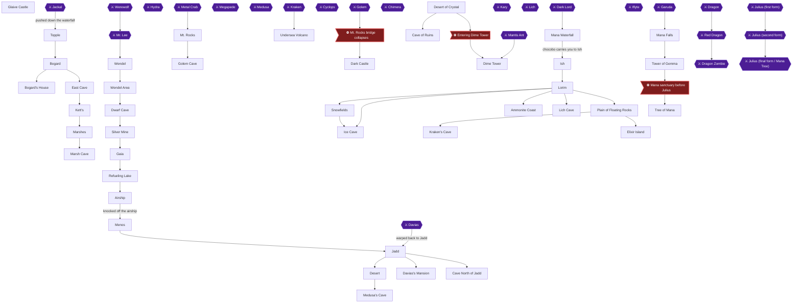

### Achievement Dependencies

```mermaid
flowchart LR
  Zeus_Axe(["⚠ Zeus Axe (past the lava pools)"])
  Iflyte{{"⚔ Iflyte"}}
  Wendel_Boy(["⚠ Boy in SW Wendel"])
  PONR_Dime_Tower>"⛔ Entering Dime Tower"]
  Dragon_Sword(["⚠ Dragon Sword"])
  Jackal{{"⚔ Jackal"}}
  Ach_28942(["🏆 Fall to Earth"])
  Topple["Topple"]
  Ach_28943(["🏆 Damsel in Distress"])
  Mattock[/"Mattock (Bogard's chest)"/]
  Ach_28944(["🏆 Pearl of Wisdom"])
  Cure_Spell[/"Cure spell (rest at Kett's)"/]
  Ach_28945(["🏆 Rest and Heal Your Wounds"])
  Mysterious_Man["Mysterious man in Marsh Cave (Julius)"]
  Ach_28946(["🏆 Mysterious Marsh Man"])
  Hydra{{"⚔ Hydra"}}
  Ach_28947(["🏆 Hail Hydra!"])
  Mr_Lee{{"⚔ Mr. Lee"}}
  Ach_29002(["🏆 RIP, Christopher Lee"])
  Wendel["Wendel"]
  Ach_29003(["🏆 You Spoony Bard!"])
  Watts["Watts joins in the Silver Mine"]
  Ach_29004(["🏆 The World Is Mine"])
  Bogard_Joins["Bogard joins outside Gaia"]
  Ach_29005(["🏆 I Taste Like (Silver) Chicken"])
  Airship["Airship"]
  Ach_29006(["🏆 I Believe I Can Fly..."])
  Chocobo["Chocobo egg hatches"]
  Ach_29022(["🏆 Familiar Feathered Friend"])
  Fang["Fang for the boy in Jadd"]
  Ach_29023(["🏆 To Infinity, and Beyond!"])
  Amandas_Tears[/"Amanda's Tears"/]
  Ach_29058(["🏆 Mercy"])
  Lester["Lester freed from the curse"]
  Ach_29059(["🏆 Mystic Tune?! Yeah!"])
  Davias{{"⚔ Davias"}}
  Ach_29060(["🏆 Your Pendant Is in Another Castle"])
  Morning_Star[/"Morning Star (Cyclops chest)"/]
  Ach_29061(["🏆 Balls of Steel"])
  PONR_Mt_Rocks>"⛔ Mt. Rocks bridge collapses"]
  Ach_29062(["🏆 Return of the Gemma"])
  Dark_Lord{{"⚔ Dark Lord"}}
  Ach_29063(["🏆 I Am (Not) Your Father"])
  Mana_Waterfall["Mana Waterfall"]
  Ach_29064(["🏆 Glaive Strikes Back"])
  Chocobot["Dr. Bowow builds the Chocobot"]
  Ach_29065(["🏆 Chocobo 2.0"])
  Kary{{"⚔ Kary"}}
  Ach_29066(["🏆 Defroster"])
  Kraken{{"⚔ Kraken"}}
  Ach_29067(["🏆 Who's Your Octo-Daddy Now?"])
  Rusty_Sword[/"Rusty Sword (Iflyte)"/]
  Ach_29068(["🏆 Through the Fire and Flames"])
  Nuke[/"Nuke spell (Lich)"/]
  Ach_29069(["🏆 Meltdown"])
  Marcie["Marcie joins"]
  Ach_29070(["🏆 Rise of the Robots"])
  Garuda{{"⚔ Garuda"}}
  Ach_29071(["🏆 Robots Can't Jump"])
  Dragon_Zombie{{"⚔ Dragon Zombie"}}
  Ach_29072(["🏆 Dragon Slayer"])
  Excalibur[/"Excalibur restored"/]
  Ach_29073(["🏆 I've Got the Power!"])
  Julius_1{{"⚔ Julius (first form)"}}
  Ach_29074(["🏆 Duel to the Death"])
  Julius_2{{"⚔ Julius (second form)"}}
  Ach_29075(["🏆 The Real Meaning of Power"])
  Julius_3{{"⚔ Julius (final form / Mana Tree)"}}
  Ach_29076(["🏆 The End of Everything"])
  Ach_29077(["🏆 Legacy of Mana"])
  Marsh_Cave["Marsh Cave"]
  Ach_29078(["🏆 Squire"])
  Medusas_Cave["Medusa's Cave"]
  Ach_29079(["🏆 Knight"])
  Tower_of_Gemma["Tower of Gemma"]
  Ach_29080(["🏆 Gemma Knight"])
  Ach_29081(["🏆 The Way of the Warrior"])
  Ach_29082(["🏆 The Way of the Wizard"])
  Ach_29083(["🏆 The Way of the Tank"])
  Ach_29084(["🏆 The Way of the Monk"])
  Ach_29085(["🏆 Wow, You're Rich!"])
  Were_Axe(["⚠ Were Axe (snowman switch room)"])
  Ach_29086(["🏆 Kevin's Worst Nightmare"])
  Blood_Sword(["⚠ Blood Sword (knight room)"])
  Ach_29087(["🏆 Drink the Blood of My Enemies"])
  Ach_29088(["🏆 Duck Hunter"])
  Ach_29089(["🏆 Sierra's Blade"])
  Dragon_Armor(["⚠ Dragon Armor"])
  Ach_29090(["🏆 Larc's Leathers"])
  Samurai_Gear(["⚠ Samurai Armor and Helmet drops"])
  Ach_29091(["🏆 Samurai Style"])
  Aegis(["⚠ Aegis Shield (Elephant drop)"])
  Ach_29092(["🏆 Poacher"])
  Ach_29093(["🏆 War Is Hell"])
  Ach_29094(["🏆 Timber!!!"])
  Zeus_Axe -.->|missable before| Iflyte
  Wendel_Boy -.->|missable before| PONR_Dime_Tower
  Dragon_Sword -.->|missable before| PONR_Dime_Tower
  Jackal -->|unlocks| Ach_28942
  Topple -->|unlocks| Ach_28943
  Mattock -->|unlocks| Ach_28944
  Cure_Spell -->|unlocks| Ach_28945
  Mysterious_Man -->|unlocks| Ach_28946
  Hydra -->|unlocks| Ach_28947
  Mr_Lee -->|unlocks| Ach_29002
  Wendel -->|unlocks| Ach_29003
  Watts -->|unlocks| Ach_29004
  Bogard_Joins -->|unlocks| Ach_29005
  Airship -->|unlocks| Ach_29006
  Chocobo -->|unlocks| Ach_29022
  Fang -->|unlocks| Ach_29023
  Amandas_Tears -->|unlocks| Ach_29058
  Lester -->|unlocks| Ach_29059
  Davias -->|unlocks| Ach_29060
  Morning_Star -->|unlocks| Ach_29061
  PONR_Mt_Rocks -->|unlocks| Ach_29062
  Dark_Lord -->|unlocks| Ach_29063
  Mana_Waterfall -->|unlocks| Ach_29064
  Chocobot -->|unlocks| Ach_29065
  Kary -->|unlocks| Ach_29066
  Kraken -->|unlocks| Ach_29067
  Rusty_Sword -->|unlocks| Ach_29068
  Nuke -->|unlocks| Ach_29069
  Marcie -->|unlocks| Ach_29070
  Garuda -->|unlocks| Ach_29071
  Dragon_Zombie -->|unlocks| Ach_29072
  Excalibur -->|unlocks| Ach_29073
  Julius_1 -->|unlocks| Ach_29074
  Julius_2 -->|unlocks| Ach_29075
  Julius_3 -->|unlocks| Ach_29076
  Julius_3 -->|unlocks| Ach_29077
  Marsh_Cave -->|unlocks| Ach_29078
  Medusas_Cave -->|unlocks| Ach_29079
  Tower_of_Gemma -->|unlocks| Ach_29080
  Tower_of_Gemma -->|unlocks| Ach_29081
  Tower_of_Gemma -->|unlocks| Ach_29082
  Tower_of_Gemma -->|unlocks| Ach_29083
  Tower_of_Gemma -->|unlocks| Ach_29084
  Tower_of_Gemma -->|unlocks| Ach_29085
  Were_Axe -->|unlocks| Ach_29086
  Blood_Sword -->|unlocks| Ach_29087
  Zeus_Axe -->|unlocks| Ach_29088
  Dragon_Sword -->|unlocks| Ach_29089
  Dragon_Armor -->|unlocks| Ach_29090
  Samurai_Gear -->|unlocks| Ach_29091
  Aegis -->|unlocks| Ach_29092
  Wendel_Boy -->|unlocks| Ach_29093
  Julius_3 -->|unlocks| Ach_29094
  Were_Axe -->|requires| Ach_29094
  Zeus_Axe -->|requires| Ach_29094
```

## Boss Index

Full strategies are in each chapter.

| Boss | Chapter |
|---|---|
| Jackal | [1. Escape from Glaive Castle](#chapter-1-escape-from-glaive-castle) |
| Hydra | [3. Marsh Cave and the Vampire](#chapter-3-marsh-cave-and-the-vampire) |
| Werewolf | [2. Topple, Bogard and Kett's](#chapter-2-topple-bogard-and-ketts) |
| Mr. Lee | [3. Marsh Cave and the Vampire](#chapter-3-marsh-cave-and-the-vampire) |
| Megapede | [4. Wendel, the Silver Mine and Gaia](#chapter-4-wendel-the-silver-mine-and-gaia) |
| Medusa | [6. Jadd, the Oasis and Medusa's Cave](#chapter-6-jadd-the-oasis-and-medusas-cave) |
| Davias | [6. Jadd, the Oasis and Medusa's Cave](#chapter-6-jadd-the-oasis-and-medusas-cave) |
| Metal Crab | [8. Mt. Rocks and the Golem Cave](#chapter-8-mt-rocks-and-the-golem-cave) |
| Cyclops | [8. Mt. Rocks and the Golem Cave](#chapter-8-mt-rocks-and-the-golem-cave) |
| Golem | [8. Mt. Rocks and the Golem Cave](#chapter-8-mt-rocks-and-the-golem-cave) |
| Chimera | [9. Return to Glaive](#chapter-9-return-to-glaive) |
| Dark Lord | [9. Return to Glaive](#chapter-9-return-to-glaive) |
| Kary | [10. Ish, Lorim and the Ice Cave](#chapter-10-ish-lorim-and-the-ice-cave) |
| Lich | [11. The Lich, the Kraken and the Undersea Volcano](#chapter-11-the-lich-the-kraken-and-the-undersea-volcano) |
| Kraken | [11. The Lich, the Kraken and the Undersea Volcano](#chapter-11-the-lich-the-kraken-and-the-undersea-volcano) |
| Iflyte | [11. The Lich, the Kraken and the Undersea Volcano](#chapter-11-the-lich-the-kraken-and-the-undersea-volcano) |
| Mantis Ant | [12. The Cave of Ruins and Dime Tower](#chapter-12-the-cave-of-ruins-and-dime-tower) |
| Garuda | [12. The Cave of Ruins and Dime Tower](#chapter-12-the-cave-of-ruins-and-dime-tower) |
| Dragon | [13. The Tower of Gemma and the Tree of Mana](#chapter-13-the-tower-of-gemma-and-the-tree-of-mana) |
| Red Dragon | [13. The Tower of Gemma and the Tree of Mana](#chapter-13-the-tower-of-gemma-and-the-tree-of-mana) |
| Dragon Zombie | [13. The Tower of Gemma and the Tree of Mana](#chapter-13-the-tower-of-gemma-and-the-tree-of-mana) |
| Julius (first form) | [13. The Tower of Gemma and the Tree of Mana](#chapter-13-the-tower-of-gemma-and-the-tree-of-mana) |
| Julius (second form) | [13. The Tower of Gemma and the Tree of Mana](#chapter-13-the-tower-of-gemma-and-the-tree-of-mana) |
| Julius (final form / Mana Tree) | [13. The Tower of Gemma and the Tree of Mana](#chapter-13-the-tower-of-gemma-and-the-tree-of-mana) |

## Walkthrough

## Chapter 1: Escape from Glaive Castle

```mermaid
flowchart TD
  Glaive_Castle["Glaive Castle"]
  Jackal{{"⚔ Jackal"}}
  Hydra{{"⚔ Hydra"}}
  Werewolf{{"⚔ Werewolf"}}
  Mr_Lee{{"⚔ Mr. Lee"}}
  Megapede{{"⚔ Megapede"}}
  Medusa{{"⚔ Medusa"}}
  Davias{{"⚔ Davias"}}
  Metal_Crab{{"⚔ Metal Crab"}}
  Cyclops{{"⚔ Cyclops"}}
  Golem{{"⚔ Golem"}}
  Chimera{{"⚔ Chimera"}}
  Dark_Lord{{"⚔ Dark Lord"}}
  Kary{{"⚔ Kary"}}
  Lich{{"⚔ Lich"}}
  Kraken{{"⚔ Kraken"}}
  Iflyte{{"⚔ Iflyte"}}
  Mantis_Ant{{"⚔ Mantis Ant"}}
  Garuda{{"⚔ Garuda"}}
  Dragon{{"⚔ Dragon"}}
  Red_Dragon{{"⚔ Red Dragon"}}
  Dragon_Zombie{{"⚔ Dragon Zombie"}}
  Julius_1{{"⚔ Julius (first form)"}}
  Julius_2{{"⚔ Julius (second form)"}}
  Julius_3{{"⚔ Julius (final form / Mana Tree)"}}
  PONR_Mt_Rocks>"⛔ Mt. Rocks bridge collapses"]
  PONR_Dime_Tower>"⛔ Entering Dime Tower"]
  PONR_Mana_Sanctuary>"⛔ Mana sanctuary before Julius"]
  Werewolf --> Mr_Lee
  Golem --> PONR_Mt_Rocks
  Dragon --> Red_Dragon
  Red_Dragon --> Dragon_Zombie
  Julius_1 --> Julius_2
  Julius_2 --> Julius_3
  classDef ponr fill:#7f1d1d,stroke:#f87171,color:#fff;
  classDef boss fill:#4c1d95,stroke:#a78bfa,color:#fff;
  class PONR_Mt_Rocks,PONR_Dime_Tower,PONR_Mana_Sanctuary ponr;
  class Jackal,Hydra,Werewolf,Mr_Lee,Megapede,Medusa,Davias,Metal_Crab,Cyclops,Golem,Chimera,Dark_Lord,Kary,Lich,Kraken,Iflyte,Mantis_Ant,Garuda,Dragon,Red_Dragon,Dragon_Zombie,Julius_1,Julius_2,Julius_3 boss;
```

This prologue chapter covers two fights against the Jackal inside the Glaive arena, a short walk through the castle, and the Dark Lord pushing the hero down the waterfall. That fall is what unlocks the only achievement here, Fall to Earth 🟡. The most important thing to carry out of this chapter is a habit: from your very first level-up, alternate your stat choices 🟡.

### Preparation and Warnings

The hero begins at Level 1 with 19 HP, 6 MP and 50 GP 🟡. Another guide adds that the base stats start at 2 🟡. Different guides name the hero differently (Sumo, Kain); you choose the name yourself, and no default is provided 🟡.

> [!WARNING]
There is no level-up in this chapter's two Jackal fights (they give 0 EXP), but the very first level-up you earn afterwards counts 🟡. Alternate Power and Wisdom on every level-up 🟡. Another guide confirms that reaching max stats requires alternating between the two warrior and mage style choices 🟡. Players report that if you do not spread stats in a balanced manner, reaching 50 later is very hard 🟡.

🗺️ **Map:** [View Beginning Map by RyuMaster](https://www.vgmaps.com/Atlas/GB-GBC/FinalFantasyAdventure-Beginning.png)

### Glaive Castle

🗺️ **Map:** [View Glaive Castle Map by RyuMaster](https://www.vgmaps.com/Atlas/GB-GBC/FinalFantasyAdventure-GlaiveCastle.png)

The map below shows the arena's Floor 1, where the Jackal is marked with @ and the exit with e:

```text
/-e-\ /---\
| @ |_|  A|
|    _    |
|   | |   |
\---/ \---/
```

#### Arena, Floor 1: the first Jackal

You start in a room next to the Battle Arena. Walk west into the Arena and the Jackal comes out of the north gate 🟡. After naming screens you are taken straight into the arena 🟡.

**Jackal (first fight)**
- Rewards: 0 EXP, 0 GP, no items 🟡.
- Attacks: none 🟡.
- Weapon: the Sword; you have no choice 🟡.
- Pattern: it moves in a "W" pattern and will not move below the midpoint of the screen, so do not move your character up too much and you will not get hit 🟡. From where you start you are safe, so just press Attack 🟡.
- Kill count: about 8 slashes 🟡, or 8 or 9 hits per another guide 🟡.

#### Cell and B-Floor 2

After the fight, a short narrative plays and you find yourself beside your friend Willy's bed 🟡. Willy tells you the Gemma Knights must be informed and that you should see Bogard at the falls, then he passes away 🟡. Willy is the one who tells the hero about the Mana Tree and the Knights of Gemma 🟡.

On B-Floor 2, once you can move, go north one screen and talk to Amanda, the woman walking around 🟡. She wants to go home to see her little brother, and a man tells you the monsters' entrance leads to the outside 🟡. The B-Floor 2 map shows an entrance at the bottom 🟡.

Then go east one screen and climb the stairs to Floor 1 🟡.

#### Floor 1: the second Jackal

Go west one screen, where you must fight another monster, JACKAL2 🟡. It has the same stats as before: 0 EXP, 0 GP, no attacks, Sword 🟡. Use the same strategy as the first fight: stay away from the upper half of the screen so it cannot touch you 🟡.

#### Out the gate and down the waterfall

> [!TIP]
> **Before you leave:** There is nothing to collect in this chapter. Check that you understand the stat-alternating rule above before you take your first level-up 🟡.

After defeating JACKAL2, the gate to the north is still open. Go north through it, climb down the castle wall, and go west one screen 🟡. There you overhear the Dark Lord and Julius talking about the Mana Tree 🟡. Julius says the tree is in a shrine above the falls and that a girl has the key to it 🟡. The Dark Lord is the emperor of Glaive and wants the Mana Tree to become more powerful 🟡.

Once the conversation ends, the Dark Lord spots you and chases you. He then pushes you down the waterfall, dropping you 5 screens, and the hero wakes up at the bottom 🟡. You regain control on the World Map 🟡, in the Topple outskirts at F7 🟡.


> [!ACHIEVEMENT]
> **Fall to Earth (1 Points)**
> 
> *Escape from the Glaive Empire*


Fall to Earth unlocks here, for escaping the Glaive Empire 🟡.

### Jackal

The Jackal is the boss monster encountered on Floor 1 of the arena. The full route for both fights is given above. Quick summary: both fights are harmless, 0 EXP and 0 GP, and are won with the Sword 🟡.

### Before You Move On

Where to head next is covered in the following chapter; for reference, the starting shop details in Topple are that the Broad Sword costs 60 GP 🟡 and the Iron Helmet costs 140 GP. The Broad Sword is your starting weapon and deals 0 damage to undead monsters. Keep alternating Power and Wisdom at each level-up 🟡.

> [!IMPORTANT]
> ### Chapter 1 Cumulative 100% Checkpoint
> - **Magic Spells:** 0 / 8 (the first spell, Cure, comes at Kett's in chapter 2) 🟡
> - **RetroAchievements Unlocked:** 1 / 50 (1 / 480 points)

### Chapter Checklist

- [ ] Defeat the first Jackal in the arena.
- [ ] Talk to Amanda on B-Floor 2.
- [ ] Defeat JACKAL2 on Floor 1.
- [ ] Overhear the Dark Lord and Julius, and get pushed down the waterfall.
- [ ] Unlock **Fall to Earth**.
- [ ] Remember to alternate Power and Wisdom at every level-up.

---

## Chapter 2: Topple, Bogard and Kett's

```mermaid
flowchart TD
  Topple["Topple"]
  Bogard["Bogard"]
  Bogards_House["Bogard's House"]
  East_Cave["East Cave"]
  Ketts["Kett's"]
  Hydra{{"⚔ Hydra"}}
  Werewolf{{"⚔ Werewolf"}}
  Mr_Lee{{"⚔ Mr. Lee"}}
  Megapede{{"⚔ Megapede"}}
  Medusa{{"⚔ Medusa"}}
  Davias{{"⚔ Davias"}}
  Metal_Crab{{"⚔ Metal Crab"}}
  Cyclops{{"⚔ Cyclops"}}
  Golem{{"⚔ Golem"}}
  Chimera{{"⚔ Chimera"}}
  Dark_Lord{{"⚔ Dark Lord"}}
  Kary{{"⚔ Kary"}}
  Lich{{"⚔ Lich"}}
  Kraken{{"⚔ Kraken"}}
  Iflyte{{"⚔ Iflyte"}}
  Mantis_Ant{{"⚔ Mantis Ant"}}
  Garuda{{"⚔ Garuda"}}
  Dragon{{"⚔ Dragon"}}
  Red_Dragon{{"⚔ Red Dragon"}}
  Dragon_Zombie{{"⚔ Dragon Zombie"}}
  Julius_1{{"⚔ Julius (first form)"}}
  Julius_2{{"⚔ Julius (second form)"}}
  Julius_3{{"⚔ Julius (final form / Mana Tree)"}}
  PONR_Mt_Rocks>"⛔ Mt. Rocks bridge collapses"]
  PONR_Dime_Tower>"⛔ Entering Dime Tower"]
  PONR_Mana_Sanctuary>"⛔ Mana sanctuary before Julius"]
  Topple --> Bogard
  Bogard --> Bogards_House
  Bogard --> East_Cave
  East_Cave --> Ketts
  Werewolf --> Mr_Lee
  Golem --> PONR_Mt_Rocks
  Dragon --> Red_Dragon
  Red_Dragon --> Dragon_Zombie
  Julius_1 --> Julius_2
  Julius_2 --> Julius_3
  classDef ponr fill:#7f1d1d,stroke:#f87171,color:#fff;
  classDef boss fill:#4c1d95,stroke:#a78bfa,color:#fff;
  class PONR_Mt_Rocks,PONR_Dime_Tower,PONR_Mana_Sanctuary ponr;
  class Hydra,Werewolf,Mr_Lee,Megapede,Medusa,Davias,Metal_Crab,Cyclops,Golem,Chimera,Dark_Lord,Kary,Lich,Kraken,Iflyte,Mantis_Ant,Garuda,Dragon,Red_Dragon,Dragon_Zombie,Julius_1,Julius_2,Julius_3 boss;
```

This chapter takes you from the foot of the waterfall to Kett's. You rescue the Girl east of Topple, collect your first Mattock from Bogard, use it in the East Cave, and rest at Kett's to learn Cure. Three achievements are earned here: Damsel in Distress, Pearl of Wisdom and Rest and Heal Your Wounds 🟡.

> [!TIP]
> **Preparation:** Gold matters in this chapter. Buy the Iron Helmet in Topple (140 GP) and a set of Keys, and bring enough gold for the Battle Axe (150 GP) later 🟡. Fight around the Topple area until you reach level 3 or 4 and have over 140 gold 🟡.

### Combat notes for this chapter

- When you level up, your HP and MP are fully restored 🟡.
- Goblins take 2 hits and drop Candy; Mushrooms take 1 hit. Both give only 1 experience point. Candy restores 8 HP when used or sells for 2 G.
- Imps are dangerous: 3 hits to kill with only 1 level-up, 2 hits with 2 level-ups. Rabites take 1 hit 🟡.
- If you leave at least one enemy alive on a screen and move one area away, the enemies respawn. If you kill them all, you must move four areas away 🟡.
- The sword has a spin attack: press Attack with the d-pad neutral and keep holding to keep spinning for up to 8 seconds while moving freely 🟡.
- The Girl heals you when you ASK her 🟡.

### Topple

🗺️ **Map:** [View City Of Toppel(I8) Map by RyuMaster](https://www.vgmaps.com/Atlas/GB-GBC/FinalFantasyAdventure-CityOfToppel(I8).png)

#### Outside Topple: rescuing the Girl

From the bottom of the falls, walk east two screens, south, east, and north to reach Topple 🟡. Another route reads: east, east, south, south, then east to the screen with the Girl. Before rescuing the Girl, you can farm: you visit this screen and the one east of it several times. Kill all but one enemy on the first and second visits, then clear them all. The aim is to be about 7 kills past level 2 before the rescue. Keep alternating Power and Wisdom on these level-ups, as chapter 1 explains 🟡.

Go to the screen east of the farming area. A girl is yelling for help 🟡. Defeat ALL monsters on this screen. The clue that they are all dead is that the music stops 🟡. These are Mushrooms 🟡. Then talk to the injured Hasim. He asks you to take the Girl to Wendel and see Bogard, and then dies. The Girl joins your party 🟡.


> [!ACHIEVEMENT]
> **Damsel in Distress (2 Points)**
> 
> *Rescue the girl*


Ask the Girl whenever you need healing; she regenerates your HP gradually 🟡. Try to get your second level-up and 165 G as soon as possible 🟡.

#### Town of Topple

Go back left one screen, then north one screen to find the entrance to Topple 🟡. The Inn is right at the entrance and costs 10 GP 🟡. Go to the next screen left and then north for the Item and Weapon shops 🟡.

| Shop | Goods | Citation |
|---|---|---|
| Inn | 10 GP per night | |
| Weapon Shop | Broad Sword 60 GP | 🟡 |
| Weapon Shop | Iron Helmet 140 GP (+3 DEF; sells for 70) | |
| Item Shop | Cure x2, 40 GP | 🟡 |
| Item Shop | Eye Drop x3, 60 GP | 🟡 |
| Item Shop | Pure x3, 30 GP | 🟡 |
| Item Shop | Key x4, 15 GP | 🟡 |
| Item Shop | Mattock x7, 60 GP | 🟡 |

Buy the Iron Helmet, equip it, and sell your Bronze helmet 🟡. Buy Keys at the Item Shop: a set of 4 costs 15 GP 🟡, and one guide recommends 2 sets (30 GP) 🟡. Consider buying a couple of Cure potions if you had trouble with the monsters 🟡. Then exit the town.

### Bogard

Exit Topple and go east two screens. From here, go south, east, north, west, north, west three times, and north two screens. Follow the vines around and go south one screen. Then go west one screen and climb the vine north. Enter Bogard's house 🟡.

### Bogard's House

🗺️ **Map:** [View Bogard's House(G5) Map by RyuMaster](https://www.vgmaps.com/Atlas/GB-GBC/FinalFantasyAdventure-Bogard'sHouse(G5).png)

Talk to the old man three times. The first times he walks away from you, and on the third he notices the Girl's pendant and reveals himself as Bogard 🟡. He tells you to see Cibba in Wendel and opens his back room 🟡. Go north into the room and open the chest for a **Mattock** 🟡.


> [!ACHIEVEMENT]
> **Pearl of Wisdom (3 Points)**
> 
> *Meet Bogard and get your first mattock*


Bogard tells you to use the Mattock to break rocks in the cave on the east side of the mountains 🟡. To use it, equip it from the item screen and press B; unequip it afterward so you do not use it by accident 🟡.

### East Cave

🗺️ **Map:** [View Cave(East Of Bogard's House)(J6 J7) Map by RyuMaster](https://www.vgmaps.com/Atlas/GB-GBC/FinalFantasyAdventure-Cave(EastOfBogard'sHouse)(J6-J7).png)

From Bogard's house, go south, east, north, south on the other side of the mountains, and east twice. Climb down the vine into the East Cave 🟡. Equip the Mattock, stand in front of the rocks blocking the way south, and press B to clear them 🟡. Go south two screens and up the stairs 🟡. Use the ladder at the bottom right to leave to the world map 🟡.

#### The Battle Axe house

Once outside, head east twice, south, and east, and enter the little house in the middle of the screen 🟡. The man sells a **Battle Axe** for 150 gold (+8 ATK). Buy it and also a Pure potion, then equip the Axe 🟡. If you lack gold, kill enemies and come back 🟡. In the marsh, Flowers die in one hit (ignore their treasure) and Marmablues take 2 or 3 hits, so avoid them 🟡. You may notice you cannot damage the Swamp Man; some monsters are protected against some weapons or magic 🟡.

### Kett's

🗺️ **Map:** [View Ketts(K10) Map by RyuMaster](https://www.vgmaps.com/Atlas/GB-GBC/FinalFantasyAdventure-Ketts(K10).png)

From the shop, go east, south twice, and west three screens to the building 🟡. Enter Kett's. The man at the door says the east room is only for Mr. Lee 🟡. In the north room, two people tell you the key to the Marsh Cave is in the Lizardmen's nest to the south, and that a man threw a mirror away in the Cave of Marsh 🟡.

Go south from that room, west into another room, then north through the door. Walk onto the unoccupied bed 🟡.

> [!WARNING]
> **Achievement Trigger Warning:** Sleeping makes the Girl disappear by morning 🟡. You cannot use her healing afterward in this chapter, so heal and stock up first.

Just before you sleep, the Girl finds the Book of Cure and gives it to you. You learn **Cure** (2 MP, recovers HP) 🟡.


> [!ACHIEVEMENT]
> **Rest and Heal Your Wounds (4 Points)**
> 
> *Rest at Kett's and learn the Cure spell*


In the morning the Girl is gone. Ask the man guarding Mr. Lee's room and he says he has not seen her 🟡.

> [!TIP]
> **Before you leave Kett's:** The Lizardmen's nest and Kett's dungeon are handled in the next chapter. Make sure you have the Battle Axe, Keys, Mattocks and Cure equipped, and gold in hand 🟡.

> [!IMPORTANT]
> ### Chapter 2 Cumulative 100% Checkpoint
> - **Mattocks:** first Mattock obtained from Bogard's chest 🟡
> - **Magic Spells:** 1 / 8 (Cure)
> - **RetroAchievements Unlocked:** 4 / 50 (10 / 480 points)

### Chapter Checklist

- [ ] Defeated the monsters and talked to Hasim (Damsel in Distress)
- [ ] Bought the Iron Helmet and Keys in Topple
- [ ] Talked to Bogard three times and took the Mattock (Pearl of Wisdom)
- [ ] Cleared the rocks in the East Cave with the Mattock
- [ ] Bought the Battle Axe
- [ ] Slept at Kett's and learned Cure (Rest and Heal Your Wounds)

---

## Chapter 3: Marsh Cave and the Vampire

```mermaid
flowchart TD
  Ketts["Kett's"]
  Marshes["Marshes"]
  Marsh_Cave["Marsh Cave"]
  Hydra{{"⚔ Hydra"}}
  Werewolf{{"⚔ Werewolf"}}
  Mr_Lee{{"⚔ Mr. Lee"}}
  Megapede{{"⚔ Megapede"}}
  Medusa{{"⚔ Medusa"}}
  Davias{{"⚔ Davias"}}
  Metal_Crab{{"⚔ Metal Crab"}}
  Cyclops{{"⚔ Cyclops"}}
  Golem{{"⚔ Golem"}}
  Chimera{{"⚔ Chimera"}}
  Dark_Lord{{"⚔ Dark Lord"}}
  Kary{{"⚔ Kary"}}
  Lich{{"⚔ Lich"}}
  Kraken{{"⚔ Kraken"}}
  Iflyte{{"⚔ Iflyte"}}
  Mantis_Ant{{"⚔ Mantis Ant"}}
  Garuda{{"⚔ Garuda"}}
  Dragon{{"⚔ Dragon"}}
  Red_Dragon{{"⚔ Red Dragon"}}
  Dragon_Zombie{{"⚔ Dragon Zombie"}}
  Julius_1{{"⚔ Julius (first form)"}}
  Julius_2{{"⚔ Julius (second form)"}}
  Julius_3{{"⚔ Julius (final form / Mana Tree)"}}
  PONR_Mt_Rocks>"⛔ Mt. Rocks bridge collapses"]
  PONR_Dime_Tower>"⛔ Entering Dime Tower"]
  PONR_Mana_Sanctuary>"⛔ Mana sanctuary before Julius"]
  Ketts --> Marshes
  Marshes --> Marsh_Cave
  Werewolf --> Mr_Lee
  Golem --> PONR_Mt_Rocks
  Dragon --> Red_Dragon
  Red_Dragon --> Dragon_Zombie
  Julius_1 --> Julius_2
  Julius_2 --> Julius_3
  classDef ponr fill:#7f1d1d,stroke:#f87171,color:#fff;
  classDef boss fill:#4c1d95,stroke:#a78bfa,color:#fff;
  class PONR_Mt_Rocks,PONR_Dime_Tower,PONR_Mana_Sanctuary ponr;
  class Hydra,Werewolf,Mr_Lee,Megapede,Medusa,Davias,Metal_Crab,Cyclops,Golem,Chimera,Dark_Lord,Kary,Lich,Kraken,Iflyte,Mantis_Ant,Garuda,Dragon,Red_Dragon,Dragon_Zombie,Julius_1,Julius_2,Julius_3 boss;
```

This chapter takes you from Kett's to the lizardmen's nest for the Bronze Key, through Marsh Cave to the Hydra, and back to Kett's to expose the guard as a Werewolf, rescue the Girl and kill Mr. Lee. Four achievements are earned here: recruiting the man in Marsh Cave, beating the Hydra, killing the vampire, and reaching Level 10.

### Preparation and Overview

Stock up on Keys and Mattocks before you start. The cave walkthrough calls for 4 Mattocks and 3 Keys, and Kett's Dungeon calls for 5 Mattocks and 2 Keys 🟡. The Marshes shop sells Mattocks (x7) for 60 GP and Keys (x4) for 15 GP 🟡. If you run out, Skeletons drop Keys and floating fish drop Mattocks.

> [!TIP]
> **Farming trick:** Fight every monster on a screen except one, then leave and re-enter. Everything respawns, which gives plenty of gold and EXP. It works especially well on the lizardmen screen 🟡.

> [!WARNING]
> **Achievement Trigger Warning:** Level 10 needs 1101 total EXP 🟡. Farm respawning monsters during this chapter and check your level before you leave Kett's. The Hydra is recommended at Level 13 and Mr. Lee at Level 15 🟡.


> [!ACHIEVEMENT]
> **Squire (5 Points)**
> 
> *Reach Level 10*


The Squire achievement is earned simply by reaching Level 10, so keep farming until it pops 🟡.

### Marshes

🗺️ **Map:** [View Cave Of Marsh(O9) Map by RyuMaster](https://www.vgmaps.com/Atlas/GB-GBC/FinalFantasyAdventure-CaveOfMarsh(O9).png)

Enemies here include Jellyfish (4 GP, 3 EXP), Flowers that drop Pure, and Marsh Ghosts that only magic can hurt. Poison Flowers inflict poison 🟡. The tool shop in the Marshes sells the Battle Axe for 150 GP, and the general store also stocks Cure x2, Pure x3, Eydrp x3, Key x4 and Mattock x7 🟡. Axes cut down trees, though most leave a stump you cannot pass 🟡.

#### Get the Cure spell at Kett's

Inside Kett's, the guard says the eastern door is reserved for Mr. Lee 🟡. In the north room, one person says the Marsh Cave key is in the lizardmen's nest to the south, and another says a mirror was thrown away in the Cave of Marsh 🟡. If you did not already sleep here, go south, west, north and walk onto the unoccupied bed. The Girl gives you the Book of Cure and you learn Cure; by morning she is gone 🟡. Ask the guard afterward and he denies knowing her 🟡.

#### The Bronze Key

From outside Kett's go east three screens, then south. Defeat every lizardman on that screen. A chest appears in the middle containing the Bronze Key 🟡. Lizardmen take 2 or 3 hits and drop Cure potions 🟡. Equip the Bronze Key from the item screen. Go north one screen, east, then north, and enter the door into Marsh Cave 🟡.

### Marsh Cave

Marsh Cave contains a Sickle, an Iron Shield, the Fire spell and the Mirror. Floating fish hit hard, so use Cure liberally 🟡.

#### Floor 1 entrance: recruit the man

As soon as you enter, a man wanders the screen. Talk to him and accept his offer to join. He attacks with fireballs, and if you ask him he explains the Mattock 🟡. One source calls recruiting him optional, but the achievement requires it 🟡.


> [!ACHIEVEMENT]
> **Mysterious Marsh Man (5 Points)**
> 
> *Recruit the mysterious man dressed like a bard*


#### Route to the Sickle

Walk north, west, and step on the odd tile near the south wall to reveal stairs, then go down 🟡. Another route describes the switch at the bottom of the screen revealing a ladder at the top left 🟡. On the next floor, go east a screen and climb down the vine at the end of the log bridge. Go west a screen and re-enter the cave 🟡.

Go east one screen and use a Mattock on the middle of the south wall; striking it makes a cranking sound. Go south a screen and slide across the ice to the chest holding the **Sickle**. Equip it to cut vines 🟡. The floor pulls you back in, so equip the Sickle and hack away the herbs to leave 🟡. Then return to the entrance room.

#### Iron Shield and healing spring

Go south; the man's fireballs kill the blobs. Use a Mattock on the west wall and go west 🟡. For a full HP/MP restore: use a Key on the door to the north, push the chest onto the odd tile, descend, go south and search the bottom of the pond 🟡.

From that room go west twice, then north. Use a Key on the east door and defeat all monsters; a chest appears with the **Iron Shield**. Equip it, since it blocks Hydra fireballs 🟡. Go west through the door, cut the vines with the Sickle and go north. Walk east a screen and use a Mattock on the rock in the northeast corner to reveal stairs, then descend 🟡.

#### Down to the Hydra

Climb along the vines south, go west into the cave, then west and south, and use a Key on the door. Kill the monsters, slide east on the northernmost ice row, break the rock with a Mattock, then go south and break the southernmost rock. Step on the switch, save, and equip Cure; then take the stairs down 🟡. Cure and Candy conserve MP before the boss 🟡.

### Hydra

Go east a screen to fight the Hydra. Recommended level 13; it rewards 94 GP and 10 EXP 🟡.

**Strategy:**
- Equip the Sickle and Iron Shield: the Sickle destroys fireballs and the shield blocks them 🟡.
- Move north as the Hydra moves south, attack its heads as it comes up, retreat south as it rises, then repeat 🟡.
- Only hits to the head do damage; stay below it 🟡.
- If cornered, face the fireballs with the shield equipped 🟡.
- It deals up to 13 damage, so keep HP above that. Mash Attack after a hit to extend invincibility 🟡.

After the fight two chests appear. Open the first to learn **Fire**; attack the chest to destroy it and open the second for the **Mirror** 🟡.


> [!ACHIEVEMENT]
> **Hail Hydra! (5 Points)**
> 
> *Defeat the Hydra*


The man tells you to show the Mirror to the man at Kett's and vanishes; you are warped outside 🟡.

### Kett's

🗺️ **Map:** [View Ketts(K10) Map by RyuMaster](https://www.vgmaps.com/Atlas/GB-GBC/FinalFantasyAdventure-Ketts(K10).png)

Return to Kett's and save outside. In the dungeon, Face Orbs and Pirates are hurt only by Fire 🟡. Zombie Mice need magic 🟡.

#### Werewolf

Equip the Mirror and talk to the guard. He turns into a Werewolf. It is not a true boss 🟡. It deals about 10 damage and 4 Axe hits kill it 🟡. Afterward, rest at the beds to restore HP and MP 🟡.

#### Through the dungeon to the Girl

From the Werewolf room go east twice, north, west and up the stairs. On the next floor go south and Mattock the east wall, go through the hole, north, east, south twice, west. Break one of the pots with a Mattock and step on the odd tile; take the new stairs in the southeast corner 🟡.

Go east, north, unlock the door with a Key and open the chest for the **Chain Flail**. Use it on the east pole to escape, and step on the odd tile to remove the blocks 🟡. Go south twice, west, and up the stairs, then up the stairs to the north 🟡.

Go west and use the Chain across the chasm, then west and south down the stairs. Go west, then north, kill all creatures, and let the Attack Meter fill to MAX before crossing the gap with the Chain. If you fall, go north and up the stairs, then south through the door 🟡. Then go east twice, north, west; push the chest onto the odd tile and descend 🟡. Mattock the southeast pot and go down 🟡.

On B-Floor 2 go east, unlock the south door with a Key, and open the second coffin from the right on the bottom row to find the Girl 🟡. Ask her to recover HP 🟡.

### Mr. Lee

Backtrack to the dungeon entrance, then save and heal before going west through the door 🟡. Once you find the Girl, walking out triggers the fight at the entrance 🟡.

Recommended level 15; he drops 10 GP, 11 EXP and the Book of Sleep. He moves among four spots, then opens his cape to launch bats 🟡.

**Strategy:**
- Block bats with your shield, dodge, and strike with the Chain 🟡.
- Target his body, not his wings 🟡.
- Fire works while he moves, and the Chain from below while he stands still 🟡.
- Heal with Cure or by asking the Girl 🟡.


> [!ACHIEVEMENT]
> **RIP, Christopher Lee (5 Points)**
> 
> *Kill the vampire and save the girl (again)*


You gain Sleep, then are warped outside Kett's.

> [!TIP]
> **Before you leave Kett's:** Confirm you have Fire and Sleep and have reached Level 10. Wendel is next: east three screens, south, west (cut the vines), south, west, north, cross the river with the Chain Flail, south, east, south twice, east, north twice 🟡.

> [!IMPORTANT]
> ### Chapter 3 Cumulative 100% Checkpoint
> - **Magic Spells:** 3 / 8 (Cure, Fire, Sleep)
> - **Key chests:** Sickle, Iron Shield, Chain Flail collected
> - **RetroAchievements Unlocked:** 8 / 50 (30 / 480 points)

### Chapter Checklist
- [ ] Learned Cure at Kett's
- [ ] Bronze Key from lizardmen
- [ ] Recruited the Marsh Cave man
- [ ] Sickle and Iron Shield
- [ ] Hydra defeated; Fire and Mirror
- [ ] Werewolf defeated; Chain Flail
- [ ] Girl rescued; Mr. Lee defeated; Sleep learned
- [ ] Level 10 reached

---

## Chapter 4: Wendel, the Silver Mine and Gaia

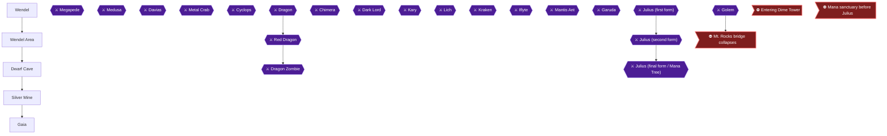

This chapter takes you from the Vampire fight's aftermath into Wendel, where the man who helped you in Marsh Cave is unmasked as Julius. You then buy Oil, ride the mine cart, recruit Watts, beat Megapede for Silver, equip Silver gear and cross Gaia, where Bogard joins you. The one thing you must not skip is the boy in south-west Wendel (War Is Hell), which is missable 🟡.

### Area Overview & Preparation

- Wendel has an Inn (10 GP), a weapon shop, an item shop and the temple where Cibba lives 🟡.
- Heal is a 1 MP spell that cures status ailments, and you receive it from Cibba as a story gift 🟡.
- The Oil you need costs 500 GP, so carry enough gold before you leave Wendel. If you are short, kill enemies outside until you reach 500 GP 🟡.
- Silver gear costs 700 GP (armor), 505 GP (shield) and 562 GP (sword) from Watts, so keep gold for at least one piece 🟡.

> [!WARNING]
> **Missable Achievement Warning:** War Is Hell (the boy in south-west Wendel) can only be done after Glaive's attack, because the boy is invincible before it 🟡. Commenters believe you cannot return to Wendel after Dime Tower, so treat it as lost once you enter Dime Tower and do it in this chapter 🟡. Whether Wendel can be revisited after Dime Tower is unconfirmed by any source. It can also be done later, when the story brings you back to Wendel, but before Dime Tower 🟡.

### Chapter Items to Collect

| Item | Where Found | Action / Requirement | Citation |
|---|---|---|---|
| Magic Book of Heal (Heal spell) | Wendel, from Cibba | **TAKE** (story gift after Julius escapes) | 🟡 |
| Oil | Item shop south of Dwarf Cave, 500 GP | **BUY** | 🟡 |
| Silver | Chest after Megapede | **TAKE** | |
| Silver Armor / Shield / Sword | Watts, Dwarf Cave | **BUY** at least one | 🟡 |
| Silver Helmet | Item shop near Refueling Lake, 240 GP | Optional **BUY** | 🟡 |

### Wendel

🗺️ **Map:** [View City Of Wendel(N13) Map by RyuMaster](https://www.vgmaps.com/Atlas/GB-GBC/FinalFantasyAdventure-CityOfWendel(N13).png)

#### Arrival and shopping

From outside Kett's, go east three times, south, west (cut the vines), south, west, north, cross the river with the Chain Flail, then south, east, south twice, east and north twice to reach Wendel 🟡. The man who helped you in Marsh Cave greets you east of the entrance.

The weapon shop sells Broad Sword 60 GP, Iron Helmet 140 GP, Iron Shield 185 GP and Iron Armor 315 GP (+8 DEF). The item shop sells Cure x2 for 40 GP, Pure for 30 GP, Eyedrop x3 for 60 GP, Key x4 for 15 GP and Mattock x7 for 60 GP 🟡. Buy Mattocks and Keys here, since the Silver Mine needs Mattocks 🟡. The Inn costs 10 GP 🟡.

#### The temple scene

Go east and north to the temple, then walk north to Cibba. Cibba has Jena stand on the circle and her mother appears, telling her to guard the Mana Tree with the Gemma Knights. Then a man announces that Glaive is attacking and takes Jena away.

Exit the temple and walk south to the town entrance. You may avoid or kill monsters on the way 🟡. At the entrance the man takes off his disguise and reveals himself as Julius, and Glaive now has Jena.


> [!ACHIEVEMENT]
> **You Spoony Bard! (5 Points)**
> 
> *Learn the true identity of the mysterious man dressed like a bard*


Julius defeats you, and you wake in the temple, where Cibba tells you Julius took the Girl away in his airship and gives you Heal 🟡.

> [!TIP]
> After Heal, use the Inn to recover MP before leaving, as Heal costs 1 MP and your MP may be low 🟡.

### Boy in SW Wendel (War Is Hell)

> [!WARNING]
> **Missable Achievement Warning:** Do this now. War Is Hell only works after Julius takes the Girl, and only on the boy in the south-west corner of Wendel 🟡.

#### Killing the boy in south-west Wendel

Find the boy one screen west of the entrance. He says "Dwarf Cave is to the west!" 🟡. He is the only child in town who counts, and the little girl does not work 🟡.

People in towns can be killed, but they have a lot of HP. Keep hitting him with a weapon at max Will Power 🟡. One player killed him quickly with the Blood Sword at Power 42 🟡. One commenter reported him as immortal, which is unconfirmed for the correct timing 🟡.


> [!ACHIEVEMENT]
> **War Is Hell (5 Points)**
> 
> *Kill an innocent boy in the streets of Wendel after Glaive's invasion of the city*


If you miss it, it can still be done when the story returns you to Wendel, before Dime Tower 🟡.

### Wendel Area

#### From Wendel to the Oil shop

Leave Wendel going south, then west, south, west. Cut the tree to the west directly above the sand with the Battle Axe, go west twice and enter the cave 🟡. Enemies here include Pig Warriors (Candy or Gold Bag) and Bees 🟡. Bees are dangerous: kill them with Fire before walking past 🟡. Crabs here drop Nectar, so get at least one if you can.

Optional: a Wendel Area warp trick exists in the woods west of Wendel, but nothing needs it 🟡.

### Dwarf Cave

🗺️ **Map:** [View Dwarf Cave(J15) Map by RyuMaster](https://www.vgmaps.com/Atlas/GB-GBC/FinalFantasyAdventure-DwarfCave(J15).png)

🗺️ **Map:** [View Shop(F12) Map by RyuMaster](https://www.vgmaps.com/Atlas/GB-GBC/FinalFantasyAdventure-Shop(F12).png)

Talk to the dwarves. One says you need Oil for the trolley, and that Gaia likes Silver, which can be found in the mine to the north 🟡.

#### Buying Oil

Leave the cave and go north one screen, cross the stream with the Chain, head south twice, east, and enter the item shop. Buy Oil for 500 GP 🟡. Also buy Keys and Mattocks here if needed 🟡.

Then go north, cross the stream with the Chain, go north twice, equip the Battle Axe and chop the trees across two screens, then go west into the Silver Mine 🟡.

### Silver Mine

🗺️ **Map:** [View Silver Mine(J12) Map by RyuMaster](https://www.vgmaps.com/Atlas/GB-GBC/FinalFantasyAdventure-SilverMine(J12).png)

#### Floor 1: the mine cart

Equip the Oil and the Sickle, then walk into the cart 🟡. Switches must be hit with the Sickle 🟡. Do not hit the first switch. Hit the second and third 🟡. Hold Up + Right and mash Attack on entering the screen for the second switch, then hold Down + Right and mash Attack for the third 🟡. Attack Spiders as you pass through them to avoid damage 🟡. If you miss, the cart loops back to the start, so just try again 🟡. The cart then hits a rock pile and you fall into the mineshaft 🟡.

#### B-Floor 2: Watts

At the bottom, Watts joins you.


> [!ACHIEVEMENT]
> **The World Is Mine (5 Points)**
> 
> *Recruit Watts after falling (again) in the mines*


ASK Watts to shop for items 🟡. Go north and break the northern boulder with a Mattock, then go east through the door 🟡. A path south has rocks to break with a Mattock, leading to a recovery spring 🟡. Back north, break the east wall with a Mattock and go through. In the slippery-floor room, break the pot (the right jar), step on the odd tile or switch and slide east on the ice to the stairs down 🟡.

Then go west twice, west, north and up the stairs on B-Floor 3, go west and down the stairs on B-Floor 2, and arrive at the boss floor 🟡.

### Megapede

Recommended level is 19. Equip the Chain and have a Cure spell ready 🟡. Fire also works on the head 🟡.

- Megapede comes out of one of four holes and moves in a figure 8. Wait at a hole and hit it in the head. Body hits do nothing.
- It follows a set path: it enters from the right, loops, exits top, then enters from the bottom, loops, and exits left 🟡.
- It explodes on defeat, so keep at least 20 HP and move away right after the explosion.

Reward: 161 GP, 48 EXP, and a chest with Silver. Opening the chest transports you outside.

### Gaia

🗺️ **Map:** [View Gaia(I12 I14) Map by RyuMaster](https://www.vgmaps.com/Atlas/GB-GBC/FinalFantasyAdventure-Gaia(I12-I14).png)

#### Buying Silver gear

Watts forges Silver gear and tells you to meet him at the Dwarf Cave. Go to the Dwarf Cave, go south one room and talk to Watts: Armor 700 GP, Shield 505 GP, Sword 562 GP 🟡. Equip at least one piece; one is enough 🟡. Without Silver, Gaia refuses to let you in 🟡. The Silver Sword deals double damage to undead.

Exit the Dwarf Cave, go north twice, west, and north one screen to the cave mouth 🟡.

#### Crossing Gaia

Go west and south. Walking south between the two statues closes the door. Step back north slowly until it opens, then go south through it and up the stairs in the southeast corner 🟡.


> [!ACHIEVEMENT]
> **I Taste Like (Silver) Chicken (5 Points)**
> 
> *Venture through the Gaia Pass and get some help*


Outside, Bogard joins you and says the Airship is refueling at the lake to the north. Ask him to learn MAX attacks 🟡.

#### South of Gaia

Cut a path through trees south, then west. Crabs here die to 2 Silver Sword hits and drop Nectar. Go north twice to an Inn (10 GP) 🟡. Then chop trees west and enter the item shop: Silver Helmet 240 GP, Cure, Ether 320 GP, Keys, Mattocks 🟡. Clouds drop Ether. The Chain gap needs a full Will meter 🟡. The route to the Airship continues in the next chapter 🟡.

> [!TIP]
> Before you leave, confirm you have equipped Silver gear, bought Keys and Mattocks, and killed the Wendel boy. XP and cash can be boosted very quickly around this point 🟡.

> [!IMPORTANT]
> ### Chapter 4 Cumulative 100% Checkpoint
> - **Magic Spells:** 4 / 8 (Heal from Cibba) 🟡
> - **Silver obtained:** 1 / 1
> - **RetroAchievements Unlocked:** 12 / 50 (50 / 480 points)

### Chapter Checklist

- [ ] You Spoony Bard! (29003)
- [ ] War Is Hell (29093)
- [ ] The World Is Mine (29004)
- [ ] I Taste Like (Silver) Chicken (29005)
- [ ] Heal learned
- [ ] Silver obtained and Silver gear equipped
- [ ] Bogard in the party

---

## Chapter 5: The Airship and Menos

```mermaid
flowchart TD
  Refueling_Lake["Refueling Lake"]
  Airship["Airship"]
  Menos["Menos"]
  Medusa{{"⚔ Medusa"}}
  Davias{{"⚔ Davias"}}
  Metal_Crab{{"⚔ Metal Crab"}}
  Cyclops{{"⚔ Cyclops"}}
  Golem{{"⚔ Golem"}}
  Chimera{{"⚔ Chimera"}}
  Dark_Lord{{"⚔ Dark Lord"}}
  Kary{{"⚔ Kary"}}
  Lich{{"⚔ Lich"}}
  Kraken{{"⚔ Kraken"}}
  Iflyte{{"⚔ Iflyte"}}
  Mantis_Ant{{"⚔ Mantis Ant"}}
  Garuda{{"⚔ Garuda"}}
  Dragon{{"⚔ Dragon"}}
  Red_Dragon{{"⚔ Red Dragon"}}
  Dragon_Zombie{{"⚔ Dragon Zombie"}}
  Julius_1{{"⚔ Julius (first form)"}}
  Julius_2{{"⚔ Julius (second form)"}}
  Julius_3{{"⚔ Julius (final form / Mana Tree)"}}
  PONR_Mt_Rocks>"⛔ Mt. Rocks bridge collapses"]
  PONR_Dime_Tower>"⛔ Entering Dime Tower"]
  PONR_Mana_Sanctuary>"⛔ Mana sanctuary before Julius"]
  Refueling_Lake --> Airship
  Airship -->|"knocked off the airship"| Menos
  Golem --> PONR_Mt_Rocks
  Dragon --> Red_Dragon
  Red_Dragon --> Dragon_Zombie
  Julius_1 --> Julius_2
  Julius_2 --> Julius_3
  classDef ponr fill:#7f1d1d,stroke:#f87171,color:#fff;
  classDef boss fill:#4c1d95,stroke:#a78bfa,color:#fff;
  class PONR_Mt_Rocks,PONR_Dime_Tower,PONR_Mana_Sanctuary ponr;
  class Medusa,Davias,Metal_Crab,Cyclops,Golem,Chimera,Dark_Lord,Kary,Lich,Kraken,Iflyte,Mantis_Ant,Garuda,Dragon,Red_Dragon,Dragon_Zombie,Julius_1,Julius_2,Julius_3 boss;
```

This chapter takes you from the refueling lake to Glaive's Airship, where you speak to the Girl through her window and receive the Pendant. Julius then blasts the hero off the ship, and you land in Menos. After shopping, you go to the forest north of Menos and hatch a chocobo egg. Two achievements fall here: I Believe I Can Fly... and Familiar Feathered Friend.

> [!TIP]
> **Before you leave:** Stock up on Keys and Mattocks before boarding the Airship. The route needs a Key for the south door on B-Floor 4 and a Mattock for a pot on B-Floor 2 🟡.

### Refueling Lake

When you exit Gaia's Cave, Bogard joins you and tells you the Airship is refueling at the lake to the north. Gaia only lets you through if you wear at least one piece of Silver equipment 🟡.

#### Werewolves (optional leveling)

One screen south of the cave exit is a group of four Werewolves. They are replenished even after you kill them all, so this is an easy place to gain levels. With a throwing-type weapon equipped, go to the screen south of them and wait for the attack bar to max out. Then go north and let the weapon fly to kill all of them in one shot, if your Power is high enough.

#### Item Shop near the lake

From the cave, go south, cut a path through the trees, then go west a screen. Next go north twice to see an Inn. Use the Battle Axe on the trees to your left, go west twice, then north into the Item Shop 🟡.

The Item Shop sells 🟡:

| Item | Price | Citation |
|---|---|---|
| Silver Helmet | 240 GP | 🟡 |
| Cure x2 | 40 GP | 🟡 |
| Ether | 320 GP | 🟡 |
| Key x4 | 15 GP | 🟡 |
| Mattock x7 | 60 GP | 🟡 |

Buy the Silver Helmet, a set of Keys and a set of Mattocks 🟡. The Silver Helmet gives +8 DP and sells for 120 GP 🟡.

#### Reaching the Airship

From the shop, follow these steps 🟡:

1. Go east twice, north, then east through the trees to the next screen.
2. Wait until your attack bar is at max, then use the Chain Flail to cross the stream. Only a maxed Chain reaches the pole 🟡.
3. Go north, east, use the Chain Flail, then go west.
4. Go down the vine and west.
5. Use the Chain Flail to cross the water, then go south.
6. Go west and north twice.
7. Climb the chain up into the Airship.

### Airship

🗺️ **Map:** [View Glaive's Airship(G10) Map by RyuMaster](https://www.vgmaps.com/Atlas/GB-GBC/FinalFantasyAdventure-Glaive'sAirship(G10).png)

You need 1 Key and 1 Mattock here 🟡. The Pendant is only yours temporarily.

Enemies here include Carrot (44 GP, 38 EXP) and Porcupine (37 GP, 42 EXP) in the Airship Area 🟡. Clouds (28 EXP, 18 G) and Eye (21 EXP, 25 G) can only be hurt by Magic or swords 🟡. Kill the Owls with the chain, since they may drop a Crystal. Eye Spys often die in one shot if you attack with Fire while the Will bar is partially full 🟡. Be careful with Eye Spies, because once you are Moogled you can die from a single hit 🟡.

Bogard is a Gemma Knight who fights with a Sword. If you ASK him, he teaches you MAX attacks 🟡.

#### Floor 1 (Deck) and B-Floor 2: going in

1. Starting from the deck, go north a screen along the west side of the mast. Go west, south and through the door 🟡.
2. On B-Floor 2, go west three times, north, east and then down the stairs 🟡.

#### B-Floor 3: the odd tiles

1. Go west a screen, then south a screen 🟡.
2. Step onto the odd tile in the northeast corner, then stand on the odd tile in the northwest corner. Stairs appear in the southeast corner. Go down them 🟡.

#### B-Floor 4: finding the Girl

1. Go west twice, use a Key on the south door, and go south. The Girl is in a jail cell 🟡.
2. Walk south to the jail door. The Airship begins to move. The Girl cannot open the gate but thinks she can escape through the window, so she needs your help from outside 🟡.
3. Bogard stays behind to guard her once you try to leave 🟡.

#### Climbing to the outside window

1. From the Girl's room, go north a screen, east twice and up the stairs 🟡.
2. On B-Floor 3, go north, west, then up the stairs 🟡.
3. On B-Floor 2, go south, west three times, then north. Use a Mattock on the north pot and go up the stairs 🟡.
4. On Floor 1, go east once and then north a screen, staying on the left side of the mast. Go west twice, south, then east 🟡.
5. Go south down the ladder to the next screen, then east a screen 🟡.

If a fence blocks you on the deck, press the right-hand switch to reach the left-hand one 🟡. A second route, where you kill the Werewolves on the left side before stepping on the upper right switch to open the fence and the upper left switch to reveal a ladder, is also described 🟡.

#### The Pendant and the fall

Talk to the Girl leaning out of the second window. She gives you the Pendant 🟡.


> [!ACHIEVEMENT]
> **I Believe I Can Fly... (5 Points)**
> 
> *Fall from the airship*


Julius then blasts the hero with a fireball and you fall off the ship. You cannot avoid it. You fall several screens and land in a house in Menos.

### Menos

🗺️ **Map:** [View City Of Menos(E10) Map by RyuMaster](https://www.vgmaps.com/Atlas/GB-GBC/FinalFantasyAdventure-CityOfMenos(E10).png)

You land in Amanda's house. She takes the Pendant while you are unconscious and leaves the village. Exit the house and walk to the Weapon Shop.

#### Shops

The Weapon Shop sells the Wind Spear for 1150 GP (sells for 575 GP, +16 ATK, a chance to throw monsters across the screen). The Item Shop is one screen right of Amanda's house 🟡. Its stock:

| Item | Price | Citation |
|---|---|---|
| Moogle (x3) | 120 GP | |
| X-Cure (x2) | 160 GP | |
| Key (x4) | 15 GP | |
| Pure (x3) | 30 GP | |
| Mattock (x7) | 60 GP | |
| EyeDrop (x3) | 60 GP | |
| Soft (x3) | 90 GP | |

#### Town information

- A boy mentions he saw a chocobo egg in a forest up north 🟡.
- Amanda's younger brother Lester plays the harp in Jadd, at the north end of the desert 🟡.
- The Book of Ice is hidden somewhere in the desert 🟡.

### The Chocobo Egg

The chocobo is in the forest north-east of Menos, at G8 on the Hikuutei map notes and H7 on the world map legend 🟡.

1. From outside Menos, go south twice and cross the bridge 🟡.
2. Go north, east, north twice, west, north twice, east, south, east 🟡.
3. Equip the Chain and use it to cross the gap 🟡.
4. Examine the egg. It hatches into a Chocobo that follows you 🟡.


> [!ACHIEVEMENT]
> **Familiar Feathered Friend (5 Points)**
> 
> *Find a chocobo*


> [!WARNING]
> **Achievement Trigger Warning:** One player reported that the Familiar Feathered Friend achievement did not pop when they fell from Glaive Castle a second time, and they were already at the Temple of Mana. Whether it can be triggered later is unconfirmed 🟡. Hatch the egg now, as described above, to be safe.

Once back across the chasm, ASK the Chocobo to ride it 🟡. While riding, enemies cannot harm you, but you cannot kill monsters either.

#### Heading to Jadd

From outside Menos, Jadd is south, south, west, west, north, north, west, north. If you go directly after getting the Chocobo, from the first bridge go west, west, north, north, west, north 🟡. The next chapter continues from there. Jadd's Weapon Shop sells Gold Helmet (680 GP) and Gold Shield (920 GP) 🟡.

> [!IMPORTANT]
> ### Chapter 5 Cumulative 100% Checkpoint
> - **Magic Spells:** 4 / 8
> - **Chocobo:** Hatched in the forest north-east of Menos 🟡
> - **RetroAchievements Unlocked:** 14 / 50 (60 / 480 points)

### Chapter Checklist

- [ ] Bought Silver Helmet, Keys and Mattocks at the lake shop
- [ ] Reached the Girl on B-Floor 4 and received the Pendant
- [ ] Achievement: I Believe I Can Fly... (29006)
- [ ] Visited the Menos shops (Wind Spear)
- [ ] Hatched the chocobo egg
- [ ] Achievement: Familiar Feathered Friend (29022)

---

## Chapter 6: Jadd, the Oasis and Medusa's Cave

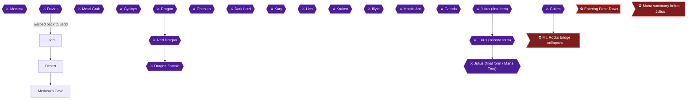

This chapter takes you through Jadd, out into the desert for a Fang, around the two palm trees to open Medusa's Cave, and through the cave itself. You recruit Amanda, take the Ice spell, beat Medusa and then put Amanda down to collect her Tears. Three achievements are in play: To Infinity, and Beyond! (29023), Mercy (29058) and Knight (29079). The cave route uses Mattocks and Keys, so stock up in Jadd before you go 🟡.

> [!WARNING]
> **Missable Achievement Warning:** To Infinity, and Beyond! (29023) must be earned while you are in the Jadd region, before the Mt. Rocks bridge collapses in chapter 8 🟡. Get a Fang from the lizards in the desert and give it to the boy next to Jadd's Item Shop now. Carry spare Fangs, because reports on whether the first Fang pops the achievement disagree. Whether the first Fang always triggers it is unconfirmed in the collected sources 🟡.

### Before You Start

- You need a Chocobo for the trip. From outside Menos, the route to Jadd is south, south, west, west, north, north, west, north 🟡.
- Bring Keys and Mattocks. The Medusa's Cave route uses a Mattock on the south wall and the north wall, and Keys on several doors 🟡.
- Have the Chain Flail equipped for the ice-patch puzzle 🟡.
- Knight (29079) asks for Level 25, which requires 16,254 total experience 🟡.

### Jadd

🗺️ **Map:** [View City Of Jadt(B9) Map by RyuMaster](https://www.vgmaps.com/Atlas/GB-GBC/FinalFantasyAdventure-CityOfJadt(B9).png)

🗺️ **Map:** [View City Of Jadt(B9) Davias Mansion Map by RyuMaster](https://www.vgmaps.com/Atlas/GB-GBC/FinalFantasyAdventure-CityOfJadt(B9)-DaviasMansion.png)

The Davias Mansion map is for the next chapter, when you go inside the mansion. Davias's house is in the northwest section of Jadd 🟡.

#### Gear and Shops

- The Inn costs 10 GP 🟡.
- The Weapon Shop sells Gold Armor for 1300 GP, Gold Helmet for 680 GP and Gold Shield for 920 GP 🟡. Gold Armor gives +16 DP and Gold Helmet +14 DP. If you are short on money, skip the Gold Shield 🟡. You can also find a Gold Armor inside Medusa's Cave, so you may not need to buy it.
- The Item Shop sells X-Cure (2) for 160 GP, Pure (3) for 30 GP, EyeDrop (3) for 60 GP, Soft (3) for 90 GP, Moogle (3) for 120 GP, Key (4) for 15 GP and Mattock (7) for 60 GP 🟡.
- Davias says a Medusa is in the cave Amanda went to, and the bird beside him is Amanda's brother 🟡. Do not go into the mansion yet. Medusa's Cave comes first.
- Do not walk one screen south, one east, one north and one east from outside Jadd. That leads to fatal poison gas 🟡. The gas is cleared later in the story 🟡.

#### The Boy Next to the Item Shop

The boy next to the Item Shop trades his clue for a Bag of Fang 🟡. Fangs are dropped rarely by the lizards living in the desert 🟡.

### Fang for the boy in Jadd (desert farming)

Leave Jadd and fight in the desert until a lizard drops a Fang 🟡.

Desert enemies:
- Basilisk drops a Ruby (51 GP, 40 EXP) 🟡.
- Scorpion drops nothing (10 GP, 54 EXP) 🟡.
- Lizard drops nothing or a Fang (41 GP, 48 EXP) 🟡.

Basilisks die to a single Fire shot 🟡. A Fang sells for 14 GP and can be exchanged for info in Jadd 🟡.

> [!WARNING]
> **Missable Achievement Warning:** This is the To Infinity, and Beyond! step. Hand a Fang to the boy before you leave the Jadd region for good 🟡. Reports disagree on whether the first Fang is enough. Some players popped it with the first Fang before the cave was open, while others needed a Fang after beating Medusa. This is unconfirmed 🟡.

Return to Jadd and give the Fang:

1. Go to the boy next to the Item Shop and accept his offer of the clue for a Bag of Fang 🟡.
2. He says "Palm trees.. and 8." 🟡


> [!ACHIEVEMENT]
> **To Infinity, and Beyond! (5 Points)**
> 
> *Learn the secret of the oasis in Jadd*


If the achievement does not pop, do not worry yet. Players report it popping after giving another Fang after entering the cave 🟡. One player needed a third Fang 🟡. Keep spare Fangs and try again after Medusa.

### Desert

- A magic shop sits south, east, south, south, west, west, north of Jadd 🟡. It sells X-Ether for 640 GP, Flame (2) for 60 GP, Blaze (2) for 240 GP, Silence for 100 GP and Pillow for 100 GP 🟡.
- Medusa's Cave is south, east, south, south, east, south, south, west, north from outside Jadd 🟡. An Inn (10 GP) lies south, east, east of the cave 🟡.

#### Opening the Cave

1. Stand at the two separate palm trees and dismount from your Chocobo 🟡.
2. Walk a sideways figure 8 around the two palm trees. You may need to do it two or three times before the cave opens 🟡.
3. Another description: the two trees make three lanes (between them, to the right and to the left). Walk up the center, down the right, up the center, then down the left 🟡.
4. When the cave opens, go inside 🟡.

### Medusa's Cave

🗺️ **Map:** [View Cave Of Palmy Desert(D15) Map by RyuMaster](https://www.vgmaps.com/Atlas/GB-GBC/FinalFantasyAdventure-CaveOfPalmyDesert(D15).png) (a different desert cave, the Lich Cave, which you enter in chapter 11; not needed now) 🟡

🗺️ **Map:** [View Cave Of Medusa(C13) Map by RyuMaster](https://www.vgmaps.com/Atlas/GB-GBC/FinalFantasyAdventure-CaveOfMedusa(C13).png)

Items here: Gold Armor, the Ice spell, and Amanda's Tears. Enemies include Mummies (drop Flame, use magic or swords), Biting Lizards (immune to Fire) and Shadow Zeroes, which deal about 50 damage and drop Ethers and Wisdom Crystals. Keep HP full against Shadow Zeroes 🟡.

#### Entrance: Recruit Amanda

Inside, Amanda explains she took the Pendant to exchange for her brother, but Davias turned him into a parrot, and she seeks the Tears of Medusa. She joins your party. She attacks with a Dagger and can cure petrification when you ASK 🟡.

#### Floor 1

Floor 1 has the entrance, locked doors, breakable walls, a healing spring, the Spell Book of Ice and the Gold Armor.

**Gold Armor route:**

1. From where you found Amanda, go south and use a Mattock on the south wall 🟡.
2. Go south through the new entrance 🟡.
3. Go west twice, south once, west twice, then north three times 🟡.
4. Go west, use a Key on the door, go south, and kill all the enemies in the room 🟡.
5. Open the chest for the **Gold Armor**.

**Ice spell route:**

1. Go north, east, and use a Key on the north door, then go north through it 🟡.
2. Two odd tiles are here. The one closest to the bottom opens the door and the other closes it 🟡.
3. Equip the Chain Flail. Go west and step onto the bottom ice patch, which brings you onto the first odd tile 🟡.
4. Use the Chain Flail on the post to the east so you do not slide onto the second button, then go east one screen through the opened door.
5. Open the chest for the **Ice spell** (Magic Book of Ice). It costs 2 MP and shoots controllable ice.

**Healing spring (optional):**

Use a Key on the west door, go through it and walk into the bottom of the pond to restore your HP and MP 🟡.

**Snowman puzzles:**

1. From the room next to the recovery fountain, go south, east, and use a Mattock on the north wall. Go through the wall 🟡.
2. Move the frozen snowman onto the floor tile to open the door 🟡.
3. Go north through the door. Cast Ice on one of the Spiders to freeze it into a snowman. You can control the ice as it travels 🟡.
4. Push the frozen enemy onto the odd tile, which opens the north door 🟡.
5. Go north through the door and down the stairs 🟡.

#### Floor 2

Go north and down the stairs 🟡.

#### Floor 3: Medusa

Climb down the vine. Just before you go west, heal up 🟡.

**Medusa** (recommended level 28):
- Rewards: 88 GP and 90 EXP in one source 🟡.
- Her attack is snakes, which can inflict Ston status. Ask Amanda to cure it 🟡.
- Stay below her, dodge the snakes, and keep attacking her head with the Wind Spear or Chain Flail 🟡. The suggested gear also includes the Cure spell 🟡.
- Alternatively, Fire destroys any snakes it passes through, and her head takes much more damage from Fire than her skirt 🟡.

#### After the Fight: Mercy

> [!WARNING]
> **Achievement Trigger Warning:** Amanda is bitten and will turn into a Medusa. You must attack and kill her, then walk into her body for the Tears. Your inventory needs room for Amanda's Tears 🟡.

1. Medusa dies but leaves no tears 🟡.
2. As you are ready to leave, Amanda says she was injured and will turn into a Medusa. She asks you to kill her and take her tears to her brother.
3. Attack Amanda once she transforms. A player who thought she had to be left alone found that hitting her killed her.
4. Walk into her corpse to collect **Amanda's Tear** 🟡. You are then transported out of the cave 🟡.


> [!ACHIEVEMENT]
> **Mercy (5 Points)**
> 
> *Save Amanda from succumbing to the bite of Medusa and collect her tears*


### Knight (Level 25)

Reaching Level 25 requires 16,254 total EXP 🟡. Knight normally pops around here, during or just after Medusa's Cave. If you are short, fight the desert enemies near Jadd: Basilisks, Scorpions and Lizards all give EXP 🟡.


> [!ACHIEVEMENT]
> **Knight (10 Points)**
> 
> *Reach Level 25*


### Back in Jadd: Retry the Fang

If To Infinity, and Beyond! still has not unlocked, go back to Jadd after Medusa and give the boy another Fang. This is the retry players report working 🟡. Do this before the Mt. Rocks bridge in chapter 8 collapses, because you cannot go back after that 🟡.

> [!TIP]
> **Before you leave Jadd:** Confirm To Infinity, and Beyond! has popped, buy any Gold gear you want, and stock Keys and Mattocks. The next chapter goes into Davias's Mansion, where you equip Amanda's Tear and examine the parrot.

> [!IMPORTANT]
> ### Chapter 6 Cumulative 100% Checkpoint
> - **Chests Opened (this chapter):** Gold Armor and Ice spell 🟡
> - **Magic Spells:** 5 / 8
> - **Sidequests Completed:** Fang for the Jadd boy (see the retry notes above) 🟡
> - **RetroAchievements Unlocked:** 17 / 50 (80 / 480 points)

### Chapter Checklist

- [ ] Bought Gold gear in Jadd and stocked Keys and Mattocks
- [ ] Fang obtained from a desert lizard
- [ ] Fang given to the boy next to the Jadd Item Shop (To Infinity, and Beyond!, 29023)
- [ ] Opened Medusa's Cave with the figure 8
- [ ] Recruited Amanda
- [ ] Gold Armor chest opened
- [ ] Ice spell taken
- [ ] Medusa defeated
- [ ] Amanda killed and Amanda's Tear collected (Mercy, 29058)
- [ ] Level 25 reached (Knight, 29079)

---

## Chapter 7: Davias's Mansion

```mermaid
flowchart TD
  Davias_Mansion["Davias's Mansion"]
  Davias{{"⚔ Davias"}}
  Metal_Crab{{"⚔ Metal Crab"}}
  Cyclops{{"⚔ Cyclops"}}
  Golem{{"⚔ Golem"}}
  Chimera{{"⚔ Chimera"}}
  Dark_Lord{{"⚔ Dark Lord"}}
  Kary{{"⚔ Kary"}}
  Lich{{"⚔ Lich"}}
  Kraken{{"⚔ Kraken"}}
  Iflyte{{"⚔ Iflyte"}}
  Mantis_Ant{{"⚔ Mantis Ant"}}
  Garuda{{"⚔ Garuda"}}
  Dragon{{"⚔ Dragon"}}
  Red_Dragon{{"⚔ Red Dragon"}}
  Dragon_Zombie{{"⚔ Dragon Zombie"}}
  Julius_1{{"⚔ Julius (first form)"}}
  Julius_2{{"⚔ Julius (second form)"}}
  Julius_3{{"⚔ Julius (final form / Mana Tree)"}}
  PONR_Mt_Rocks>"⛔ Mt. Rocks bridge collapses"]
  PONR_Dime_Tower>"⛔ Entering Dime Tower"]
  PONR_Mana_Sanctuary>"⛔ Mana sanctuary before Julius"]
  Golem --> PONR_Mt_Rocks
  Dragon --> Red_Dragon
  Red_Dragon --> Dragon_Zombie
  Julius_1 --> Julius_2
  Julius_2 --> Julius_3
  classDef ponr fill:#7f1d1d,stroke:#f87171,color:#fff;
  classDef boss fill:#4c1d95,stroke:#a78bfa,color:#fff;
  class PONR_Mt_Rocks,PONR_Dime_Tower,PONR_Mana_Sanctuary ponr;
  class Davias,Metal_Crab,Cyclops,Golem,Chimera,Dark_Lord,Kary,Lich,Kraken,Iflyte,Mantis_Ant,Garuda,Dragon,Red_Dragon,Dragon_Zombie,Julius_1,Julius_2,Julius_3 boss;
```

Davias's Mansion is the big house in the northwest of Jadd. Three achievements are tied to it: equipping the Were Axe, recruiting Lester, and defeating Davias. Davias's death sends you straight back to Jadd, so finish everything in the mansion before you fight him 🟡.

### Preparation

🗺️ **Map:** [View City Of Jadt(B9) Davias Mansion Map by RyuMaster](https://www.vgmaps.com/Atlas/GB-GBC/FinalFantasyAdventure-CityOfJadt(B9)-DaviasMansion.png)

- You need Amanda's Tears, the Ice Spell, at least two Mattocks and two Keys. The Jadd Item Shop sells Keys (15 GP) and Mattocks (60 GP) 🟡.
- Amanda's Tears come from Amanda's body after Medusa's Cave 🟡.
- The Jadd Weapon Shop sells the Gold Helmet (680 GP) and Gold Shield (920 GP) 🟡. The Gold Shield can sometimes block Black Mage fireballs 🟡.
- Some mansion monsters are invulnerable to the Wind Spear, so the Silver Sword is recommended 🟡.
- Black Mages in the mansion are invincible and deal huge damage, so avoid them 🟡. Flames and Vampires need Magic or Swords (a Morning Star also works on Vampires) 🟡.

> [!WARNING]
> **Missable Achievement Warning:** The Were Axe (Kevin's Worst Nightmare) is missable. Take it from the chest on Floor 1 and equip it before you defeat Davias, whose death warps you to Jadd. Do not sell it: an axe is needed for Timber!!! later, and the Battle Axe cannot damage the final boss 🟡.

### Davias's Mansion

#### Floor 1 to Floor 2: Lester freed from the curse

1. Enter the mansion from Jadd, go up the stairs on Floor 1, then go east twice on Floor 2 into the room where Davias and the bird were.
2. Equip Amanda's Tears and talk to the parrot. He turns into Lester and joins you.


> [!ACHIEVEMENT]
> **Mystic Tune?! Yeah! (5 Points)**
> 
> *Recruit Lester*


3. A staircase appears in the lower right corner after Lester plays his mystic tune. Take it down to Floor 1.

#### Floor 1: Mattock wall and the tile room

4. Go east twice and use a Mattock on the north wall. Go north twice, use a Key on the west door, go west and south one screen. Walk counter-clockwise around the tiles and climb the stairs 🟡.

#### Floor 2: Panel puzzle

5. Go west four times. Step onto the odd tile one space north of the iron fence and walk counter-clockwise until stairs appear, then go down 🟡.
6. Another guide describes the stair trigger as pressing right, up, left, then down in order 🟡. A third describes stepping on the floor panels in numbered order to make a ladder appear 🟡. All three describe the same stair trigger; the numbered-panel diagram from that guide is:

```
 43       Legend: the numbers are the order of the panels you should follow. 
5xx2
6xx1
 7 
```

#### Floor 1: Were Axe (snowman switch room)

7. Back on Floor 1, go north, west, and south four times.
8. Cast Ice on one monster to freeze it into a snowman. Push it onto the odd tile (the switch) and go east through the opened door.
9. The door locks behind you. Defeat every enemy in the room and a chest appears.
10. Open the chest for the **Were Axe** (+20 AP, chops trees). Equip it now.


> [!ACHIEVEMENT]
> **Kevin's Worst Nightmare (10 Points)**
> 
> *Equip the Were Axe*


#### Return to the upper floors

11. Go west, north twice, and use a Mattock on the east wall. Go east and south, then up the stairs 🟡.
12. On Floor 2, unlock the north door with a Key and go north, then take the stairs up to Floor 3 🟡.

> [!TIP]
> Before you leave the mansion, heal up and make sure nothing remains to collect, since Davias's defeat sends you to Jadd 🟡.

### Davias

Heal up, then go west on Floor 3 🟡. The recommended level is 30; he gives 98 GP and 95 EXP in one guide 🟡.

- He is guarded by four circling fireballs and throws flame balls, moving east and west across the top of the screen.
- Quick approach: stay inside the fireball ring and keep slashing with the Were Axe. Safer approach: stay at the bottom, dodge, and fire your powered-up weapon.
- Nectar adds +15 attack (Davias normally takes 5 damage). Walk into his face and mash attack to extend invincibility. Cast Cure when HP is under 45, since his body hits for about 40 🟡.
- Do not touch the ring fireballs; you can attack the other fireballs with your weapon.


> [!ACHIEVEMENT]
> **Your Pendant Is in Another Castle (5 Points)**
> 
> *Defeat Davias*


After he falls, he reveals Garuda flew the Pendant over Mt. Rocks toward Glaive, and you are warped to Jadd. Lester plays his harp to clear the poison gas and gives you the Magic Book of Mute.

> [!IMPORTANT]
> ### Chapter 7 Cumulative 100% Checkpoint
> - **Magic Spells:** 5 / 8
> - **Were Axe:** obtained and kept
> - **Lester:** recruited
> - **RetroAchievements Unlocked:** 20 / 50 (100 / 480 points)

### Chapter Checklist

- [ ] Freed Lester with Amanda's Tears
- [ ] Opened the Were Axe chest and equipped it
- [ ] Defeated Davias
- [ ] Received the Magic Book of Mute from Lester in Jadd
- [ ] Kept the Were Axe unsold

---

## Chapter 8: Mt. Rocks and the Golem Cave

```mermaid
flowchart TD
  Cave_North_of_Jadd["Cave North of Jadd"]
  Mt_Rocks["Mt. Rocks"]
  Golem_Cave["Golem Cave"]
  Metal_Crab{{"⚔ Metal Crab"}}
  Cyclops{{"⚔ Cyclops"}}
  Golem{{"⚔ Golem"}}
  Chimera{{"⚔ Chimera"}}
  Dark_Lord{{"⚔ Dark Lord"}}
  Kary{{"⚔ Kary"}}
  Lich{{"⚔ Lich"}}
  Kraken{{"⚔ Kraken"}}
  Iflyte{{"⚔ Iflyte"}}
  Mantis_Ant{{"⚔ Mantis Ant"}}
  Garuda{{"⚔ Garuda"}}
  Dragon{{"⚔ Dragon"}}
  Red_Dragon{{"⚔ Red Dragon"}}
  Dragon_Zombie{{"⚔ Dragon Zombie"}}
  Julius_1{{"⚔ Julius (first form)"}}
  Julius_2{{"⚔ Julius (second form)"}}
  Julius_3{{"⚔ Julius (final form / Mana Tree)"}}
  PONR_Mt_Rocks>"⛔ Mt. Rocks bridge collapses"]
  PONR_Dime_Tower>"⛔ Entering Dime Tower"]
  PONR_Mana_Sanctuary>"⛔ Mana sanctuary before Julius"]
  Metal_Crab --> Mt_Rocks
  Mt_Rocks --> Golem_Cave
  Golem --> PONR_Mt_Rocks
  Dragon --> Red_Dragon
  Red_Dragon --> Dragon_Zombie
  Julius_1 --> Julius_2
  Julius_2 --> Julius_3
  classDef ponr fill:#7f1d1d,stroke:#f87171,color:#fff;
  classDef boss fill:#4c1d95,stroke:#a78bfa,color:#fff;
  class PONR_Mt_Rocks,PONR_Dime_Tower,PONR_Mana_Sanctuary ponr;
  class Metal_Crab,Cyclops,Golem,Chimera,Dark_Lord,Kary,Lich,Kraken,Iflyte,Mantis_Ant,Garuda,Dragon,Red_Dragon,Dragon_Zombie,Julius_1,Julius_2,Julius_3 boss;
```

This chapter takes you from Jadd, where Lester clears the poison gas and teaches you Mute, through the Metal Crab cave and up Mt. Rocks into the Golem Cave. There you beat Cyclops for the Morning Star, equip it, and beat Golem for the Lit spell. Finish everything in the Jadd and Mt. Rocks region before you walk past Golem, because a bridge collapses behind you afterwards.

> [!CAUTION]
> **Point of No Return:** Entering the cave past Golem collapses the bridge behind you and you cannot return 🟡. Once you proceed, you will not be able to leave Granz Castle until you have completed the events there 🟡. Finish the Fang and the Were Axe business first, and buy any armor you want at the Mt. Rocks Weapon Shop before you go.

### Preparation

- Golem Cave needs 1 Mattock and 2 Keys 🟡.
- Recommended levels: Metal Crab 33, Cyclops 37, Golem 39 🟡.
- Keep a Cure spell handy for all three bosses 🟡.
- Do not try to fight Golem until you have the Morning Star 🟡.

### Jadd: Lester and Mute

After Davias falls you are taken back to Jadd, where Lester plays his harp to clear the poison gas to the north. Before you leave, Lester hands you the Magic Book of Mute (1 MP, blocks monster magic) and you learn it immediately.

Heal at the Inn and stock up on anything you need before leaving town; take your Chocobo with you.

Jadd's Weapon Shop sells Gold Helmet for 680 GP and Gold Shield for 920 GP 🟡. You can skip these if you plan to buy Opal gear at Mt. Rocks.

> [!TIP]
> Before you leave the Jadd area, make sure you have finished the Fang (Bag of Fang, which the boy in Jadd wants) and the Were Axe from Davias's Mansion. Those belong to the region you cannot return to 🟡.

### Cave North of Jadd

🗺️ **Map:** [View Cave Of Mt Rocks(B3 E4) Map by RyuMaster](https://www.vgmaps.com/Atlas/GB-GBC/FinalFantasyAdventure-CaveOfMtRocks(B3-E4).png)

#### Overworld approach

From outside Jadd travel south, east, north, east, north twice, and east (chop the trees with your Axe). Then go north twice, east, north, and finally west into the cave 🟡. Along the way, going down the second vine to the east and south twice reaches a Magic Shop 🟡.

While walking, Molebears, Werewolves and Gorillas each die to a single Fire cast, and Iffish are invulnerable to Fire 🟡.

#### Inside the cave

Go west, north, west (use the Axe), west, then south. Save your game before going left to the Metal Crab 🟡. The room with the Face enemies takes 2 hits each and they drop X-Ethers.

#### Boss: Metal Crab

- Recommended level 33; it yields 108 GP and 104 EXP in one guide, and 107 EXP and 101 GP in another.
- Stand in the upper left corner of the screen, where the Metal Crab cannot hit you. Equip the Were Axe, wait for your Will Meter to max, then step down and throw the axe at its head.
- Only its face is vulnerable, and that is not reachable when it is at the bottom of the screen 🟡. A Wind Spear is also suited to hitting its mouth.

After the fight, take the stairs down to Basement Floor 2, go west three times, and climb the stairs up to leave the cave 🟡.

### Mt. Rocks

🗺️ **Map:** [View Mt Rocks(F2) Map by RyuMaster](https://www.vgmaps.com/Atlas/GB-GBC/FinalFantasyAdventure-MtRocks(F2).png)

🗺️ **Map:** [View Shop(D4) Map by RyuMaster](https://www.vgmaps.com/Atlas/GB-GBC/FinalFantasyAdventure-Shop(D4).png)

#### Outside the cave

From the cave exit, one route goes west, south, east, south; an Item Shop is a screen east then north 🟡. Otherwise go south three times and east to a pond. Walking to the bottom of the pond restores HP and MP 🟡.

Beware of the robot-like enemy on the way: touching it can inflict Moogle, dropping your defense to 0 🟡. Springs are invincible, fast, kill in 2 hits, and inflict Moogle too 🟡.

#### Weapon Shop

From the pond head west, north (stay right), east, north, east, then take the rightmost vine north and go north into the Weapon Shop 🟡.

| Item | Price | Citation |
|---|---|---|
| Opal Armor | 3000 GP (+19 DP) | |
| Opal Helmet | 3500 GP | |
| Opal Shield | 3900 GP | |

Opal gear is far stronger than Gold 🟡. If you lack money, fight nearby enemies until you can afford it 🟡.

The Mt. Rocks Magic Shop sells Ether 320, Flame x2 60, Blaze x2 240, Frost x2 320, Silence 100, and Pillow 100 GP 🟡.

#### To Golem Cave

Climb south to the base of the cliff, take the left vine north three times, then go west and chop the trees. Walk to the north side, then east, north twice, east, south twice (use the Axe), east, and north into Golem Cave 🟡.

### Golem Cave

#### Floor 1

Many screens warp you back to the first screen 🟡. If you go the wrong way you return to the start 🟡.

1. Go north, east twice, and use a Mattock on the north wall. Go north, then west 🟡.
2. In the four-chest room, place a chest on a tile, then knock it off (attack it) to open the door. Per another guide, place all four chests on the four tiles and attack one 🟡. If you destroy a chest, leave and re-enter 🟡. The Werewolf puzzle room is solved by pushing a chest onto a button and destroying it 🟡.
3. Go north, east, open the door with a Key, then east, south three times, east twice, and up the stairs 🟡.

#### Floor 2 and Boss: Cyclops

Save and heal before going east 🟡.

- Level 37; yields 63 GP and 71 EXP 🟡.
- Stay below him as he charges horizontally and hit him with the Were Axe; when he reaches the bottom go above and hit him as he climbs 🟡.
- His weapon can kill in one hit; his eye takes more damage than his feet 🟡. He only attacks horizontally, sometimes twice in a row 🟡.

### Morning Star (Cyclops chest)

Open the chest that appears after the fight for the Morning Star 🟡. Equip it right away 🟡.


> [!ACHIEVEMENT]
> **Balls of Steel (5 Points)**
> 
> *Equip the Morning Star*


The Morning Star gives +30 ATK and does everything a Mattock does, so you can discard Mattocks.

### Golem

Go back west three times to the entrance, north, heal and save, then unlock the north door with a Key 🟡.

- Level 39; 96 GP and 172 EXP 🟡.
- Use only the Morning Star. Stay at the bottom, sidestep downward charges and strike 🟡. Stay close and mash the attack button to score 2 hits per swing 🟡.
- Reward: Spell Book of Lit (2 MP, thunderbolt) 🟡.

Then go north, smash the rocks with the Morning Star, and climb the stairs. On Floor 2 climb the vine and go east; the bridge collapses and you come out beside the waterfall 🟡.

> [!IMPORTANT]
> ### Chapter 8 Cumulative 100% Checkpoint
> - **Magic Spells:** 7 / 8 (Mute and Lit gained here)
> - **Morning Star:** equipped 🟡
> - **RetroAchievements Unlocked:** 21 / 50 (105 / 480 points)

### Checklist

- [ ] Fang and Were Axe finished
- [ ] Mute received from Lester
- [ ] Metal Crab defeated
- [ ] Opal gear bought if desired
- [ ] Cyclops defeated, Morning Star equipped (Balls of Steel)
- [ ] Golem defeated, Lit learned

---

## Chapter 9: Return to Glaive

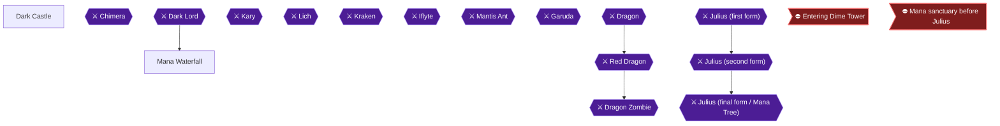

This chapter takes you back into the Glaive Empire. After the bridge collapses behind you, you come out next to the waterfall by the castle 🟡. You then climb through the Dark Castle, beat Chimera, free the Girl, collect the Blood Sword, beat the Dark Lord, and are thrown down the waterfall again by Julius. Four achievements fall in this chapter: Return of the Gemma, Drink the Blood of My Enemies, I Am (Not) Your Father, and Glaive Strikes Back.

### Preparation

- Bring at least 3 Keys; the castle needs them 🟡.
- The recommended level is 40 for Chimera and 41 for the Dark Lord 🟡.
- You will want the Morning Star from Mt. Rocks and the Lit spell from the Golem. The Chain Flail and the Ice spell are also used in the castle 🟡.
- An Item Shop and Inn sits on Floor 1 of the castle, so you can restock Keys there if you run short 🟡.

> [!WARNING]
> **Missable Achievement Warning:** The Blood Sword (achievement 29087, Drink the Blood of My Enemies) sits in a chest in the Floor 2 knight room, and its deadline is before you defeat the Dark Lord 🟡. After the Dark Lord you are thrown out of the castle 🟡, so open that chest and equip the sword first.

### Arrival at the Waterfall

The bridge collapses behind you when you go toward the cave, and the screen fades to the waterfall at the castle 🟡.


> [!ACHIEVEMENT]
> **Return of the Gemma (5 Points)**
> 
> *Return to the Glaive Empire on a rescue mission*


From the waterfall, go east twice and into the castle area 🟡. Face enemies outside can be killed in one hit with a Morning Star swing when your Will bar is full 🟡.

### Dark Castle

🗺️ **Map:** [View Glaive Castle Map by RyuMaster](https://www.vgmaps.com/Atlas/GB-GBC/FinalFantasyAdventure-GlaiveCastle.png) (the Dark Castle is Glaive Castle; the same map covers the prologue). The source ASCII maps cover Floors 1 to 5 of the castle.

#### Floor 1: finding the way in

The main gate is locked. Walk west one screen, cut down the trees and go west again, then go north one screen and walk into the door 🟡.

#### B-Floor 2: the bridges

Cross the north bridge, then the west bridge, and go north. Next go east, cross the bridge to the south, go east, and cross the bridge to the north. Go east one screen and up the stairs 🟡.

#### Floors 1, 2, 5, 4: up the vine and down

Climb the vine above you and go north one screen. On Floor 2 go north another screen. The last vine lifts you several floors to a set spot on Floor 5 🟡. Go down the stairs, then down another flight on Floor 4 🟡. If enemies block your path on the vine, re-enter the screen 🟡.

#### Floor 3: Chimera

Heal up and save on Floor 3, then go west to face Chimera 🟡. Bring Cure.

**Chimera**
- Level 40 recommended; it awards 90 EXP and 21 GP in one source and 91 GP and 20 EXP in another 🟡.
- It flies above you, drops two flaming bombs from its wings, then flies down in a zigzag 🟡.
- One approach: stand near the top of the screen, attack as fast as you can, and cure occasionally 🟡.
- It is invulnerable to Lit, so cast Fire rapidly. Another guide lists the Morning Star as preferred, so use whichever you can land reliably 🟡.
- Each time it reaches the center of the screen it may dive for about 45 damage, so cast Cure if your HP is below 50 🟡.
- Stay out of the range of the fireballs dropped from its wings 🟡.

### The Girl in Her Cell

After Chimera, descend the stairs in the southwest corner to Floor 2, which is the Girl's prison cell. She runs up and joins you and says the Dark Lord took her pendant. She heals your HP when you ASK her, so do this often. Go down the stairs next.

### Shop, Spikes and the Chain Puzzle

Go up the stairs north, then south down the steps to the next screen. On Floor 1 go west one screen and enter the building. You can rest on the bed and buy supplies at the Item Shop 🟡. Exit, go east, and walk north up the steps 🟡.

Go west three times, south, and into the door 🟡. Quickly walk across the spikes; they hurt a lot, so have the Girl heal you afterward 🟡. Use a Key on the door and go north. Then go east, break the north wall with the Mattock or Morning Star, and go north through the hole. Go west, and use the Chain Flail to cross to the odd tile. Stand on it and a staircase appears. Go down 🟡.

The room's puzzle: Chain to the middle pole, then with a full Will bar chain to the left pole to hit the button, then with a full Will bar chain to the bottom pole 🟡. Another route description says grapple the northern pole, then the left pole, step on the switch so a ladder appears in the lower right, then grapple the southern pole and use the ladder 🟡. While flashing from damage you cannot press a button or enter stairs 🟡. Wizards inflict Stone with magic or Moogle on touch, and can only be defeated with about 10 Morning Star hits 🟡. Dark Knights die to one Fire cast if hit from the side or back 🟡.

### Werewolf Room

On Floor 2 go north, east, south twice, east, use a Key on the door, and go east. Kill the enemies and rest on the bed to restore HP and MP 🟡. Then go west three times. The room has four empty chests on odd tiles. Do not knock any of them off or the stairs vanish 🟡. The Chain Flail works for killing the monsters here 🟡. Then go down the stairs 🟡.

### Blood Sword (Knight Room)

On Floor 1 go east twice and use a Mattock on the east wall, then go east through the opening, then east, north, and up the stairs 🟡.

> [!WARNING]
> **Missable Achievement Warning:** Open the Blood Sword chest before moving on and equip it before the Dark Lord. Commenters ask for this achievement to be marked missable 🟡.

On Floor 2 go south and east and kill all the enemies in the room, then open the chest for the **Blood Sword** 🟡. It gives +26 ATK, sells for 937 GP, and heals you for 25% of damage dealt.

Open the menu and equip it now.


> [!ACHIEVEMENT]
> **Drink the Blood of My Enemies (10 Points)**
> 
> *Equip the Blood Sword*


### Toward the Dark Lord

Go west, north, and use a Mattock on the north wall. Go north through the opening, use a Key on the door, go east through the opened door, and go up the stairs 🟡.

On Floor 3 go south and west twice. Use the Ice spell to freeze two monsters into snowmen and push them onto the two odd tiles, then go down the stairs 🟡. Only the Dark Knights can be frozen; the Black Mages cannot. If only one knight is present, leave and re-enter until two appear 🟡. You cannot push a snowman while flashing from damage 🟡. If the stairs do not appear even when solved, push both snowmen off the buttons and back on 🟡.

On Floor 2 go west, north, and up the stairs. On Floor 3 go north, west, heal up and save, then go up the stairs 🟡. The throne room is next to the Dark Lord, so you can fight a few Dark Knights for EXP before the fight 🟡.

### Dark Lord

The Dark Lord is at the top of the castle. The Girl leaves and the fight begins 🟡. Drink the Blood of My Enemies should already have unlocked when you equipped the Blood Sword; if it has not, equip it now, because after this fight you cannot go back to the knight room 🟡.

**Dark Lord**
- Level 41 recommended; 167 GP and 12 EXP in one source, 166 EXP and 11 GP in another 🟡.
- He runs around and swings his sword, follows your movements, and can use a MAX-type attack 🟡.
- One guide says the Morning Star passes through his shield and damages him 🟡. Another says he can only be hurt by Lit and deals about 55 damage, so cast Cure if below 60 HP 🟡. The sources disagree, so try the Morning Star and switch to Lit if it does no damage.
- Lit method: run to an upper corner with Cure equipped to get his AI stuck, wait for the Will meter to fill, equip Lit, walk into him so he turns away, then cast Lit at his back. Cure yourself and repeat.
- If Lit glitches and he flies off the balcony, hit him with the Morning Star to finish him.
- Defeating him yields the Fake Pendant 🟡.


> [!ACHIEVEMENT]
> **I Am (Not) Your Father (5 Points)**
> 
> *Defeat the Dark Lord*


### Mana Waterfall

Go south down the stairs. The Girl is gone and you are moved outside the castle. You see her walking by; follow her west to the waterfall 🟡. The Pendant reverses the waterfall, but yours is a fake 🟡. Julius appears and says the Girl is his. He has her use the real Pendant and cast the spell, the waterfall reverses, and Julius zaps you off the cliff 🟡.


> [!ACHIEVEMENT]
> **Glaive Strikes Back (5 Points)**
> 
> *Leave the Glaive Empire... again*


Your chocobo picks you up and carries you east into Ish 🟡. This sets up the next chapter.

> [!TIP]
> **Before you leave:** Make sure the Blood Sword is equipped and the Dark Lord is beaten before the cutscene. Afterward you wake in Ish, where the Inn costs 10 GP and the Weapon Shop sells the Flame Chain for 6300 GP.

> [!IMPORTANT]
> ### Chapter 9 Cumulative 100% Checkpoint
> - **Blood Sword:** 1 / 1
> - **Magic Spells:** 7 / 8
> - **RetroAchievements Unlocked:** 25 / 50 (130 / 480 points)

### Chapter Checklist

- [ ] Reached the Glaive Empire waterfall (Return of the Gemma)
- [ ] Beat Chimera and freed the Girl
- [ ] Took the Blood Sword from the knight room and equipped it (Drink the Blood of My Enemies)
- [ ] Defeated the Dark Lord (I Am (Not) Your Father)
- [ ] Watched Julius reverse the waterfall (Glaive Strikes Back)

---

## Chapter 10: Ish, Lorim and the Ice Cave

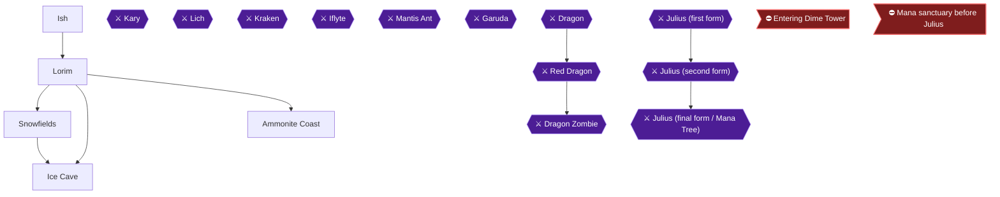

This chapter takes you from Ish, where Dr. Bowow turns your chocobo into the Chocobot, across the sea to Wendel and Lorim, through the Ice Cave to Kary, and back to Cibba for the Bone Key 🟡. Two achievements are here: Chocobo 2.0 and Defroster.

> [!TIP]
> **Before you leave Ish:** spend your money here first. The Ish weapon shop sells the Flame Chain (6300 GP), Flame Armor (5625 GP) and Flame Shield (4400 GP) 🟡. One guide says to buy the Flame Flail but not the armor or shield 🟡. Another says to buy the Flame Armor 🟡. The Flame Chain is the one purchase the Ice Cave requires 🟡; the armor and shield are optional.

> [!WARNING]
> **Wendel revisit unconfirmed:** Whether Wendel can be revisited after Dime Tower is unconfirmed; commenters believe not. If you skipped War Is Hell in chapter 4, you can still kill the boy in south-west Wendel now, on this visit. Treat it as lost once you enter Dime Tower.

### Ish

🗺️ **Map:** [View City Of Isch(J3) Map by RyuMaster](https://www.vgmaps.com/Atlas/GB-GBC/FinalFantasyAdventure-CityOfIsch(J3).png)

Your chocobo carries you into Ish, and you wake in a house beside Bogard, who survived the fall from the airship thanks to Sarah but has a broken back.

1. Leave the house and talk to Sarah. She says the chocobo is being fixed at Doctor Bowow's house 🟡.
2. Shop before leaving. Ish contains an Inn (10 GP), a Weapon Shop and an Item Shop 🟡.
   - Weapon Shop: Flame Chain 6300 GP, Flame Armor 5625 GP, Flame Shield 4400 GP 🟡. You need the Flame Chain for the Ice Cave 🟡.
   - Item Shop: X-Cure 160, Pure 30, EyeDrop 60, Soft 90, Moogle 120, Key 15, Mattock 60 🟡. The Ice Cave needs 2 Keys 🟡. Buy extra Keys and a Mattock too.
   - A Magic Shop west of Ish sells X-Ether (640 GP) 🟡.
3. Rest at the Inn for 10 GP 🟡.

### Dr. Bowow builds the Chocobot

Go west twice and enter Dr. Bowow's house 🟡. He has mechanized the chocobo's legs so it can cross water, and renamed it Chocobot 🟡.


> [!ACHIEVEMENT]
> **Chocobo 2.0 (5 Points)**
> 
> *Meet Dr. Bowow and witness the next step in chocobo evolution*


Visit his house on the west side of town; you can only enter or leave the water at a dock 🟡.

1. Talk to Bogard again. He says you need the sword Excalibur to beat Julius and tells you to ask Cibba in Wendel 🟡.
2. Talk to Dr. Bowow again. He says to sail east from the northern pier and go north to Wendel; south leads to the Ammonites 🟡.
3. Leave town to the south and talk to the Chocobot outside to recruit it 🟡. If it is stuck behind rocks in the upper left corner, leave the screen and return 🟡.

#### Journey to Wendel

From outside Ish go west, west, north, north, west to the pier, step into the water, go east seven times, north twice, onto the pier, then north twice into Wendel 🟡. In Wendel go north once and talk to the girl near the top. She says Cibba went to Lorim, near the snowfields.

Wendel has an Inn, a Weapon Shop, an Item Shop and a temple 🟡. If War Is Hell was missed in chapter 4, kill the boy now: he stands one screen west of the entrance and says "Dwarf Cave is to the west!" 🟡. Commenters say it can be done on a later Wendel visit before Dime Tower 🟡.

### Lorim

🗺️ **Map:** [View Lorim(M6) Map by RyuMaster](https://www.vgmaps.com/Atlas/GB-GBC/FinalFantasyAdventure-Lorim(M6).png)

From Wendel go south twice to the pier, then (s,w,w,s,w,w,s,e,s,s,s,s) onto the pier, then (n,e,s,s,e,n) into Lorim 🟡. Go north into the throne room. The king says Kary froze his subjects and Cibba 🟡. Your task is to find Kary 🟡.

Optional: Ice Armor (7350 GP) and Ice Shield (6200 GP) are sold at a weapon shop 🟡. Guides name its location differently (Snow Field, NW Snow Fields or Ammonite Coast); it is the lone shop at map square N2, linked as the Shop(N2) map below. Directions from outside Lorim: (s,w,n,n,w,s,n,n,n,n,w,n,e,e,e,e,e,s,s,s,e,s,s,s,s,w,n,n,w,s,n,e,s,e,n,n,n,w,n,w,n) 🟡. Ice Armor makes Kary's hits weak 🟡.

### Snowfields

🗺️ **Map:** [View Shop(N2) Map by RyuMaster](https://www.vgmaps.com/Atlas/GB-GBC/FinalFantasyAdventure-Shop(N2).png)

From outside Lorim go south, west, north twice, west, chop the trees with the Axe, and go north four screens 🟡. There is an item shop one screen west with the usual stock 🟡. The Snowfields are home to Snowman, Walrus and Wolfhead 🟡. Wolves and Snowmen die to one Fire cast; Walruses die if your Will meter is mostly full 🟡. Then go east twice, south twice, west, south, east twice and enter the cave 🟡.

### Ice Cave

🗺️ **Map:** [View Cave Of Snowfields(N4) Map by RyuMaster](https://www.vgmaps.com/Atlas/GB-GBC/FinalFantasyAdventure-CaveOfSnowfields(N4).png)

You need 2 Keys, the Flame Chain and a Mattock or Morning Star 🟡. Ice acts as a one-way conveyor belt 🟡. Eyes here are invincible and inflict Stone 🟡. Potos die to one Fire cast and drop X-Ethers; Duck Knights die to two 🟡.

#### Floor 1

1. Go north, walk counter-clockwise around the ice and go north 🟡.
2. Step on the odd tile, go south to the wall and wait for the snowman, then push him north onto the odd tile 🟡.
3. Go east, use the Flame Chain to go north, cross the ice with the Chain going west 🟡.
4. Use a Key on the north door, go east twice, use a Key on the next door and climb the stairs 🟡.

#### Floor 2

Go north, west and onto the ice. Walk around the rocks and back onto the ice. In the room with the down stairs, take the bottom-left ice path south, walk around the rocks and back on the ice, then take the single middle ice path west. Break the north wall with a Mattock or Morning Star, go north and up the stairs 🟡.

#### Floor 3

1. Break the north wall and go north to the pond that heals HP and MP 🟡.
2. Go south a screen and west a screen, then south to a room of enemies. Kill all of them and open the chest for an **Elixir**.
3. Go north, east twice, use a Key on the door and climb to Floor 4 🟡.
4. Go east and back into the cave to Floor 3 🟡.
5. Cross the ice with the Chain, go west twice, south, and use the Chain to reach the middle. Step on the tile and take the northwest ice patch, then step on the odd tile in the southeast corner. Go south and east twice, cutting the bramble with the Axe, then take the east ice track and the south ice 🟡.
6. Use the Chain across the ice west, then a Key on the north door 🟡. Walk to the bottom of the lake to restore HP and MP 🟡.
7. Go onto the ice west, break the west wall with a Mattock or Morning Star, go through, cross the streams with the Chain and climb the stairs 🟡.
8. On Floor 4 go east and back into the cave, then on Floor 3 go east, north and up the stairs 🟡.

One room has a switch that opens the south door by hitting middle poles with a flail and stepping on the switch 🟡.

### Kary

> [!TIP]
> **Before you leave for the boss:** heal up. A guide recommends level 46 🟡; another says you need 35 Will 🟡.

Go east to fight Kary 🟡. She attacks with Icicle Throw and Tail Lash and only her head is vulnerable 🟡. The Flame Chain destroys icicles 🟡; the Flame Shield blocks all of them 🟡. She moves across the screen at top, middle or bottom: stay above or below her, hit her head, and after she crosses the middle ice move opposite to her direction 🟡. Magic users: she is immune to Nuke; hit her head with Fire, then Lit, then Lit 🟡. Victory gives 129 GP and about 181 EXP (another guide says 183) 🟡.


> [!ACHIEVEMENT]
> **Defroster (10 Points)**
> 
> *Defeat Kary*


A chest appears; open it for the **Ice Sword** and a transport out of the cave 🟡. It is +40 ATK, double damage to fire monsters and zero to ice monsters.

### Ammonite Coast

> [!WARNING]
> **Achievement Trigger Warning:** keep one free item slot before speaking to Cibba, or you may not receive the Bone Key.

Return to Lorim, talk to the king, then go (s,e,n) to Cibba, who gives you the **Bone Key** 🟡. He sends you via the Ammonite Coast to the cave in the Floatrocks 🟡.

Ammonite Coast hazards: Manta Rays inflict Poison and Griffin Hands inflict Moogle, which hopping on the Chocobo cures 🟡. Octopuses give 132 EXP and 152 G 🟡. The Morning Star destroys Floating Rocks 🟡. The Kraken's cave opens by equipping the Bone Key 🟡.

> [!TIP]
> **Before you leave Lorim:** confirm the Bone Key is in your inventory and you hold the Ice Sword.

> [!IMPORTANT]
> ### Chapter 10 Cumulative 100% Checkpoint
> - **Dungeon Chests Opened:** Ice Cave Elixir and Ice Sword 🟡
> - **Magic Spells:** 7 / 8
> - **RetroAchievements Unlocked:** 27 / 50 (145 / 480 points)

### Chapter Checklist
- [ ] Chocobot recruited (Chocobo 2.0)
- [ ] Flame Chain and Keys bought
- [ ] Cibba's location learned in Wendel
- [ ] Elixir collected in the Ice Cave
- [ ] Kary defeated (Defroster) and Ice Sword taken
- [ ] Bone Key received from Cibba

---

## Chapter 11: The Lich, the Kraken and the Undersea Volcano

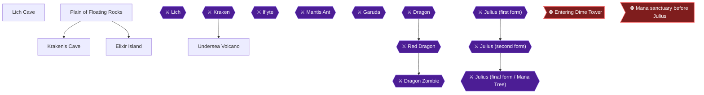

This chapter takes you from Lorim to the Lich Cave for the Nuke spell, then to the Bone Key cave in the Plain of Floating Rocks for the Kraken, then through the Undersea Volcano to Iflyte and the Rusty Sword. The guide recommends getting Nuke before the Legendary Sword, even though the story points you to the sword first 🟡. Four achievements are available here: Meltdown, Who's Your Octo-Daddy Now?, Duck Hunter and Through the Fire and Flames. The Zeus Axe has to be picked up and equipped before Iflyte, so read the warnings first.

> [!WARNING]
> **Missable Achievement Warning (Duck Hunter, 29088):** The Zeus Axe sits in a chest on Undersea Volcano B-Floor 3 🟡. Take it and equip it BEFORE you fight Iflyte 🟡. Never sell or discard it; the Timber!!! achievement needs it later 🟡.

> [!WARNING]
> **Missable Achievement Warning (Through the Fire and Flames, 29068):** One player killed Iflyte and then went back for the Zeus Axe, and lost the Iflyte achievement 🟡. Another player asked whether leaving the room after the kill was the cause 🟡. This is unconfirmed: no source answers whether leaving the room before taking the Rusty Sword stops the achievement. Take the Zeus Axe first, then open Iflyte's chest immediately without leaving the room.

### Preparation

- You need Keys, a Mattock or the Morning Star, the Sickle and the Ice spell for the dungeons ahead 🟡.
- The Item Shop in the Plain of Floating Rocks sells Keys (x4) for 15 GP and Mattocks (x7) for 60 GP 🟡. The guide notes you need 1 Key for the Kraken's Cave and 2 Keys for the Undersea Volcano 🟡.
- Cure and the Morning Star are the guide's picks for the Lich 🟡.

### Lorim: the Bone Key (if not already collected)

From Wendel, you reach Lorim by going south twice to the pier, then (s,w,w,s,w,w,s,e,s,s,s,s) onto the pier, then (n,e,s,s,e,n) into the town 🟡. After finishing the Ice Cave, walk back to Lorim, go north into the throne room and talk to the king 🟡. If you already collected the Bone Key at the end of chapter 10, skip to the Lich Cave.

1. Make sure you have a free Items slot.
2. From the town entrance go east one screen, then north one screen, and talk to Cibba.
3. Cibba gives you the Bone Key and tells you to use it at the cave in the Floatrocks, where the guardian holds the Legendary Sword.

### Lich Cave

The guide's advice is to take Nuke before the sword 🟡. From outside Lorim go (s,w,n,n,w,s), step into the water, go (n,n,n,n,w,n,n,w,w,w,n,n) to dry land, then (w,s,w,s,w,n) into the cave 🟡.

#### Floors 1 to B-Floor 3

Take the stairs down on Floor 1, then take the stairs down again on B-Floor 2 to reach B-Floor 3 🟡. On B-Floor 3, heal up and save; the Lich waits to the north 🟡.

🗺️ **Map:** [View Cave Of Palmy Desert(D15) Map by RyuMaster](https://www.vgmaps.com/Atlas/GB-GBC/FinalFantasyAdventure-CaveOfPalmyDesert(D15).png) (the Lich Cave sits at world-map square D15) 🟡

### Nuke spell (Lich)

- Recommended level is 48 🟡. Rewards are 220 GP and 198 EXP according to the first guide 🟡.
- Attacks: flying skulls. Your weapon can destroy them.
- Never touch him; contact deals very heavy damage, and you can hit him on any part of his body 🟡.
- Fill HP and MP first. The Flame Flail is suggested for its fast attack that hits him several times 🟡.
- Pattern: he flies a figure eight and sometimes leaves the screen and reappears on the other side 🟡. Stand in the middle with the Morning Star; if you strike at the right time he passes over you without damage. Alternate attacks with Cure 🟡.
- Another guide advises staying at the bottom and moving left or right as he turns; when he goes south, go up with him and then return to the bottom after he passes.
- If you play as a mage build, fully charged Lit spells are the advice; he hits for about 100 per hit 🟡.

> [!ACHIEVEMENT]
> **Meltdown (10 Points)**
> 
> *Defeat the Lich and obtain the Nuke Magic*

Defeating the Lich gives you the final spell, Nuke. It costs 3 MP 🟡. You now have all 8 spells for this chapter's checkpoint. Note: one guide says the Nuke Magic comes from "Death" 🟡; the boss fight above is the one other sources confirm as the Lich.

> [!TIP]
> **Before you leave the Lich Cave:** Nuke is needed later to blast the crystal in the Desert of Crystal 🟡.

### Plain of Floating Rocks

🗺️ **Map:** [View Shop(N16) Map by RyuMaster](https://www.vgmaps.com/Atlas/GB-GBC/FinalFantasyAdventure-Shop(N16).png)

From outside the Lich Cave go (s,e,n,e,n,e,s,s,w,w,w,w,w,n,n,w,w,n,n,n,n,n,n,w,n,n,w,s) onto dry land 🟡. Other starting points: from outside Lorim use the long route 🟡, or from the pier south of Wendel use (s,s,s,s,e,e,s,s,s,s,s,w,n,n,w,s) 🟡.

1. On dry land go north, then east a screen, use the chain to cross the stream, go south twice, east, south three times and west into the Plain of Floating Rocks.
2. Break rocks with the Morning Star and continue south.
3. An Item Shop is one screen west of that path 🟡. Stock: X-Cure (x2) 160 GP, Pure (x3) 30 GP, EyeDrop (x3) 60 GP, Soft (x3) 90 GP, Moogle (x3) 120 GP, Key (x4) 15 GP, Mattock (x7) 60 GP 🟡.
4. Go south, east, south twice, west, north, and across the bridge. Then south twice into the Weapon Shop.
5. Buy the **Thunder Spear** for 11250 GP (sells for 5625). It is the recommended weapon for the Kraken and Iflyte 🟡. It can paralyze and does double damage to water monsters.
6. Go south, east, south, east twice and north. The Magic Shop is here 🟡. It sells X-Ether 640 GP, Flame 60 GP, Blaze 240 GP, Frost 320 GP, LitBolt 100 GP and Thunder 400 GP 🟡.
7. Go west and use the Bone Key on the door (equip it first).

Tortoises here drop X-Cure 🟡; one guide says to use the Morning Star only on them 🟡.

### Kraken's Cave

🗺️ **Map:** [View Cave Of Floatrocks(A15&P1) Map by RyuMaster](https://www.vgmaps.com/Atlas/GB-GBC/FinalFantasyAdventure-CaveOfFloatrocks(A15&P1).png)

#### Floor 1

Go north, use a Key, go north again and break the east wall with a Mattock or Morning Star. Go east twice, step on the top tile and then the bottom tile, and pass through the east door. Go north twice, break the north wall, then go north to the stairs down 🟡.

Another guide describes a room with two switches: destroy the rocks to press the upper switch and then the lower one 🟡. A mage guide says the first button opens the river and the second opens the door 🟡.

#### B-Floor 2: Kraken

Heal and save, then cross the bridge; the Kraken rises from the water 🟡.

- Recommended level 47 🟡. Rewards: 199 EXP and 150+ GP in one guide 🟡.
- Attacks: tentacles. Use the Thunder Spear and Cure 🟡.
- Stand directly above it and stab its head quickly; your shield blocks about half the blows. Its explosion may damage you 🟡.
- Hit its head, then move out of the way of its tentacles 🟡. You will likely take heavy damage regardless 🟡.
- Magic option: the tentacles are invulnerable; cast Fire at its head from the second bridge tile from the right with a full Will meter 🟡.

> [!ACHIEVEMENT]
> **Who's Your Octo-Daddy Now? (10 Points)**
> 
> *Defeat the Kraken*

A new exit appears after the Kraken falls 🟡.

#### Side trip: Elixir Island (optional)

Defeating all the fire-breathing sea horses with Lit on Elixir Island makes an Elixir appear. No achievement needs it, so skip it if you are short on time.

### Undersea Volcano

Exit the cave onto an island, go east, south, west, north and enter the cave 🟡. Enemies are strong here, so watch HP 🟡. Earth Elementals die to one Lit cast and drop X-Ethers 🟡.

#### Floor 1

Go south, west twice, north and break the west wall. Go west, clear the vines with the Sickle, freeze two enemies with Ice and put them on the odd tiles, then take the stairs down 🟡. Another guide says to leave the knights alive, turn two into snowmen on the switches, and re-enter if only one is left 🟡.

#### B-Floor 2 and B-Floor 3: Zeus Axe (past the lava pools)

Go west and through the door 🟡. On B-Floor 3 the marsh costs about 100 HP, so cross it quickly 🟡. Lava also hurts: walking across does damage equal to three times your level.

Route: go west, north a screen, then north, west, south, west, south. Unlock the door with a Key and go south 🟡. Kill every enemy and a chest appears in the middle 🟡.

> [!ACHIEVEMENT]
> **Duck Hunter (10 Points)**
> 
> *Equip the Zeus Axe*

Open the chest for the **Zeus Axe** (+48 ATK, sells for 4900 GP but do not sell it). It is past the lava pools 🟡. Equip it now to unlock Duck Hunter before moving on 🟡.

Then go north twice, break the east wall, go east, north, east, north, break the east wall and descend the stairs 🟡. On B-Floor 4 go into the new cave opening 🟡.

#### B-Floor 5

Go north, east twice, south twice, and walk to the bottom of the middle pond to restore HP and MP 🟡. Go north, use a Key on the door, go east, break the bottom-right boulder and descend 🟡. The door is locked going west 🟡.

#### B-Floor 6 and 7

Choose the right door of three 🟡. On B-Floor 7 go south, west, north, freeze two monsters onto the odd tiles, knock away a snowman and take the stairs down 🟡.

#### B-Floor 8: Iflyte

Heal up and save, then go west 🟡. Confirm the Zeus Axe is already equipped or at least collected.

- Recommended level 50 🟡. Rewards about 264 to 271 GP and 213 to 223 EXP 🟡.
- Best gear: Thunder Spear and Cure 🟡.
- He rolls into a ball across the screen, and stops at the top to show his body. Hit his head when revealed, or hit his center while rolling 🟡. Dodge the roll 🟡.
- Lit works too, even while he bounces 🟡.

Once he dies a chest appears in the middle 🟡. Open it right away, without leaving the room 🟡.

> [!ACHIEVEMENT]
> **Through the Fire and Flames (10 Points)**
> 
> *Defeat Iflyte and obtain the Rusty Sword*

You receive the **Rusty Sword** (+20 ATK). Do not worry about it vanishing later; it becomes XCalibur as part of the story 🟡.

> [!TIP]
> **Before you leave the Undersea Volcano:** You are taken outside after the chest 🟡. If your Chocobot is stuck in the upper left corner, leave the screen and return 🟡. Next, return to Cibba in Lorim and then head to the Cave of Ruins 🟡.

> [!IMPORTANT]
> ### Chapter 11 Cumulative 100% Checkpoint
> - **Magic Spells:** 8 / 8 (Nuke from the Lich)
> - **Weapons gained:** Thunder Spear, Zeus Axe, Rusty Sword
> - **RetroAchievements Unlocked:** 31 / 50 (185 / 480 points)

### Chapter Checklist

- [ ] Bone Key received from Cibba
- [ ] Lich defeated, Nuke learned (Meltdown)
- [ ] Thunder Spear bought
- [ ] Kraken defeated (Who's Your Octo-Daddy Now?)
- [ ] Zeus Axe taken and equipped before Iflyte (Duck Hunter)
- [ ] Zeus Axe NOT sold
- [ ] Iflyte defeated and Rusty Sword taken at once (Through the Fire and Flames)

---

## Chapter 12: The Cave of Ruins and Dime Tower

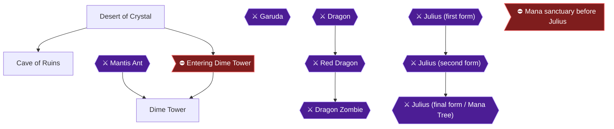

This chapter takes you from the Desert of Crystal, where you cast Nuke on the right-hand crystal, through the Cave of Ruins (Dragon Shield, Dragon Sword, the Mantis Ant boss and the Rusty Sword tile) and up Dime Tower, where Marcie joins you, the Dragon Armor waits on Floor 4 and Garuda guards the top. Four achievements are placed here: Sierra's Blade, Larc's Leathers, Rise of the Robots and Robots Can't Jump.

> [!WARNING]
> **Missable Achievement Warning:** Sierra's Blade (Dragon Sword) and Larc's Leathers (Dragon Shield plus Dragon Armor) are both missable. Take the Dragon Sword and the Dragon Shield in the Cave of Ruins before you enter Dime Tower 🟡.

> [!WARNING]
> **Missable Achievement Warning:** War Is Hell (the boy in Wendel) is also lost once you enter Dime Tower. Whether Wendel can be revisited afterwards is unconfirmed by any source, but commenters believe it cannot. Treat it as lost and do it before this chapter 🟡.

### Preparation

- You need the Nuke spell from the Lich. Dr. Bowow in Ish says Nuke can blow up a crystal in the Desert of Crystal right outside Ish.
- You need the Rusty Sword from Iflyte in your inventory for the tile in the Cave of Ruins.
- Bring Cure and Fire equipped as magic options, an Axe (for trees on Floor 6), a Flail, Ice, and a Mattock or Morning Star. Dime Tower uses Keys and breakable walls 🟡.
- The Desert of Crystal magic shop sells Thunder (x2) for 400 GP if you want it 🟡.
- A commenter advises making a second save just before the sunk tower in the desert 🟡.

### Desert of Crystal

From outside Ish go one screen west, north twice, and west. Two crystals stick out of the middle of the screen 🟡. Cast Nuke on the right-hand crystal 🟡. A cave opening appears; enter it 🟡.

> [!TIP]
> Mirrors and Snails around here each die to a single Nuke cast, but Mirrors fire projectiles and Snails do not. Robots are not affected by Nuke; Lit works on them 🟡.

### Cave of Ruins

🗺️ **Map:** [View Cave Of Ruins(H1) Map by RyuMaster](https://www.vgmaps.com/Atlas/GB-GBC/FinalFantasyAdventure-CaveOfRuins(H1).png)

#### Floor 1

Go west twice and descend the stairs 🟡. Snails, Mirrors, Earth Elementals and Moths each give roughly 100-150 experience, so kill a few if you are close to a level 🟡.

#### B-Floor 2: Dragon Shield

> [!WARNING]
> **Missable Achievement Warning:** The Dragon Shield is needed for Larc's Leathers. Grab it now; once you enter Dime Tower you cannot return 🟡.

From the stairs, go north, then use the slippery floors to go east one screen 🟡. Open the chest for the **Dragon Shield**. It sells for 4100 GP, but do not sell it.

#### B-Floor 2: Dragon Sword

> [!WARNING]
> **Missable Achievement Warning:** The Dragon Sword is needed for Sierra's Blade. Take it before entering Dime Tower 🟡.

From the shield chest go west, north twice, then west twice 🟡. Open the chest for the **Dragon Sword** (+56 ATK).

Equip the Dragon Sword from your equipment menu to unlock the achievement.


> [!ACHIEVEMENT]
> **Sierra's Blade (10 Points)**
> 
> *Equip the Dragon Sword*


#### Path to Mantis Ant

From the sword chest go east four times, north three times, and west 🟡. To go north through the tile rooms, use the left half of the center tiles until you are kicked to the right side, then take the upper right tile. For the eastward room, use the left half until you are kicked to the upper side, then take the upper right tile 🟡. Heal and save before the boss 🟡.

### Mantis Ant

Recommended level is 53, and the suggested equipment is the Dragon Sword and the Cure spell 🟡. Spikes around the arena edges deal damage equal to three times your level, so do not get knocked into them 🟡.

**Easy method:** Equip Fire before entering, do not move once on the screen, and cast Fire at the boss whenever your Will meter fills. One player won in about 20 casts 🟡. You can also stay at the doorway and use ranged attacks 🟡.

**Melee method:** The source says to cross the lightning barrier into the middle, cure at once, and attack with a fast weapon. Mantis Ant stays mostly at the top and rarely uses its charge 🟡. Winning pays 214 EXP and 229 GP in one source 🟡.

After the fight, equip Cure and survive the 100 HP damage tiles as you cross the arena to the right exit 🟡.

### Raising Dime Tower

The east door opens after Mantis Ant dies. Heal to full, go through, and equip the **Rusty Sword**. You must have it equipped before stepping on the floor switch, or nothing happens 🟡. Step on the odd tile; the sword's power is released and Dime Tower is raised.

> [!CAUTION]
> **Point of No Return:** Entering Dime Tower closes off the world map. Afterwards the only route is the waterfall to the Tower of Gemma; Wendel and the Cave of Ruins are gone 🟡.

Before you enter, confirm that War Is Hell is done and that you hold both the Dragon Sword and the Dragon Shield. Rest at the Ish inn and buy Keys until you hold 8 sets 🟡. Ish is south and west twice from outside Ish 🟡. A magic shop is also nearby 🟡.

#### Desert of Crystal: Finding Dime Tower

From outside the Cave of Ruins go south twice, east, south, and west, then try to walk across the screen. Dime Tower rises from the sand. Enter the door.

### Dime Tower

🗺️ **Map:** [View Dime Tower(H4) Map by RyuMaster](https://www.vgmaps.com/Atlas/GB-GBC/FinalFantasyAdventure-DimeTower(H4).png)

Tablets are scattered through the tower. Reading them is optional and the route below skips them.

#### Marcie joins

As soon as you walk in, Marcie joins you. Use ASK to restore your MP to full.


> [!ACHIEVEMENT]
> **Rise of the Robots (10 Points)**
> 
> *Recruit Marcie*


Marcie attacks with a Laser Beam 🟡. Enemies here include Swords, Gauntlets, Birdmen (can poison) and beret fuzzballs (can inflict Moogle). Angry Ducks drop X-Cure 🟡.

#### Floor 1

Go west, north twice, east, and use a Mattock or Morning Star on the east wall. Go east, north, west, and up the stairs 🟡.

#### Floor 2

Go west, south, east, south twice, east, and up the stairs 🟡.

#### Floor 3

Climb the vine north one screen and go through the door 🟡. The four-floor-switch room lies on the way; use the Flail to reach the middle and step on all four switches to open the north door 🟡.

#### Floor 4: Dragon Armor

> [!WARNING]
> **Missable Achievement Warning:** Equip the Dragon Armor with the Dragon Shield for Larc's Leathers. You cannot return for either after the tower.

Go west and use a Key on the north door. Go north, then east, and open the chest in the middle for the **Dragon Armor** (+35 DEF). Equip the Dragon Armor and Dragon Shield together.


> [!ACHIEVEMENT]
> **Larc's Leathers (10 Points)**
> 
> *Equip the Dragon Armor and Dragon Shield*


Then go west and use a Mattock or Morning Star on the west wall, go west, and climb the stairs 🟡.

#### Floor 5

Go south and rest in a bed to restore HP and MP, then go north and up the stairs 🟡.

#### Floor 6

Two monsters are surrounded by trees to the south. Stand in the bottom corners facing the walls away from the trees and swing the Axe so the trees fall without hurting the monsters 🟡. Then freeze both with Ice, which opens the north door 🟡. Ice can be steered diagonally to avoid cutting trees that let Marcie destroy your snowmen 🟡.

Go north, use a Key on the door, go east, then south and up the stairs 🟡.

#### Floor 7: Garuda

Heal and save, then go north to start the fight 🟡.

Recommended level is 55 and the suggested equipment is the Flame Chain and Cure 🟡. Garuda dives across the screen and drops feathers. When he is upper left, stand in the lower left corner; when he is upper right, stand in the lower right. Follow him when he charges. Your weapon can destroy his feathers. Stay near the center until he is about to dive so feathers are not aimed at the corner. Fully charged Nuke blasts also work 🟡. He gives 221 EXP and 266 GP in one source 🟡.

#### After Garuda

Go west one screen. Before moving on, cast Cure until your HP is full and ASK Marcie to restore all MP, since this is the last time to use him 🟡. Then go west twice.

Part of the tower collapses. Marcie throws you across the gap and cannot jump himself; the tower falls with him. The achievement pops before the cutscene, as commenters note 🟡.


> [!ACHIEVEMENT]
> **Robots Can't Jump (10 Points)**
> 
> *Return to the Glaive Empire for the last time*


Go west three times to the waterfall, which reverses flow and carries you to the mountain top 🟡.

> [!TIP]
> Before you leave: confirm you have the Dragon Sword, Dragon Shield and Dragon Armor. From here the only route is the waterfall and the Tower of Gemma; you cannot return to the world map 🟡.

> [!IMPORTANT]
> ### Chapter 12 Cumulative 100% Checkpoint
> - **Dungeon Chests Opened:** Dragon Shield, Dragon Sword, Dragon Armor collected 🟡
> - **Magic Spells:** 8 / 8
> - **RetroAchievements Unlocked:** 35 / 50 (225 / 480 points)

### Chapter Checklist

- [ ] Nuke cast on the right crystal; Cave of Ruins entered
- [ ] Dragon Shield taken (B-Floor 2)
- [ ] Dragon Sword taken and equipped (Sierra's Blade)
- [ ] Mantis Ant defeated
- [ ] Rusty Sword equipped on the tile; Dime Tower raised
- [ ] War Is Hell done, Dragon Sword and Shield in hand; Keys stocked
- [ ] Marcie recruited (Rise of the Robots)
- [ ] Dragon Armor and Dragon Shield equipped (Larc's Leathers)
- [ ] Garuda defeated
- [ ] Robots Can't Jump unlocked
- [ ] Waterfall climbed

---

## Chapter 13: The Tower of Gemma and the Tree of Mana

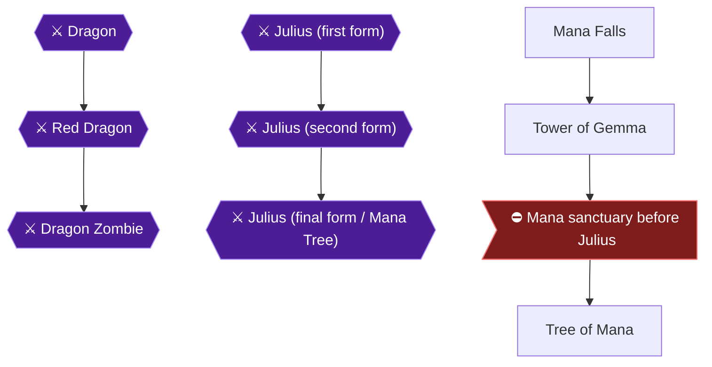

This is the final chapter. You ride the reversed waterfall to the top of the mountain, climb the Tower of Gemma (called the Temple of Mana in one guide), beat three dragons, receive Excalibur, farm the best armor and shield, grind your levels, and finish with Julius and the Mana Tree 🟡. Almost every achievement here must be done before the point of no return at the Mana sanctuary, so read the preparation section first.

### Overview and Preparation

The recommended levels for the bosses run from 57 (Dragon) to 60 (Dragon Zombie and Julius) 🟡. One guide advises at least Level 50 for Julius 🟡.

Achievements to finish before leaving the tower area:

- **Gemma Knight:** Level 50 needs 128,969 total experience 🟡.
- **The Way of the Warrior / Wizard / Tank / Monk:** Power, Wisdom, Stamina and Willpower all need to reach 50. These are technically missable if you always pick the same stat when leveling up 🟡. A commenter who over-invested in one stat found raising the others later was very slow, so spread points evenly 🟡. One guide says to alternate between Senshi and Madoushi to reach max stats 🟡. Another says to alternate Power and Wisdom 🟡.
- **Wow, You're Rich!:** You must hold 50,000 GP at one time. A commenter says reaching Level 50 naturally brings you close to this 🟡.
- **Samurai Style and Poacher:** both are missable and covered below.

> [!WARNING]
> **Missable Achievement Warning:** Samurai Style (Samurai Armor and Samurai Helmet) must be farmed in the Tower of Gemma, where the Ninjas and Demon Heads live, before you pass the first four screens of the Mana sanctuary; there is no way back afterwards 🟡. Poacher (Aegis Shield) comes from the Elephants, which live inside the Mana sanctuary just before Julius, so farm it there before you walk up to the final fight 🟡.

> [!WARNING]
> **Missable Achievement Warning:** Timber!!! needs the Were Axe or Zeus Axe at the final battle. The Battle Axe cannot damage the final boss, and without one of the other two axes you must restart the game. Do not sell or discard the Zeus Axe 🟡.

### Mana Falls

After Garuda falls, Dime Tower collapses. Go west twice, and Marcie throws you across the gap but cannot jump himself. Go west three times to the waterfall, which reverses its flow; walk into it to be carried to the top of the mountain 🟡. At the top, go west, north twice, and enter the temple 🟡.

### Tower of Gemma

🗺️ **Map:** [View Temple Of Mana 1 Map by RyuMaster](https://www.vgmaps.com/Atlas/GB-GBC/FinalFantasyAdventure-TempleOfMana-1.png)

🗺️ **Map:** [View Temple Of Mana 2 Map by RyuMaster](https://www.vgmaps.com/Atlas/GB-GBC/FinalFantasyAdventure-TempleOfMana-2.png)

The guide provides floor maps for this tower. You will need two Keys 🟡. Mage walkthrough advice: avoid defeating ordinary enemies unless you are about to level; Ninjas' projectiles deal around 90 damage, and Ninjas and Fiend Heads can teleport directly on top of you 🟡.

#### Floor 1

Go south, east twice, north twice, unlock the north door with a Key, then go north and up the stairs 🟡.

#### Floor 2 and the Dragon

Heal and save, then go north to trigger the Dragon 🟡.

**Dragon** (recommended level 57, 257 to 262 GP depending on the source, 0 EXP):

- The Dragon travels in a circle through the arena; his fireballs can be blocked by your shield.
- Only the head can be damaged with a long-reach weapon (Flame Flail or Thunder Spear) 🟡.
- The mage route says the only vulnerable square is the front foot under his head, because his wing intercepts shots aimed higher. Use fully charged Nukes, and consider taking a weak fireball hit on purpose so the invincibility time lets you cast uninterrupted.

When he is defeated, enter the portal in the northeast corner 🟡.

#### Floors 3 to 7

- **Floor 3:** Go east and enter the portal 🟡.
- **Floor 4:** Go north, west, north, use a Key on the door, go west and enter the portal 🟡.
- **Floor 5:** Go east and enter the portal 🟡.
- **Floor 6:** Go south and break the west wall. Go west twice, south, west, and enter the portal 🟡.
- **Floor 7:** Go west and south twice. Cast Ice and steer the icicle with the control pad to hit the monster on the odd tile; the door opens. Go east and up the stairs 🟡. In the mage route the icicle goes through the labyrinth, across the orb, to the Minotaur on the button, and it may take two tries because an extra Minotaur is down there 🟡.

Samurai Warriors/Ninjas here drop Elixirs or Samurai Armor, Demon Heads drop X-Ether or the Samurai Helmet, and Elephants drop the Aegis Shield 🟡. The farming method is in the "Armor and Shield Farming" section below.

#### Floor 8 and the Red Dragon

Heal and save, then go north 🟡.

**Red Dragon** (recommended level 58, 257 GP, 0 EXP): it moves in the opposite direction and has more HP than the first Dragon, but the strategy is the same 🟡. Attack only the head with a Flame Flail or Thunder Spear 🟡. Enter the portal when it is defeated 🟡.

#### Floors 9 to 12

- **Floor 9:** Go west and enter the portal 🟡.
- **Floor 10:** Go north, east, north and enter the portal 🟡.
- **Floor 11:** Go east into the portal, then head south, east twice, and enter the next portal 🟡.
- **Floor 12 (healing room):** Use a Key on the door and go west. Go to the bottom of the pond to restore HP and MP, then leave and re-enter the portal 🟡.
- **Floor 11 again:** Go west, south, into the portal, then go west into the next portal 🟡.
- **Floor 12 (snowman puzzle):** Go east and use a Key on the door, go east through it and twice more. Freeze a monster into a snowman and place it on the odd tile directly above the odd tile in the bottom-left corner 🟡. Another guide says to turn a Ninja into a snowman and put it on the floor switch second from the bottom in the left column, which opens the north door 🟡. The mage guide agrees: the correct button is on the left side, second from the bottom 🟡. Then go north three times and up the stairs 🟡.

Heal and save before the next fight 🟡.

#### Dragon Zombie

**Dragon Zombie** (recommended level 60, 270 GP, 0 EXP) 🟡:

- Use a long-reach weapon on its head. Your weapon can destroy the fireballs and your shield can block them.
- Touching the body costs about 75 HP.
- Fireballs and contact hurt much more than with the previous dragons 🟡.
- The mage route says fire works well; Nuke is workable if you have many X-Ethers, and you should attack from below so you do not miss the erratic heads.


> [!ACHIEVEMENT]
> **Dragon Slayer (10 Points)**
> 
> *Defeat every dragon in the Mana shrine*


Defeating Dragon, Red Dragon and Dragon Zombie completes Dragon Slayer 🟡. Enter the portal once the monster is dead 🟡.

#### Floor 13: Excalibur restored

Go north four times and talk to the Lady, who transforms your Rusty Sword into Excalibur 🟡. The script has her say you have been a great Knight of Gemma before giving you the sword 🟡. Excalibur gives +85 attack and the Rusty Sword is removed permanently. Equip it right away 🟡.


> [!ACHIEVEMENT]
> **I've Got the Power! (10 Points)**
> 
> *Brandish the Mana Sword, Excalibur, after it is restored*


Then go north twice, west, south, and west, and heal and save 🟡. The Mana sanctuary is still ahead, and it is where the point of no return begins 🟡.

### Armor and Shield Farming

#### Samurai Armor and Helmet drops: the drop-chest trick

This is the key to both missable equipment achievements. The contents of a chest are decided when you open it, not when it appears 🟡. To use it:

1. Fill your item inventory completely, but keep room in your equipment inventory 🟡.
2. Kill the monster carrying the equipment you want until one drops a chest 🟡.
3. Try to open the chest. You get "Can't carry!" messages and the chest stays closed. Keep trying and eventually you get the armor instead of an item 🟡.

You only need one chest to drop rather than killing many monsters 🟡.

Respawning enemies: enemies return if you visit three other screens and come back, or if you leave one monster alive and return 🟡. Commenters say that leaving one enemy alive, exiting and re-entering works well 🟡. Another method: kill the Ninjas in one room, save, soft reset, load, and a new set spawns 🟡.

#### Samurai Armor (Ninjas)

The armor drops from Ninjas, which also drop Elixirs, and gives +45 defense. Ninjas give 254 EXP and 10 GP 🟡. Use the chest trick on a Ninja's chest 🟡.

#### Samurai Helmet (Demon Heads)

The helmet drops from Demon Heads, which also drop X-Ether, and gives +25 defense 🟡. The Devil Head is vulnerable to Nuke magic and swords 🟡. A commenter kills them with Nuke, saves, and uses Ethers and Elixirs to restore MP before repeating 🟡. Use the chest trick on their chest 🟡.


> [!ACHIEVEMENT]
> **Samurai Style (25 Points)**
> 
> *Equip the best armor and helm*


Equip the Samurai Armor and Samurai Helmet to earn Samurai Style 🟡.

#### Aegis Shield (Elephant drop)

Elephants drop the Aegis Shield (and Unicorns). They live in the Mana sanctuary, just before the final boss, so this farming happens after you cross the point of no return below, but before you approach Julius 🟡. Excalibur is recommended against them 🟡. Reload the screen until two Elephants are on it by leaving and returning without killing, and kill them on each screen where they appear. Their Unicorn drops fill inventory slots, then use the chest trick 🟡. The Aegis Shield deflects any projectile, including the final boss's force balls 🟡.


> [!ACHIEVEMENT]
> **Poacher (25 Points)**
> 
> *Equip the best shield*


Equip the Aegis Shield to earn Poacher 🟡.

### Grinding: Level 50, Stats and GP

Elephants near the final boss are a good place to grind to Level 50 🟡. Another source says one room in the dungeon is a good leveling spot and warns that going beyond Lv99 on the original Game Boy version reportedly freezes the game 🟡. Keep alternating stat choices at each level-up so that Power, Wisdom, Stamina and Willpower can all reach 50 🟡. Power raises attack, Stamina raises HP and defense, and Wisdom raises MP and magic damage.


> [!ACHIEVEMENT]
> **Gemma Knight (25 Points)**
> 
> *Reach Level 50*


Reach Level 50 for Gemma Knight 🟡.


> [!ACHIEVEMENT]
> **The Way of the Warrior (10 Points)**
> 
> *Level up your Power to 50*


> [!ACHIEVEMENT]
> **The Way of the Wizard (10 Points)**
> 
> *Level up your Wisdom to 50*


> [!ACHIEVEMENT]
> **The Way of the Tank (10 Points)**
> 
> *Level up your Stamina to 50*


> [!ACHIEVEMENT]
> **The Way of the Monk (10 Points)**
> 
> *Level up your Willpower to 50*


Get Power, Wisdom, Stamina and Willpower all to 50 🟡.


> [!ACHIEVEMENT]
> **Wow, You're Rich! (25 Points)**
> 
> *Collect 50,000 GP*


Hold 50,000 GP at one time. Do not spend it down before the achievement fires 🟡.

> [!CAUTION]
> **Point of No Return:** After the first four screens of the Mana sanctuary you are trapped until Julius is beaten 🟡. Finish the Samurai Armor and Samurai Helmet in the tower first, and carry several Elixirs. The Elephants (Aegis Shield) and their grinding spot for Level 50, the stats and 50,000 GP are inside the sanctuary, so do those before you go north to Julius 🟡.

### Tree of Mana

Go north to find Julius and the Girl, and prepare to fight 🟡. The path to the tree is one-way 🟡. Excalibur provides 85 attack here 🟡. The Girl can heal you if you ASK her 🟡. Elixirs restore all HP and MP, so use them freely 🟡. A Cure spell is recommended 🟡.

#### Julius (first form)

Recommended level 60; 638 EXP and 818 GP 🟡. Julius splits into three duplicates; attack and defeat all three 🟡. Use Cure as needed 🟡. The charging attack of the maxed sword is the most efficient attack in all three forms 🟡.

Mage tip: his Nukes deal about 20 damage and touching him about 100, so stay above 100 HP. Fully charged Nukes kill the clones in one hit. You must kill the final clone while standing on the left or bottom side of the screen 🟡.


> [!ACHIEVEMENT]
> **Duel to the Death (10 Points)**
> 
> *Defeat Julius*


#### Julius (second form)

He becomes a monster that flies above, throwing lightning bolts and swooping down 🟡. Dodge the swoop and hit him with Excalibur 🟡. Try to stay by his side, since he can charge from either direction 🟡. He gives 162 GP 🟡. Do not attack him from below when he is on the left or right side, or you cannot avoid the diagonal dive 🟡.


> [!ACHIEVEMENT]
> **The Real Meaning of Power (25 Points)**
> 
> *Defeat Julius after his Mana-fueled transformation*


#### Julius (final form / Mana Tree)

He becomes a head with two arms that teleports around the screen and fires Nukes or force balls 🟡. Stay near the center of the screen and attack when he appears 🟡. The Aegis Shield makes the force balls harmless; ask Fuji/the Girl to regenerate HP, and a Nuke equipped alongside Excalibur helps 🟡. If he warps on top of you, you can take multiple body hits, so focus on healing 🟡. The mage guide says his hands are invincible and he fires two Nukes from each of his positions, and that his Nukes can be intercepted by timed shots from the opposite side 🟡.

> [!WARNING]
> **Missable Achievement Warning:** Timber!!! requires the final blow on the Mana Tree to be struck with an axe. Switch to the Were Axe or Zeus Axe for the last hit. The Battle Axe cannot damage it 🟡. One player used the Zeus Axe and it still took many hits, even after 10 hits with Excalibur, so bring healing 🟡.


> [!ACHIEVEMENT]
> **The End of Everything (25 Points)**
> 
> *Defeat the Mana Tree after it is corrupted by Julius*


> [!ACHIEVEMENT]
> **Timber!!! (25 Points)**
> 
> *Land the final blow on the Mana Tree with an axe*


Defeat the corrupted Mana Tree, finishing with the axe, to earn The End of Everything and Timber!!! 🟡.

#### Ending

After the Mana Tree disappears, Jena agrees to stay and become the new Tree of Mana 🟡.


> [!ACHIEVEMENT]
> **Legacy of Mana (10 Points)**
> 
> *Restore the Mana Tree and see the end screen*


Watch the ending through to the end screen to earn Legacy of Mana 🟡.

> [!IMPORTANT]
> ### Chapter 13 Cumulative 100% Checkpoint
> - **Magic Spells:** 8 / 8
> - **Dragons defeated:** Dragon, Red Dragon, Dragon Zombie
> - **Equipment:** Excalibur, Samurai Armor, Samurai Helmet, Aegis Shield 🟡
> - **RetroAchievements Unlocked:** 50 / 50 (480 / 480 points)

### Chapter Checklist

- [ ] Rode the reversed waterfall to the Tower of Gemma
- [ ] Defeated Dragon, Red Dragon and Dragon Zombie (Dragon Slayer)
- [ ] Received Excalibur from the Lady on Floor 13 (I've Got the Power!)
- [ ] Samurai Armor and Samurai Helmet equipped (Samurai Style)
- [ ] Aegis Shield equipped (Poacher)
- [ ] Level 50 reached (Gemma Knight)
- [ ] Power, Wisdom, Stamina and Willpower all at 50
- [ ] Held 50,000 GP at once (Wow, You're Rich!)
- [ ] Kept the Were Axe or Zeus Axe
- [ ] Defeated Julius, his second form and the Mana Tree
- [ ] Final blow on the Mana Tree with an axe (Timber!!!)
- [ ] Watched the ending (Legacy of Mana)

---

## Final Checklist

**1. Escape from Glaive Castle**

- [ ] ⚠ The Way of the Warrior/Wizard/Tank/Monk (stats to 50) (before: Every level-up from the first one: alternate Power and Wisdom; over-investing one stat makes the others hard to reach 50)
- [ ] 🏆 Fall to Earth

**2. Topple, Bogard and Kett's**

- [ ] 🏆 Damsel in Distress
- [ ] 🏆 Pearl of Wisdom
- [ ] 🏆 Rest and Heal Your Wounds

**3. Marsh Cave and the Vampire**

- [ ] 🏆 Mysterious Marsh Man
- [ ] 🏆 Hail Hydra!
- [ ] 🏆 RIP, Christopher Lee
- [ ] 🏆 Squire

**4. Wendel, the Silver Mine and Gaia**

- [ ] ⚠ Kill the boy in south-west Wendel (before: After Julius takes the Girl in Wendel (Glaive's attack), and before entering Dime Tower in chapter 12)
- [ ] 🏆 You Spoony Bard!
- [ ] 🏆 War Is Hell
- [ ] 🏆 The World Is Mine
- [ ] 🏆 I Taste Like (Silver) Chicken

**5. The Airship and Menos**

- [ ] 🏆 I Believe I Can Fly...
- [ ] 🏆 Familiar Feathered Friend

**6. Jadd, the Oasis and Medusa's Cave**

- [ ] ⚠ Give a Fang to the boy in Jadd (before: While in Jadd in chapter 6, before the Mt. Rocks bridge collapses in chapter 8)
- [ ] 🏆 To Infinity, and Beyond!
- [ ] 🏆 Mercy
- [ ] 🏆 Knight

**7. Davias's Mansion**

- [ ] ⚠ Were Axe in Davias's Mansion (before: Before defeating Davias (his death warps you to Jadd); keep the axe for Timber!!!)
- [ ] 🏆 Kevin's Worst Nightmare
- [ ] 🏆 Mystic Tune?! Yeah!
- [ ] 🏆 Your Pendant Is in Another Castle

**8. Mt. Rocks and the Golem Cave**

- [ ] 🏆 Balls of Steel
- [ ] ⛔ Everything above is done before: Mt. Rocks bridge collapse

**9. Return to Glaive**

- [ ] ⚠ Blood Sword in the Dark Castle knight room (before: Before defeating the Dark Lord in chapter 9)
- [ ] 🏆 Return of the Gemma
- [ ] 🏆 Drink the Blood of My Enemies
- [ ] 🏆 I Am (Not) Your Father
- [ ] 🏆 Glaive Strikes Back

**10. Ish, Lorim and the Ice Cave**

- [ ] 🏆 Chocobo 2.0
- [ ] 🏆 Defroster

**11. The Lich, the Kraken and the Undersea Volcano**

- [ ] ⚠ Zeus Axe in the Undersea Volcano (before: Before fighting Iflyte; never sell it (needed for Timber!!!))
- [ ] ⚠ Iflyte and the Rusty Sword (before: Get the Zeus Axe before Iflyte and take the Rusty Sword at once; going back afterwards cost one player this achievement)
- [ ] 🏆 Meltdown
- [ ] 🏆 Who's Your Octo-Daddy Now?
- [ ] 🏆 Duck Hunter
- [ ] 🏆 Through the Fire and Flames

**12. The Cave of Ruins and Dime Tower**

- [ ] ⚠ Dragon Sword in the Cave of Ruins (before: Before entering Dime Tower)
- [ ] ⚠ Dragon Shield (Cave of Ruins) + Dragon Armor (Dime Tower) (before: Take the Dragon Shield before entering Dime Tower; equip both together in Dime Tower)
- [ ] 🏆 Sierra's Blade
- [ ] 🏆 Larc's Leathers
- [ ] 🏆 Rise of the Robots
- [ ] 🏆 Robots Can't Jump
- [ ] ⛔ Everything above is done before: Entering Dime Tower

**13. The Tower of Gemma and the Tree of Mana**

- [ ] ⚠ Samurai Armor and Samurai Helmet drops (before: Before passing the first screens of the Mana sanctuary (no way back))
- [ ] ⚠ Aegis Shield from Elephants (before: Before passing the first screens of the Mana sanctuary (no way back))
- [ ] ⚠ Final blow on the Mana Tree with an axe (before: Keep the Were Axe or Zeus Axe until the final battle; without one you must restart the game)
- [ ] 🏆 Dragon Slayer
- [ ] 🏆 I've Got the Power!
- [ ] 🏆 Samurai Style
- [ ] 🏆 Poacher
- [ ] 🏆 Gemma Knight
- [ ] 🏆 The Way of the Warrior
- [ ] 🏆 The Way of the Wizard
- [ ] 🏆 The Way of the Tank
- [ ] 🏆 The Way of the Monk
- [ ] 🏆 Wow, You're Rich!
- [ ] 🏆 Duel to the Death
- [ ] 🏆 The Real Meaning of Power
- [ ] 🏆 The End of Everything
- [ ] 🏆 Timber!!!
- [ ] 🏆 Legacy of Mana
- [ ] ⛔ Everything above is done before: Mana sanctuary

## 100% Completion Verification Checklist

All 50 achievements (480 points).

| ✔ | Achievement | Points | Type | Chapter |
|---|---|---|---|---|
| ☐ | **Fall to Earth** — Escape from the Glaive Empire | 1 |  | [1](#chapter-1-escape-from-glaive-castle) |
| ☐ | **Damsel in Distress** — Rescue the girl | 2 |  | [2](#chapter-2-topple-bogard-and-ketts) |
| ☐ | **Pearl of Wisdom** — Meet Bogard and get your first mattock | 3 |  | [2](#chapter-2-topple-bogard-and-ketts) |
| ☐ | **Rest and Heal Your Wounds** — Rest at Kett's and learn the Cure spell | 4 |  | [2](#chapter-2-topple-bogard-and-ketts) |
| ☐ | **Mysterious Marsh Man** — Recruit the mysterious man dressed like a bard | 5 |  | [3](#chapter-3-marsh-cave-and-the-vampire) |
| ☐ | **Hail Hydra!** — Defeat the Hydra | 5 |  | [3](#chapter-3-marsh-cave-and-the-vampire) |
| ☐ | **RIP, Christopher Lee** — Kill the vampire and save the girl (again) | 5 |  | [3](#chapter-3-marsh-cave-and-the-vampire) |
| ☐ | **You Spoony Bard!** — Learn the true identity of the mysterious man dressed like a bard | 5 |  | [4](#chapter-4-wendel-the-silver-mine-and-gaia) |
| ☐ | **The World Is Mine** — Recruit Watts after falling (again) in the mines | 5 |  | [4](#chapter-4-wendel-the-silver-mine-and-gaia) |
| ☐ | **I Taste Like (Silver) Chicken** — Venture through the Gaia Pass and get some help | 5 |  | [4](#chapter-4-wendel-the-silver-mine-and-gaia) |
| ☐ | **I Believe I Can Fly...** — Fall from the airship | 5 |  | [5](#chapter-5-the-airship-and-menos) |
| ☐ | **Familiar Feathered Friend** — Find a chocobo | 5 |  | [5](#chapter-5-the-airship-and-menos) |
| ☐ | **To Infinity, and Beyond!** — Learn the secret of the oasis in Jadd | 5 | missable | [6](#chapter-6-jadd-the-oasis-and-medusas-cave) |
| ☐ | **Mercy** — Save Amanda from succumbing to the bite of Medusa and collect her tears | 5 |  | [6](#chapter-6-jadd-the-oasis-and-medusas-cave) |
| ☐ | **Mystic Tune?! Yeah!** — Recruit Lester | 5 |  | [7](#chapter-7-daviass-mansion) |
| ☐ | **Your Pendant Is in Another Castle** — Defeat Davias | 5 |  | [7](#chapter-7-daviass-mansion) |
| ☐ | **Balls of Steel** — Equip the Morning Star | 5 |  | [8](#chapter-8-mt-rocks-and-the-golem-cave) |
| ☐ | **Return of the Gemma** — Return to the Glaive Empire on a rescue mission | 5 |  | [9](#chapter-9-return-to-glaive) |
| ☐ | **I Am (Not) Your Father** — Defeat the Dark Lord | 5 |  | [9](#chapter-9-return-to-glaive) |
| ☐ | **Glaive Strikes Back** — Leave the Glaive Empire... again | 5 |  | [9](#chapter-9-return-to-glaive) |
| ☐ | **Chocobo 2.0** — Meet Dr. Bowow and witness the next step in chocobo evolution | 5 |  | [10](#chapter-10-ish-lorim-and-the-ice-cave) |
| ☐ | **Defroster** — Defeat Kary | 10 |  | [10](#chapter-10-ish-lorim-and-the-ice-cave) |
| ☐ | **Who's Your Octo-Daddy Now?** — Defeat the Kraken | 10 |  | [11](#chapter-11-the-lich-the-kraken-and-the-undersea-volcano) |
| ☐ | **Through the Fire and Flames** — Defeat Iflyte and obtain the Rusty Sword | 10 |  | [11](#chapter-11-the-lich-the-kraken-and-the-undersea-volcano) |
| ☐ | **Meltdown** — Defeat the Lich and obtain the Nuke Magic | 10 |  | [11](#chapter-11-the-lich-the-kraken-and-the-undersea-volcano) |
| ☐ | **Rise of the Robots** — Recruit Marcie | 10 |  | [12](#chapter-12-the-cave-of-ruins-and-dime-tower) |
| ☐ | **Robots Can't Jump** — Return to the Glaive Empire for the last time | 10 |  | [12](#chapter-12-the-cave-of-ruins-and-dime-tower) |
| ☐ | **Dragon Slayer** — Defeat every dragon in the Mana shrine | 10 |  | [13](#chapter-13-the-tower-of-gemma-and-the-tree-of-mana) |
| ☐ | **I've Got the Power!** — Brandish the Mana Sword, Excalibur, after it is restored | 10 |  | [13](#chapter-13-the-tower-of-gemma-and-the-tree-of-mana) |
| ☐ | **Duel to the Death** — Defeat Julius | 10 | progression | [13](#chapter-13-the-tower-of-gemma-and-the-tree-of-mana) |
| ☐ | **The Real Meaning of Power** — Defeat Julius after his Mana-fueled transformation | 25 | progression | [13](#chapter-13-the-tower-of-gemma-and-the-tree-of-mana) |
| ☐ | **The End of Everything** — Defeat the Mana Tree after it is corrupted by Julius | 25 | progression | [13](#chapter-13-the-tower-of-gemma-and-the-tree-of-mana) |
| ☐ | **Legacy of Mana** — Restore the Mana Tree and see the end screen | 10 | win_condition | [13](#chapter-13-the-tower-of-gemma-and-the-tree-of-mana) |
| ☐ | **Squire** — Reach Level 10 | 5 |  | [3](#chapter-3-marsh-cave-and-the-vampire) |
| ☐ | **Knight** — Reach Level 25 | 10 |  | [6](#chapter-6-jadd-the-oasis-and-medusas-cave) |
| ☐ | **Gemma Knight** — Reach Level 50 | 25 |  | [13](#chapter-13-the-tower-of-gemma-and-the-tree-of-mana) |
| ☐ | **The Way of the Warrior** — Level up your Power to 50 | 10 |  | [13](#chapter-13-the-tower-of-gemma-and-the-tree-of-mana) |
| ☐ | **The Way of the Wizard** — Level up your Wisdom to 50 | 10 |  | [13](#chapter-13-the-tower-of-gemma-and-the-tree-of-mana) |
| ☐ | **The Way of the Tank** — Level up your Stamina to 50 | 10 |  | [13](#chapter-13-the-tower-of-gemma-and-the-tree-of-mana) |
| ☐ | **The Way of the Monk** — Level up your Willpower to 50 | 10 |  | [13](#chapter-13-the-tower-of-gemma-and-the-tree-of-mana) |
| ☐ | **Wow, You're Rich!** — Collect 50,000 GP | 25 |  | [13](#chapter-13-the-tower-of-gemma-and-the-tree-of-mana) |
| ☐ | **Kevin's Worst Nightmare** — Equip the Were Axe | 10 | missable | [7](#chapter-7-daviass-mansion) |
| ☐ | **Drink the Blood of My Enemies** — Equip the Blood Sword | 10 | missable | [9](#chapter-9-return-to-glaive) |
| ☐ | **Duck Hunter** — Equip the Zeus Axe | 10 | missable | [11](#chapter-11-the-lich-the-kraken-and-the-undersea-volcano) |
| ☐ | **Sierra's Blade** — Equip the Dragon Sword | 10 | missable | [12](#chapter-12-the-cave-of-ruins-and-dime-tower) |
| ☐ | **Larc's Leathers** — Equip the Dragon Armor and Dragon Shield | 10 | missable | [12](#chapter-12-the-cave-of-ruins-and-dime-tower) |
| ☐ | **Samurai Style** — Equip the best armor and helm | 25 | missable | [13](#chapter-13-the-tower-of-gemma-and-the-tree-of-mana) |
| ☐ | **Poacher** — Equip the best shield | 25 | missable | [13](#chapter-13-the-tower-of-gemma-and-the-tree-of-mana) |
| ☐ | **War Is Hell** — Kill an innocent boy in the streets of Wendel after Glaive's invasion of the city | 5 | missable | [4](#chapter-4-wendel-the-silver-mine-and-gaia) |
| ☐ | **Timber!!!** — Land the final blow on the Mana Tree with an axe | 25 | missable | [13](#chapter-13-the-tower-of-gemma-and-the-tree-of-mana) |

## Sources

This guide was built only from these sources:

- **RetroAchievements** — Final Fantasy Adventure — RetroAchievements community comments: [link](https://retroachievements.org/game/2403)
- **VGMaps** — Beginning Map by RyuMaster: [link](https://www.vgmaps.com/Atlas/GB-GBC/FinalFantasyAdventure-Beginning.png)
- **VGMaps** — Overworld Map by RyuMaster: [link](https://www.vgmaps.com/Atlas/GB-GBC/FinalFantasyAdventure-Overworld.png)
- **VGMaps** — Bogard's House(G5) Map by RyuMaster: [link](https://www.vgmaps.com/Atlas/GB-GBC/FinalFantasyAdventure-Bogard'sHouse(G5).png)
- **VGMaps** — Cave(East Of Bogard's House)(J6 J7) Map by RyuMaster: [link](https://www.vgmaps.com/Atlas/GB-GBC/FinalFantasyAdventure-Cave(EastOfBogard'sHouse)(J6-J7).png)
- **VGMaps** — Cave Of Floatrocks(A15&P1) Map by RyuMaster: [link](https://www.vgmaps.com/Atlas/GB-GBC/FinalFantasyAdventure-CaveOfFloatrocks(A15&P1).png)
- **VGMaps** — Cave Of Marsh(O9) Map by RyuMaster: [link](https://www.vgmaps.com/Atlas/GB-GBC/FinalFantasyAdventure-CaveOfMarsh(O9).png)
- **VGMaps** — Cave Of Medusa(C13) Map by RyuMaster: [link](https://www.vgmaps.com/Atlas/GB-GBC/FinalFantasyAdventure-CaveOfMedusa(C13).png)
- **VGMaps** — Cave Of Mt Rocks(B3 E4) Map by RyuMaster: [link](https://www.vgmaps.com/Atlas/GB-GBC/FinalFantasyAdventure-CaveOfMtRocks(B3-E4).png)
- **VGMaps** — Cave Of Palmy Desert(D15) Map by RyuMaster: [link](https://www.vgmaps.com/Atlas/GB-GBC/FinalFantasyAdventure-CaveOfPalmyDesert(D15).png)
- **VGMaps** — Cave Of Ruins(H1) Map by RyuMaster: [link](https://www.vgmaps.com/Atlas/GB-GBC/FinalFantasyAdventure-CaveOfRuins(H1).png)
- **VGMaps** — Cave Of Snowfields(N4) Map by RyuMaster: [link](https://www.vgmaps.com/Atlas/GB-GBC/FinalFantasyAdventure-CaveOfSnowfields(N4).png)
- **VGMaps** — City Of Isch(J3) Map by RyuMaster: [link](https://www.vgmaps.com/Atlas/GB-GBC/FinalFantasyAdventure-CityOfIsch(J3).png)
- **VGMaps** — City Of Jadt(B9) Map by RyuMaster: [link](https://www.vgmaps.com/Atlas/GB-GBC/FinalFantasyAdventure-CityOfJadt(B9).png)
- **VGMaps** — City Of Jadt(B9) Davias Mansion Map by RyuMaster: [link](https://www.vgmaps.com/Atlas/GB-GBC/FinalFantasyAdventure-CityOfJadt(B9)-DaviasMansion.png)
- **VGMaps** — City Of Menos(E10) Map by RyuMaster: [link](https://www.vgmaps.com/Atlas/GB-GBC/FinalFantasyAdventure-CityOfMenos(E10).png)
- **VGMaps** — City Of Toppel(I8) Map by RyuMaster: [link](https://www.vgmaps.com/Atlas/GB-GBC/FinalFantasyAdventure-CityOfToppel(I8).png)
- **VGMaps** — City Of Wendel(N13) Map by RyuMaster: [link](https://www.vgmaps.com/Atlas/GB-GBC/FinalFantasyAdventure-CityOfWendel(N13).png)
- **VGMaps** — Dime Tower(H4) Map by RyuMaster: [link](https://www.vgmaps.com/Atlas/GB-GBC/FinalFantasyAdventure-DimeTower(H4).png)
- **VGMaps** — Dwarf Cave(J15) Map by RyuMaster: [link](https://www.vgmaps.com/Atlas/GB-GBC/FinalFantasyAdventure-DwarfCave(J15).png)
- **VGMaps** — Gaia(I12 I14) Map by RyuMaster: [link](https://www.vgmaps.com/Atlas/GB-GBC/FinalFantasyAdventure-Gaia(I12-I14).png)
- **VGMaps** — Glaive's Airship(G10) Map by RyuMaster: [link](https://www.vgmaps.com/Atlas/GB-GBC/FinalFantasyAdventure-Glaive'sAirship(G10).png)
- **VGMaps** — Glaive Castle Map by RyuMaster: [link](https://www.vgmaps.com/Atlas/GB-GBC/FinalFantasyAdventure-GlaiveCastle.png)
- **VGMaps** — Inn(H13&E14) Map by RyuMaster: [link](https://www.vgmaps.com/Atlas/GB-GBC/FinalFantasyAdventure-Inn(H13&E14).png)
- **VGMaps** — Ketts(K10) Map by RyuMaster: [link](https://www.vgmaps.com/Atlas/GB-GBC/FinalFantasyAdventure-Ketts(K10).png)
- **VGMaps** — Lorim(M6) Map by RyuMaster: [link](https://www.vgmaps.com/Atlas/GB-GBC/FinalFantasyAdventure-Lorim(M6).png)
- **VGMaps** — Mt Rocks(F2) Map by RyuMaster: [link](https://www.vgmaps.com/Atlas/GB-GBC/FinalFantasyAdventure-MtRocks(F2).png)
- **VGMaps** — Shop(A1) Map by RyuMaster: [link](https://www.vgmaps.com/Atlas/GB-GBC/FinalFantasyAdventure-Shop(A1).png)
- **VGMaps** — Shop(A11) Map by RyuMaster: [link](https://www.vgmaps.com/Atlas/GB-GBC/FinalFantasyAdventure-Shop(A11).png)
- **VGMaps** — Shop(C4) Map by RyuMaster: [link](https://www.vgmaps.com/Atlas/GB-GBC/FinalFantasyAdventure-Shop(C4).png)
- **VGMaps** — Shop(D4) Map by RyuMaster: [link](https://www.vgmaps.com/Atlas/GB-GBC/FinalFantasyAdventure-Shop(D4).png)
- **VGMaps** — Shop(F6) Map by RyuMaster: [link](https://www.vgmaps.com/Atlas/GB-GBC/FinalFantasyAdventure-Shop(F6).png)
- **VGMaps** — Shop(F12) Map by RyuMaster: [link](https://www.vgmaps.com/Atlas/GB-GBC/FinalFantasyAdventure-Shop(F12).png)
- **VGMaps** — Shop(G3) Map by RyuMaster: [link](https://www.vgmaps.com/Atlas/GB-GBC/FinalFantasyAdventure-Shop(G3).png)
- **VGMaps** — Shop(J1) Map by RyuMaster: [link](https://www.vgmaps.com/Atlas/GB-GBC/FinalFantasyAdventure-Shop(J1).png)
- **VGMaps** — Shop(K15) Map by RyuMaster: [link](https://www.vgmaps.com/Atlas/GB-GBC/FinalFantasyAdventure-Shop(K15).png)
- **VGMaps** — Shop(M8) Map by RyuMaster: [link](https://www.vgmaps.com/Atlas/GB-GBC/FinalFantasyAdventure-Shop(M8).png)
- **VGMaps** — Shop(N2) Map by RyuMaster: [link](https://www.vgmaps.com/Atlas/GB-GBC/FinalFantasyAdventure-Shop(N2).png)
- **VGMaps** — Shop(N12) Map by RyuMaster: [link](https://www.vgmaps.com/Atlas/GB-GBC/FinalFantasyAdventure-Shop(N12).png)
- **VGMaps** — Shop(N16) Map by RyuMaster: [link](https://www.vgmaps.com/Atlas/GB-GBC/FinalFantasyAdventure-Shop(N16).png)
- **VGMaps** — Silver Mine(J12) Map by RyuMaster: [link](https://www.vgmaps.com/Atlas/GB-GBC/FinalFantasyAdventure-SilverMine(J12).png)
- **VGMaps** — Temple Of Mana 1 Map by RyuMaster: [link](https://www.vgmaps.com/Atlas/GB-GBC/FinalFantasyAdventure-TempleOfMana-1.png)
- **VGMaps** — Temple Of Mana 2 Map by RyuMaster: [link](https://www.vgmaps.com/Atlas/GB-GBC/FinalFantasyAdventure-TempleOfMana-2.png)
- **GameFAQs** — Guide and Walkthrough by LevinMage: [link](https://gamefaqs.gamespot.com/gameboy/563272-final-fantasy-adventure/faqs/5825)
- **GameFAQs** — Guide and Walkthrough by _ATadeo_: [link](https://gamefaqs.gamespot.com/gameboy/563272-final-fantasy-adventure/faqs/9218)
- **GameFAQs** — Guide and Walkthrough by 3vrB257A5gq3fg: [link](https://gamefaqs.gamespot.com/gameboy/563272-final-fantasy-adventure/faqs/77706)
- **GameFAQs** — Game Script by KFHEWUI: [link](https://gamefaqs.gamespot.com/gameboy/563272-final-fantasy-adventure/faqs/37595)
- **GameFAQs** — Item Guide by jelly_soup: [link](https://gamefaqs.gamespot.com/gameboy/563272-final-fantasy-adventure/faqs/39541)
- **GameFAQs** — Mage Walkthrough by --Crow--: [link](https://gamefaqs.gamespot.com/gameboy/563272-final-fantasy-adventure/faqs/71168)

Verification: 239 verified · 1379 single-source · 0 resolved conflicts · 2 rejected facts.
