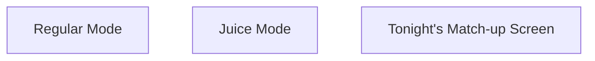
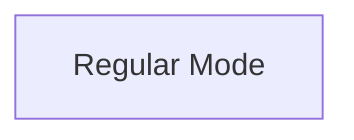
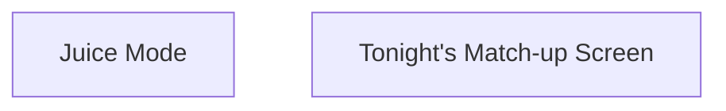

# NBA Jam — 100% RetroAchievements Walkthrough

## Metadata

- **Platform:** SNES/Super Famicom
- **Developer:** Iguana Entertainment
- **Publisher:** Acclaim
- **Genre:** Sports - Basketball
- **Released:** 1994-03-04
- **Achievements:** 28 (530 points)

> [!NOTE]
> Every instruction in this guide was extracted from the sources listed at the bottom and checked against them (12 facts confirmed by 2+ sources, 644 from a single source). Statements marked 🟡 come from only one source. Anything we could not confirm says **"Unable to verify from collected sources."**

## Game Overview

### The Premise

NBA Jam on the SNES is a two-on-two basketball game with 27 NBA teams to beat, and once all 27 are beaten the game turns Juice on for every game 🟡. Beating the teams in a row builds toward the 27-0 record that shows the ending 🟡.

This set has 28 achievements worth 530 points. The route is built around one long run: beat all 27 teams in a row on V.Hard difficulty with one record. That run covers the win streaks, the V.Hard milestones and the ending. A short clean-up of score and stat achievements follows it.

### Basic Controls and Moves

The moves you will use:

- **Pass:** press pass. Press turbo and pass for a quicker, safer pass 🟡.
- **Shoot:** hold shoot. A shot is more accurate at the peak of the jump 🟡.
- **Head fake:** tap shoot once. Your computer teammate will shoot if you do this while he has the ball 🟡.
- **Dunk:** hold shoot while running. Hold turbo and shoot for a super dunk 🟡. You must be moving to dunk 🟡.
- **Lay-up:** hold shoot for a short time while running 🟡.
- **Elbows:** tap turbo twice, then tap shoot repeatedly 🟡.
- **Steal:** tap steal to knock the ball away. Tap steal and turbo to knock the opponent down 🟡.
- **Block:** hold shoot to jump, and hold turbo as well to jump higher 🟡.
- **Rebound:** automatic if you are close enough. Otherwise press shoot and point toward the ball 🟡.
- **Alley-oop:** easier with two-player teams. The player without the ball moves under the basket and holds shoot. The ball handler presses turbo and pass 🟡.

### Defense and Stealing

To block a shot, jump at the moment you expect the shooter to jump 🟡. To reject a dunker, wait until he reaches the peak of his jump and then jump to block 🟡. A low dunk such as an easy jam can instead be stopped by knocking the dunker down with turbo and steal 🟡. It is possible to block the buzzer three-pointer. Right after the ball is passed inbounds, press turbo, jump and point toward the shooter 🟡.

There are three common ways to steal:

- Stick close and press steal a lot 🟡.
- Knock opponents down. Against computer opponents this can be repeated until they drop the ball 🟡.
- Let a player shoot while you are near his basket and jump before the shot gets there, though you may be called for goaltending 🟡.

A commenter adds that running in front of the passing lane while holding turbo is sometimes enough to steal the ball 🟡.

To rebound, press shoot to jump toward the ball after it has hit the rim or board 🟡. You can also knock down opposing players near the ball so you can pick it up off the floor 🟡. A player close enough to the ball jumps for it automatically 🟡.

### Scoring Tools

- **Easy jam:** be close to the basket and hold shoot 🟡.
- **Longer-range dunks:** hold turbo and shoot from further out. The guide gives spots for each one, such as the tomahawk jams, the cannonball slam and the 720 slam 🟡.
- **Pass out of a dunk:** in mid-dunk, if your teammate is open, press pass to send him the ball for an easy three.

### On Fire

A character who makes three shots in a row is "on fire". Two in a row is "heating up" 🟡. While on fire, future shots have a much better chance of going in, though some still miss. You also get unlimited turbo 🟡. You stay on fire until the other team makes a basket, and the effect usually fades after about 30 points regardless 🟡. To stay on fire, play in the back of the court, goaltend layups and three-pointers, and steal and rebound when possible 🟡. To take an opponent off fire, dunk the ball 🟡.

### Protecting a Lead

With a lead of four points or more and the ball, stay at your own end of the court and hold your position as long as you can. The computer does nothing until the shot clock drops below 5 🟡. At 6 seconds, pass to an open teammate or take a shot. After a miss, rebound, pass back to the backcourt player and milk the clock again 🟡.

A commenter describes the same idea for V.Hard. With roughly a 3+ point lead in the 4th quarter and the ball, wait at half court until the shot clock shows. At about 7 seconds left, drive toward the basket and weave up or down to get past the defender 🟡. You can also stand at half court and let your computer teammate run into your defender and push him over. The guarding defender does nothing until you cross half court 🟡.

V.Hard is hard because the CPU's full-court shots always go in, which causes last-second losses 🟡. That is why the route never relies on a narrow lead at the buzzer.

### Power-Up Codes

Power-up codes are entered on the "Tonight's match up" screen, the one with the big VS, before tip-off 🟡. Those listed as confirmed are:

- **Fire:** press B 7 times, then hold UP + Y + B until tip-off.
- **Shot %:** press any button, then hold DOWN + B + A until tip-off 🟡.
- **Turbo:** press any button 5 times, then hold Y + B + A 🟡.
- **Juice:** press any button 13 times, then hold B + X 🟡.

The Fire code puts you on fire for the whole game. Juice makes all players move about twice as fast, and it turns on automatically for every game once all 27 teams are beaten 🟡.

Whether Tonight's Match-up codes are allowed during the V.Hard run is an open question in the comments with no answer, so the route plays the V.Hard run without codes. The codes are used only in Chapter 7, where the 100- and 200-point games are played on Normal difficulty with the Fire code.

### Passwords, Records and Initials

The game does not save your progress the way Jam TE does. Your record is lost when you exit unless you keep track of the password 🟡. The game has no save of its own, so the password is the only way to resume: write it down after every win. Each password is shown as two lines of seven characters, so copy both lines exactly as your own game displays them 🟡. The published list is for the initials ICE, playing as Detroit, and runs from record 01-00 up to 27-00 🟡. Do not load published passwords to skip games. A commenter asked whether loaded passwords count for the V.Hard achievements and got no answer, so play your own record from the start.

A few rules for your single record:

- **Use only one record.** Creating more than one account stops most achievements from unlocking 🟡.
- **Do not start your initials with DA.** Names starting with DA prevent the main achievements from unlocking 🟡.

### Special Characters

The SNES version has secret characters such as Mark Turmell (MJT), Bill Clinton (ARK) and Al Gore (NET). Enter the first two initials, place the cursor over the last initial, then hold the listed buttons and press the final letter 🟡. They are not needed for the route.

### RetroAchievements and Hardcore Rules

- **Version:** the achievements require the US ROM 🟡.
- **Emulator:** a commenter reports that an achievement called Warning did not trigger in RetroArch and required one of the emulators on the site. It is not in the current set 🟡.
- **Hardcore:** emulator features such as rewinds and emulator cheats are off. The in-game power-up codes are part of the game itself, but whether they are allowed during the V.Hard run is an open question, so the route uses them only in Chapter 7 on Normal difficulty.
- **Tag Mode:** keep it off. The assist achievement only triggers with Tag Mode off 🟡.
- **Computer assistance:** this is an Options screen setting. It affects shot percentage along with being on fire, closeness to the basket, defenders and the point difference 🟡.
- **Clock speed:** a very fast game clock makes games go quicker 🟡. Once you have beaten every team, Juice mode is on and speeds up possessions, which helps the Chapter 7 score attack 🟡.
- **Shot percentage display:** this is a code-triggered readout of your odds. The percentage does not always match results, so treat it as a guide 🟡.

### The 100% Plan in Plain Language

You need only one playthrough, because one record carries the whole set. The steps below follow the route's plan.

1. **Setup (Chapter 1).** Set the options, choose your single set of initials and learn the controls 🟡.
2. **V.Hard run (Chapters 2-6).** Beat all 27 teams in a row on V.Hard without losing and without any game going to overtime. This one run earns the win streaks of 5, 10 and 20, the V.Hard milestones and the ending. A commenter reads the V.Hard achievement logic as ignoring losses, because the win count only matters once you have 27 wins 🟡. No source confirms what a loss or an overtime game does to the V.Hard milestones, so treat every V.Hard game as must-win in regulation. Write down the password after every win 🟡.
3. **Score Attack and Stat Clean-Up (Chapter 7).** The 100- and 200-point games come last, on Normal difficulty with the Fire code. Playing them last means a loss there cannot break the V.Hard streak, which is the route's reasoning rather than a rule stated by the sources.

Several basic-feat achievements are folded into the early V.Hard games, so Chapter 2 holds 11 of the 28 achievements. These cover passing, dunking, stealing, blocking, rebounding and similar feats 🟡. No source reports achievements that lock each other out.

> [!TIP]
> Before you start Chapter 1: confirm you are on the US ROM in Hardcore Mode, settle on one set of initials that does not start with DA, and keep pen and paper handy for passwords 🟡.

## Achievement Roadmap

| Chapter | Achievements | Points |
|---|---|---|
| [1. Setup, Options and Controls](#chapter-1-setup-options-and-controls) | — | 0 |
| [2. V.Hard Games 1-5: First Win and the Basic Feats](#chapter-2-vhard-games-1-5-first-win-and-the-basic-feats) | Beginners Luck, Not So Dunky, Three Throw!, Dunk It, Don't Be Greedy, Candy from a Player, This is No Minecraft, You Don't Wanna Be That Guy, This Ring is on Fire, A Good Start, A Win Streak | 75 |
| [3. V.Hard Games 6-10](#chapter-3-vhard-games-6-10) | Great Start, Bigger Streak | 35 |
| [4. V.Hard Games 11-15](#chapter-4-vhard-games-11-15) | Amazing Start | 25 |
| [5. V.Hard Games 16-20](#chapter-5-vhard-games-16-20) | Champion Team, Unbeatable | 75 |
| [6. V.Hard Games 21-27 and the Ending](#chapter-6-vhard-games-21-27-and-the-ending) | Unstoppable Force, Legendary Team, NBA All-Star | 175 |
| [7. Score Attack and Stat Clean-Up](#chapter-7-score-attack-and-stat-clean-up) | Breaking Records, Mastery of NBA, One Three After Another Three, Dunk It Again, Not Selfish at All, Sold the Candy, Block Story, You Don't Wanna Be That Guy Again, Field Expert | 145 |

## Playthrough Planning

**Playthroughs required:** 1

One record (one set of initials) carries the whole set. Beat all 27 teams in a row on V.Hard without losing and without any game going to overtime: that one run earns the win streaks (5, 10, 20 in a row), every V.Hard milestone and the ending. If a game is lost, the win streak restarts; a commenter reads the V.Hard achievement logic as not counting losses (ra-comments-18-1), but no source confirms what a loss or an overtime game does to the V.Hard milestones, so treat every V.Hard game as must-win in regulation. Do not make extra records: a commenter warns that more than one account stops most achievements (ra-comments-1-3), and initials starting with DA block the main achievements (ra-comments-1-1). The game does not save: keep the password after each win (ra-comments-1-5). The 100- and 200-point games come last, on Normal difficulty with the Power-Up Fire code (ra-comments-2-1, ra-comments-2-3), so a loss there cannot break the streak. No source reports achievements that lock each other out.

**Settings:** Hardcore Mode, US ROM (ra-comments-1-2). One emulator caveat from the comments: an achievement called Warning did not trigger in RetroArch (ra-comments-1-6); it is not in the current set. Options: set the computer difficulty to V.Hard for the 27-team run; Tag Mode OFF, because the assist achievement only triggers with Tag Mode off (ra-comments-21-1); a very fast clock shortens games (ra-comments-1-11). Computer assistance is an Options screen setting (gf1-18-10); turning it off is part of the 200-point plan (ra-comments-1-10). Whether Tonight's Match-up power-up codes are allowed during the V.Hard run is an open question in the comments with no answer, so the route plays the V.Hard run without codes.

 🟡

## True 100% In-Game Completion Criteria

This guide covers complete in-game mastery in addition to all RetroAchievements:

| Category | 100% Requirement | Tracking Scope |
|---|---|---|
| **Teams Beaten on V.Hard** | All 27 NBA teams beaten in one record on V.Hard, each game won in regulation (no overtime), which also completes the game (the 27-0 ending). | Per-chapter checkpoint |
| **Player 1 Stat Feats** | Every Player 1 stat feat: a field goal, 3-pointer, dunk, assist, steal, block and rebound, then ten of each, plus going On Fire. | Per-chapter checkpoint |
| **Scoring Records** | A 100-point game as Player 1 and a 200-point game. | Per-chapter checkpoint |

## Missables Summary

| ⚠ Missable | Achievement | Chapter | Must be done before |
|---|---|---|---|
| V.Hard run: every game must be won in regulation (A Good Start through Legendary Team) 🟡 | Legendary Team | [2](#chapter-2-vhard-games-1-5-first-win-and-the-basic-feats) | Every V.Hard game from team 1 to team 27: a single game that goes to overtime fails the 'without going into overtime' condition |

## Points of No Return

No points of no return were identified in the collected sources.

## Progression Diagrams

### Game Progression

### Achievement Dependencies

```mermaid
flowchart LR
  VHard_01_05["V.Hard games 1-5 (Dallas to Philadelphia)"]
  Ach_23888(["🏆 Beginners Luck"])
  Controls["Controls and Techniques"]
  Ach_23882(["🏆 Not So Dunky"])
  Ach_23874(["🏆 Three Throw!"])
  Ach_23875(["🏆 Dunk It"])
  Ach_23876(["🏆 Don't Be Greedy"])
  Ach_23877(["🏆 Candy from a Player"])
  Ach_23878(["🏆 This is No Minecraft"])
  Ach_23879(["🏆 You Don't Wanna Be That Guy"])
  On_Fire["On Fire"]
  Ach_23881(["🏆 This Ring is on Fire"])
  Ach_23887(["🏆 A Good Start"])
  Ach_23964(["🏆 A Win Streak"])
  VHard_06_10["V.Hard games 6-10 (Sacramento to Atlanta)"]
  Ach_23951(["🏆 Great Start"])
  Ach_23965(["🏆 Bigger Streak"])
  VHard_11_15["V.Hard games 11-15 (Clippers to Houston)"]
  Ach_23952(["🏆 Amazing Start"])
  VHard_16_20["V.Hard games 16-20 (Charlotte to Detroit)"]
  Ach_23953(["🏆 Champion Team"])
  Ach_23966(["🏆 Unbeatable"])
  VHard_21_27["V.Hard games 21-27 (San Antonio to Chicago)"]
  Ach_23954(["🏆 Unstoppable Force"])
  Ach_23955(["🏆 Legendary Team"])
  Winning_Game["SNES ending (27-0)"]
  Ach_23884(["🏆 NBA All-Star"])
  Score_Attack["200-point game (Power-Up Fire, computer assistance off)"]
  Ach_23962(["🏆 Breaking Records"])
  Ach_23963(["🏆 Mastery of NBA"])
  Ach_23956(["🏆 One Three After Another Three"])
  Ach_23957(["🏆 Dunk It Again"])
  Ach_23958(["🏆 Not Selfish at All"])
  Ach_23959(["🏆 Sold the Candy"])
  Ach_23960(["🏆 Block Story"])
  Ach_23961(["🏆 You Don't Wanna Be That Guy Again"])
  Ach_23968(["🏆 Field Expert"])
  VHard_01_05 -->|unlocks| Ach_23888
  Controls -->|unlocks| Ach_23882
  Controls -->|unlocks| Ach_23874
  Controls -->|unlocks| Ach_23875
  Controls -->|unlocks| Ach_23876
  Controls -->|unlocks| Ach_23877
  Controls -->|unlocks| Ach_23878
  Controls -->|unlocks| Ach_23879
  On_Fire -->|unlocks| Ach_23881
  VHard_01_05 -->|unlocks| Ach_23887
  VHard_01_05 -->|unlocks| Ach_23964
  VHard_06_10 -->|unlocks| Ach_23951
  VHard_06_10 -->|unlocks| Ach_23965
  VHard_11_15 -->|unlocks| Ach_23952
  VHard_16_20 -->|unlocks| Ach_23953
  VHard_16_20 -->|unlocks| Ach_23966
  VHard_21_27 -->|unlocks| Ach_23954
  VHard_21_27 -->|unlocks| Ach_23955
  Winning_Game -->|unlocks| Ach_23884
  Score_Attack -->|unlocks| Ach_23962
  Score_Attack -->|unlocks| Ach_23963
  Score_Attack -->|unlocks| Ach_23956
  Score_Attack -->|unlocks| Ach_23957
  Score_Attack -->|unlocks| Ach_23958
  Score_Attack -->|unlocks| Ach_23959
  Score_Attack -->|unlocks| Ach_23960
  Score_Attack -->|unlocks| Ach_23961
  Score_Attack -->|unlocks| Ach_23968
```

## Walkthrough

## Chapter 1: Setup, Options and Controls

This chapter has no achievements. It covers the setup that every later chapter depends on: the right ROM, safe initials, a single account, the Options screen, the controls, team choice and password handling. Getting these right now prevents achievements from silently failing later 🟡.

### Game Setup and Options

#### Before you start

- Use the US ROM and play in Hardcore Mode. The achievements require the US ROM 🟡.
- Create only one account. If you make more than one, most achievements will not unlock 🟡.
- Never start your initials with DA. A name starting with DA stops the main achievements from unlocking 🟡.
- The game does not save your progress like Jam TE. Your record is lost when you exit the game unless you keep track of the password, so the password is the only way to resume 🟡.

> [!WARNING]
> **Achievement Trigger Warning:** Do not enter initials beginning with DA, and do not create a second account. Either mistake can stop the main achievements from unlocking 🟡.

#### Initials and the record

1. Start the game and enter your own initials when prompted. Pick any initials that do not start with DA 🟡.
2. Create this one record only and keep using it for every game 🟡.

#### Options screen

Set these before your first game:

- **Difficulty:** V.Hard. This is the difficulty the later chapters work through.
- **Tag Mode:** Off. The "Not Selfish at All" achievement only triggers with Tag Mode off 🟡.
- **Clock speed:** Set the game clock to very fast so games finish quicker 🟡.
- **Computer assistance:** The Options screen also has a computer assistance setting, which is one of the things that affects your shot percentage 🟡.

#### Passwords

After every win the game shows a password. Write down the whole password your own game shows, both lines of it, since nothing is saved otherwise 🟡.

The community password list was made with the initials ICE. It uses a key of 1 for Detroit Pistons and 2 for Chicago Bulls as the "played as" value, and its first entry records 01-00 after beating Dallas 🟡. Treat that list only as an example of what a record looks like. Do not enter its passwords to skip games: the list belongs to a different set of initials, and it is not confirmed that loaded passwords count toward the V.Hard achievements. Play your own games and record your own passwords.

> [!TIP]
> Before you leave the setup menus, double-check that your initials do not start with DA, that Tag Mode is off, and that you are on V.Hard with a fast clock 🟡.

### Controls and Techniques

#### Offense

- **Pass:** press pass. Press turbo and pass for a quicker, safer pass 🟡.
- **Shoot:** hold the shoot button down 🟡. The shot percentage is affected by being on fire, closeness to the basket, defenders in your face, the point difference and whether computer assistance is on 🟡.
- **Head fake:** tap shoot once 🟡.
- **Layup:** hold shoot for a short time while running 🟡.
- **Dunk:** hold shoot while running. Hold turbo and shoot for a super dunk 🟡. You must be moving to perform a super dunk 🟡. For the easy jam, be close to the basket and hold shoot 🟡.
- **Mid-dunk pass:** if a teammate is open during a dunk, press pass to send the ball to them for an easy three.
- **Threes:** shoot only open threes, and take the two-pointer otherwise 🟡. If your computer teammate runs ahead of you, you can usually get a screen for the three about 3/4 down the court 🟡.

#### Defense

- **Steal:** tap steal to knock the ball away 🟡. Tap steal and turbo to knock the opponent down 🟡.
- **Best steal spot:** when the computer inbounds, run between the passer and the receiver, because it always passes back to its teammate and you can intercept.
- **Block:** hold shoot to jump, and hold turbo with the jump to jump higher 🟡. Jump at the same time you believe the shooter will jump 🟡.
- **Rebound:** it is automatic if you are close enough. Otherwise press shoot and point toward the ball 🟡. Press shoot to jump toward the ball after it has hit the rim or board 🟡.

#### Getting on fire

Three made shots in a row puts a character on fire 🟡. Two in a row is heating up, and a third puts you on fire 🟡. While on fire you have unlimited turbo 🟡. You stay on fire until the other team scores 🟡.

### Team Choice

Pick a team with a power forward/center pair. On V.Hard, one player had the most success playing mostly as the Hornets (Charlotte), with some games as the Bulls (Chicago), because of those combos 🟡. In the guide's team rankings, New York is best with 33 points, and Charlotte and Chicago are tied for second with 32 points each 🟡.

Charlotte and Chicago both show up as opponents in the 27-team run, so when your own team comes up as the opponent, switch to the other of the two. The list's player did the same, switching to Chicago to play Detroit 🟡. The order of opponents in that list is only the list's own run, so your order may differ.

### Before you leave

> [!TIP]
> Before you leave setup, confirm your initials, Tag Mode off, V.Hard and the fast clock. Then write down both lines of your password after every win 🟡.

> [!IMPORTANT]
> ### Chapter 1 Cumulative 100% Checkpoint
> - **Teams Beaten on V.Hard:** 0 / 27 (no record yet; your first win shows record 01-00) 🟡
> - **RetroAchievements Unlocked:** 0 / 28 (0 / 530 points)

### Chapter Checklist

- [ ] US ROM loaded
- [ ] One account only; initials do not start with DA
- [ ] Difficulty V.Hard, Tag Mode off, clock very fast
- [ ] Controls for pass, shoot, turbo, steal, block, rebound, layup and dunk reviewed
- [ ] Team chosen (Charlotte or Chicago, switching to the other when your team is the opponent)
- [ ] Plan to record both lines of your password after every win

---

## Chapter 2: V.Hard Games 1-5: First Win and the Basic Feats

### Area Overview & Preparation

This chapter covers the first five V.Hard games in Regular Mode. In the password list's run, the opponents came in this order: Dallas Mavericks, Minnesota Timberwolves, Miami Heat, Washington Bullets and Philadelphia 76ers 🟡. No source says you choose your opponent, so your own order may differ. Along the way you pick up the single Player 1 feats (field goal, three, dunk, assist, steal, block, rebound, On Fire), then finish with A Good Start and A Win Streak.

**Preparation notes:**

- The achievements require the US ROM version 🟡.
- Do not use a player name starting with DA, or the main achievements will not unlock 🟡.
- Create no more than one account, otherwise most achievements will not unlock 🟡.
- NBA Jam does not save your progress like Jam TE. Your record is lost when you exit the game unless you keep track of the password 🟡. After each win, write down both lines of the password your own game shows. That password is your only way to resume.
- Do not load published passwords to skip games. A commenter asked whether loaded passwords count for the V.Hard achievements and the question went unanswered, so play each game yourself.
- The game clock can be set to very fast to make games go quicker 🟡.
- Do not enter any Tonight's Match-up codes during the V.Hard games. This route plays V.Hard with no codes.

> [!WARNING]
> **Missable Achievement Warning:** The V.Hard run (A Good Start through Legendary Team, achievement 23955) requires every game to be won in regulation. A single game that goes to overtime fails the "without going into overtime" condition for every V.Hard game from team 1 to team 27 🟡. Win each game before time expires and do not let it get tied.

### Regular Mode

Play Regular Mode on V.Hard. Controls to know before you start:

- **Pass:** press pass; press turbo and pass for a quicker, safer pass 🟡.
- **Shoot:** hold the shoot button down 🟡.
- **Dunk:** hold shoot while running; hold turbo and shoot for a super dunk 🟡.
- **Lay up:** hold shoot for a short time while running 🟡.
- **Steal:** tap steal to knock the ball away 🟡.
- **Block:** hold shoot to jump; hold turbo and jump to jump higher 🟡.
- **Rebound:** automatic if you are close enough, otherwise press shoot and point toward the ball 🟡.

One team-choice suggestion from a player who cleared V.Hard: play mostly as the Hornets, with some games as the Bulls, because their power forward/center combos worked best 🟡. The same player's dunk advice (Larry Johnson) applies only when you play as Charlotte 🟡.

### V.Hard games 1-5 (Dallas to Philadelphia)

#### Game 1: Dallas Mavericks

The password list's run met Dallas first 🟡. A plan that worked for another player: spam three-pointers to secure a two-possession lead, then focus on dunks 🟡. Winning your first game earns Beginners Luck.

> [!ACHIEVEMENT]
> **Beginners Luck (5 Points)**
> 
> *Win first game*

On very hard the bots pass the ball much more than on other difficulties, so spamming steals out of baseline inbounds works in your favor 🟡.

#### Game 2: Minnesota Timberwolves

The list's run met Minnesota next 🟡. Use the same approach: build a lead, then close out the game with the late-game techniques in the rubber banding section below 🟡.

#### Game 3: Miami Heat

The list's run met Miami third 🟡. On V.Hard, CPU full-court shots always go in and can cost you the game at the last second, so do not rely on a thin lead 🟡. Keep the lead large enough that a late CPU shot cannot force overtime.

#### Game 4: Washington Bullets

The list's run met Washington fourth 🟡. Expect the CPU to throw three-pointers from midcourt 🟡.

#### Game 5: Philadelphia 76ers

The list's run met Philadelphia fifth 🟡. Beat five V.Hard teams without going into overtime and A Good Start unlocks.

> [!ACHIEVEMENT]
> **A Good Start (25 Points)**
> 
> *Beat first 5 teams on V.Hard without going into overtime*

Winning five games in a row also gives A Win Streak.

> [!ACHIEVEMENT]
> **A Win Streak (5 Points)**
> 
> *Win 5 in a row*

Write down both lines of the password your game shows, since the record is lost on exit otherwise 🟡.

#### Single Player 1 feats

Each of these must be performed by Player 1 (the achievement descriptions say so). Pick them up naturally during games 1-5.

**Not So Dunky: Score a Field Goal.** Hold shoot to shoot 🟡, or hold shoot briefly while running for a lay up 🟡. Head fakes work well when shooting 🟡. An easy jam also works: be close to the basket and hold shoot 🟡.

> [!ACHIEVEMENT]
> **Not So Dunky (5 Points)**
> 
> *Score a Field Goal as Player 1*

**Three Throw!: Score a 3-pointer.** Computer teammates often let you get a screen about 3/4 down the court if the teammate runs ahead of you 🟡. Only shoot open threes; when the three is covered, a two-pointer is fine 🟡. Head fakes sometimes help get an open three 🟡. Another easy route is to dish the ball to your open teammate in the middle of a jam. Spamming threes early also builds a lead 🟡.

> [!ACHIEVEMENT]
> **Three Throw! (5 Points)**
> 
> *Score a 3 pointer as Player 1*

**Dunk It: Score a dunk.** Hold shoot while running; you must be moving to dunk 🟡. The easy jam is: close to the basket, hold shoot 🟡. A steal right under the basket allows an immediate dunk 🟡.

> [!ACHIEVEMENT]
> **Dunk It (5 Points)**
> 
> *Score a dunk as Player 1*

**Don't Be Greedy: Score an assist.** Press pass to pass 🟡. If you are doing an easy jam with an opponent nearby, pass to your teammate in mid-dunk 🟡; if the teammate is open, they can take an easy three. Another method: when your CPU teammate inbounds to you, immediately start a shot, hold shoot as both defenders jump, then pass in the air to your teammate. Usually the CPU goes straight to the basket, or shoots a three while you chase the rebound 🟡. A jump pass also gets you out of double teams for an easy roll to the basket 🟡.

> [!ACHIEVEMENT]
> **Don't Be Greedy (5 Points)**
> 
> *Score an assist as Player 1*

> [!NOTE]
> The related repeating assist achievement (Not Selfish at All) only triggers with Tag Mode off 🟡. Keeping Tag Mode off is a sensible habit here too.

**Candy from a Player: Score a steal.** Tap steal to knock the ball away 🟡, or stick close and press steal a lot 🟡. The best steal spot is running between the computer when it inbounds, since it passes back to its teammate. Stand behind the receiver of the inbounds pass to intercept it. On very hard, spam steals from baseline inbounds 🟡. Running in front of the passing lane while holding turbo can also work 🟡.

> [!ACHIEVEMENT]
> **Candy from a Player (5 Points)**
> 
> *Score a steal as Player 1*

**This is No Minecraft: Score a block.** Blocking is much harder here than in Jam TE 🟡. Hold shoot to jump (hold turbo to jump higher) 🟡. To block a shot, jump when you believe the shooter will jump 🟡. To reject a dunker, wait until he reaches the peak of his jump, then jump 🟡. You can also try to block the buzzer 3-point attempt: right after the ball is passed inbounds, press turbo, jump and point toward the shooter 🟡.

> [!ACHIEVEMENT]
> **This is No Minecraft (5 Points)**
> 
> *Score a block as Player 1*

**You Don't Wanna Be That Guy: Score a rebound.** Rebounding is automatic if you are close enough 🟡. Otherwise press shoot to jump toward the ball after it has hit the rim or board 🟡, or knock down opposing players near the ball and grab it off the floor 🟡.

> [!ACHIEVEMENT]
> **You Don't Wanna Be That Guy (5 Points)**
> 
> *Score a rebound as Player 1*

### Beating the V.Hard rubber banding

> [!WARNING]
> **Achievement Trigger Warning:** Any overtime in a V.Hard game fails the run condition 🟡. Use these techniques to close games out in regulation.

1. **Milk the clock.** With a lead of four points or more and the ball from a basket or goaltend, stay at your end of the court and hold your position as long as you can 🟡. A community version: with a 3+ point lead in the 4th quarter and the ball, stand at half court until the shot clock appears, and once it reaches about 7 seconds, drive toward the basket and weave up or down to blow by the defender 🟡.
2. **Let your teammate clear the defender.** Stand at half court and get your CPU teammate to run into the defender guarding you; the CPU pushes him over for a free run to the basket. The defender will not act until you cross half court 🟡.
3. **After a missed shot,** rebound, pass back to the backcourt player, and milk the clock again 🟡.
4. **Use the inbound trick.** When your CPU teammate inbounds to you, start a shot, hold shoot as both defenders jump, then pass in the air to your teammate 🟡.

### On Fire

A character who makes three consecutive shots is on fire 🟡. Two made shots in a row is "heating up", and a third made shot puts you on fire 🟡. While on fire, future shots have a much improved chance of going in, though some still miss 🟡, and you have unlimited turbo 🟡. You stay on fire until the other team makes a shot in their basket 🟡.

Earn this achievement naturally during the V.Hard games by hitting three shots in a row, for example by chaining open threes or dunks early when you build your lead 🟡.

> [!WARNING]
> **Achievement Trigger Warning:** Do not enter any Tonight's Match-up codes, including the Fire code, during the V.Hard games. The route plays V.Hard with no codes.

> [!ACHIEVEMENT]
> **This Ring is on Fire (5 Points)**
> 
> *Become on Fire*

If This Ring is on Fire has not unlocked by the end of the run, it comes for free in Chapter 7, where the Fire code is used on Normal difficulty.

> [!TIP]
> Before you leave this chapter, confirm you have unlocked every achievement in the checklist below and that you have written down the password your own game shows after game 5 🟡.

> [!IMPORTANT]
> ### Chapter 2 Cumulative 100% Checkpoint
> - **Teams Beaten on V.Hard:** 5 / 27 (your record should read 05-00) 🟡
> - **RetroAchievements Unlocked:** 11 / 28 (75 / 530 points)

### Chapter Checklist

- [ ] Beginners Luck (23888): first game won
- [ ] Not So Dunky (23882): field goal as Player 1
- [ ] Three Throw! (23874): 3-pointer as Player 1
- [ ] Dunk It (23875): dunk as Player 1
- [ ] Don't Be Greedy (23876): assist as Player 1
- [ ] Candy from a Player (23877): steal as Player 1
- [ ] This is No Minecraft (23878): block as Player 1
- [ ] You Don't Wanna Be That Guy (23879): rebound as Player 1
- [ ] This Ring is on Fire (23881): become on fire (or leave it for Chapter 7)
- [ ] A Good Start (23887): five V.Hard teams beaten without overtime
- [ ] A Win Streak (23964): five wins in a row
- [ ] Both lines of your own game's password written down after game 5

---

## Chapter 3: V.Hard Games 6-10

### V.Hard games 6-10 (Sacramento to Atlanta)

#### Area Overview & Preparation

This chapter covers five more V.Hard wins. The published password list's run met Sacramento, Denver, Milwaukee, Indiana and Atlanta next, in that order 🟡. No source says you pick your opponent, so your own order may differ. Treat each game as "the next team on your schedule" and use the same plan every time. Winning all five takes your record to 10-0 and unlocks **Great Start** (beat the first 10 teams on V.Hard without going into overtime) and **Bigger Streak** (win 10 in a row).

The V.Hard CPU is the danger. Its full-court shots always go in, so it can beat you on the last second 🟡. Build a lead early, then run the clock down so the CPU gets fewer possessions 🟡.

> [!WARNING]
> **Achievement Trigger Warning:** Great Start requires the first 10 teams to be beaten without going into overtime. A thin lead is not safe, because the CPU's full-court shots always go in 🟡. Build a lead you can hold before the clock gets low 🟡.

> [!WARNING]
> **Achievement Trigger Warning:** Bigger Streak needs 10 wins in a row. This game does not save your progress the way Jam TE does. Your record is lost when you exit unless you keep track of the password, so the password is the only way to resume 🟡. After every win, write down both lines of the password your own game shows.

#### Passwords

The published password list belongs to a different player (initials ICE) and uses a different team lineup, so its passwords are not yours 🟡. Do not load published passwords to skip games. A commenter asked whether loaded passwords count toward the V.Hard achievements and got no answer. Write down the password your own game displays after each win. Each password is two lines of seven characters, and you need both lines to resume.

#### Strategy for All Five Games

1. **Team choice.** One player had the most success playing mostly as the Hornets (Charlotte), with some games as the Bulls (Chicago), because both have power forward/center combos 🟡. None of this chapter's opponents (Sacramento, Denver, Milwaukee, Indiana, Atlanta) is one of those two teams, so either works 🟡. If a later opponent is the team you are using, switch to the other one.
2. **Opening.** Spam three-pointers to secure a two-possession lead 🟡. After that, focus on dunks with Larry Johnson, which applies when you are playing as the Hornets 🟡.
3. **Steals.** On very hard the bots pass the ball much more than on other difficulties, so you can spam steals out of the baseline inbounds 🟡.
4. **Milking the clock.** With a lead of four points or more, take the ball after a basket or goaltend, stay at your end of the court and hold your position as long as you can 🟡.
5. **Late-game drive.** With a 3+ point lead in the 4th quarter and the ball, stand at half court and wait for the shot clock to appear. When it reaches about 7 seconds, drive toward the basket and weave up or down. The defender runs in a straight line at your initial position, so you blow by him nearly every time 🟡.
6. **Teammate push.** Alternatively, stand at half court and get your CPU teammate to run toward the defender guarding you. He pushes the defender over and you get a free run to the basket. The defender does nothing until you cross half court 🟡.
7. **Jump pass.** When your CPU teammate inbounds to you, start a shot immediately. Hold the shoot button while both defenders jump, then pass in the air to your teammate 🟡.

#### Game 6: Sacramento Kings

In the published list's run this was the 06-00 game against the Sacramento Kings 🟡.

- Open with three-pointers to build a two-possession lead 🟡.
- Once you lead by four or more, milk the clock at your end of the court 🟡.
- Watch the last seconds. The CPU's full-court shots always go in on V.Hard 🟡.
- After the win, write down both lines of the password your game shows 🟡.

#### Game 7: Denver Nuggets

The list's run met the Denver Nuggets next, for 07-00 🟡.

- Try stealing from the baseline inbounds, since the bots pass more on very hard 🟡.
- In the 4th quarter, once you lead by 3+ and have the ball, use the half-court wait and the 7-second drive 🟡.
- Write down your password after the win 🟡.

#### Game 8: Milwaukee Bucks

The list's run then met the Milwaukee Bucks, for 08-00 🟡.

- Use the jump pass off the inbound. Start a shot, hold the button while both defenders jump, then pass in the air to your teammate 🟡.
- Write down your password after the win 🟡.

#### Game 9: Indiana Pacers

Next in the list's run were the Indiana Pacers, for 09-00 🟡.

- Keep a lead of four or more and burn the clock at your end of the court 🟡.
- If the defender is stopping your drive, try the teammate-push trick at half court 🟡.
- Write down your password after the win 🟡.

#### Game 10: Atlanta Hawks

The list's run finished this stretch against the Atlanta Hawks, for 10-00 🟡. Win in regulation, with no overtime, and you have beaten the first 10 teams without overtime.

> [!ACHIEVEMENT]
> **Great Start (25 Points)**
> 
> *Beat first 10 teams on V.Hard without going into overtime*

This win also makes ten in a row.

> [!ACHIEVEMENT]
> **Bigger Streak (10 Points)**
> 
> *Win 10 in a row*

- Use the same plan as before: build the lead with threes, then burn the clock 🟡.
- Write down both lines of your password after the win, because the game does not save your record 🟡.

> [!TIP]
> **Before you leave:** Confirm you have written down both lines of your own password for your 10-0 record, since the game does not save progress like Jam TE 🟡. The list's run met Washington (Clippers) next, though your order may differ 🟡.

> [!IMPORTANT]
> ### Chapter 3 Cumulative 100% Checkpoint
> - **Teams Beaten on V.Hard:** 10 / 27 (your record should read 10-00) 🟡
> - **RetroAchievements Unlocked:** 13 / 28 (110 / 530 points)

### Chapter Checklist

- [ ] Beat Sacramento
- [ ] Beat Denver
- [ ] Beat Milwaukee
- [ ] Beat Indiana
- [ ] Beat Atlanta
- [ ] No game in games 1-10 went into overtime (Great Start, 23951)
- [ ] 10 wins in a row (Bigger Streak, 23965)
- [ ] Both lines of your own 10-0 password written down

---

## Chapter 4: V.Hard Games 11-15

### V.Hard games 11-15 (Clippers to Houston)

#### Area Overview & Preparation

This chapter covers V.Hard games 11 through 15. The password list's run met the Clippers, Magic, Warriors, Celtics and Rockets in that order as records 11-00 through 15-00, each played as player 1 🟡. No source says you choose the opponent, so your own order may differ. The list spells the first team "Washington Clippers", which looks like a typo for the Los Angeles Clippers 🟡.

The fifth win here completes the first 15 teams, which is what **Amazing Start** asks for. Every game must be won in regulation with no overtime, so treat each game as one you must close out before the final buzzer.

The main danger on V.Hard is the CPU's last-second full court shot. Community players report that these shots always go in and cost them games at the buzzer 🟡. The plan for each game is to build a lead, burn clock, and block the buzzer three.

> [!TIP]
> **Passwords:** After each win, write down both lines of the password your own game shows. Published passwords belong to someone else's initials and record, and each entry on the list is two lines long 🟡. This game has no save of its own, so your own password is the only way to resume. Do not load published passwords to skip games: no source confirms that a loaded record counts for the V.Hard achievements.

#### Team Choice

The route recommends playing mostly as the Hornets (Charlotte), with some games as the Bulls (Chicago). Both teams have power forward/center combos, and that archetype worked best on V.Hard 🟡. None of this chapter's opponents is Charlotte or Chicago, so you can stay with your chosen team throughout. If a later opponent is the team you are using, switch to the other one. The Larry Johnson dunk tips below apply only when you play as Charlotte 🟡.

#### Core Strategy for Every Game

**Opening.** Start by spamming three-pointers to secure a two-possession lead. After that, focus on dunks with Larry Johnson 🟡.

**Steals off the baseline.** V.Hard bots pass the ball much more than on other difficulties, so spamming steals on baseline inbounds works in your favor 🟡.

**Milking the clock.** With a lead of four points or more, get the ball from a basket or a goaltend. Stay at your end of the court and hold your position as long as you can 🟡.

A community variant: with roughly a 3+ point lead in the 4th quarter and the ball, wait at half court until the shot clock reaches about 7 seconds. Then drive toward the basket and weave up or down to get past the defender 🟡.

Another option is to stand at half court and let your CPU teammate run into your defender. The teammate pushes the defender over and frees a run to the basket. The guarding defender does nothing until you cross half court 🟡.

**The buzzer three.** Right after the ball is passed inbounds, press turbo, jump, and point toward the shooter to block the buzzer three-point attempt 🟡.

### Game 11: Los Angeles Clippers

The list records this win as 11-00 🟡.

1. Open with three-pointers until you hold a two-possession lead 🟡.
2. Switch to dunks with Larry Johnson if you are playing as Charlotte 🟡.
3. On the opponent's baseline inbounds, step into the passing lane with turbo held. The steal happens under the basket, so you can dunk right away 🟡.
4. In the 4th quarter, once ahead by four or more, take the ball to your end and burn the clock 🟡.
5. On the final inbounds, jump with turbo toward the shooter to stop the buzzer three 🟡.

### Game 12: Orlando Magic

The list records this win as 12-00 🟡.

1. Use the same plan: threes for a two-possession lead, then dunks 🟡.
2. Look for steals from baseline inbounds, since the bots pass a lot 🟡.
3. In the final quarter, stand at half court and let the shot clock run to about 7 before driving past the defender 🟡.
4. If your teammate is near the defender, you can wait for the CPU to push him over and then run free to the basket. The defender does not move until you cross half court 🟡.
5. Block the buzzer three after the final inbounds 🟡.

### Game 13: Golden State Warriors

The list records this win as 13-00 🟡.

1. Build the early lead with threes 🟡.
2. The CPU's full court shots are reported to always go in on V.Hard. Build a lead big enough to survive one, and defend the last inbounds 🟡.
3. Use the buzzer block: turbo, jump, and point at the shooter right after the inbound pass 🟡.
4. Burn clock once you lead by four or more 🟡.

### Game 14: Boston Celtics

The list records this win as 14-00 🟡.

1. Open with threes, then dunk 🟡.
2. Steal from baseline inbounds for quick dunks under the basket 🟡.
3. In the 4th quarter, hold the ball at half court until the shot clock shows, then drive when it is near 7 🟡.
4. Contest the final inbounds for the buzzer three 🟡.

### Game 15: Houston Rockets

The list records this win as 15-00 🟡.

1. This is the last game of the Amazing Start run, so close it out in regulation.
2. Open with threes for a two-possession lead, then dunk 🟡.
3. Milk the clock with a lead of four or more, holding your position at your end 🟡.
4. Defend the buzzer three with turbo and a jump toward the shooter right after the inbound 🟡.
5. Watch the CPU's long shots, which are the main way to lose late 🟡.

When the Rockets game ends in regulation, with all 15 teams beaten and none of the games having gone to overtime, the achievement unlocks:

> [!ACHIEVEMENT]
> **Amazing Start (25 Points)**
> 
> *Beat first 15 teams on V.Hard without going into overtime*

> [!WARNING]
> **Achievement Trigger Warning:** Amazing Start requires beating the first 15 teams on V.Hard without going into overtime. A last-second long shot is the usual way to lose or tie late 🟡. Keep a cushion and block the buzzer three 🟡.

> [!TIP]
> **Before you leave:** After game 15, write down both lines of the password your game shows. The list's run met the Charlotte Hornets next, at 16-00 🟡. Your order may differ.

> [!IMPORTANT]
> ### Chapter 4 Cumulative 100% Checkpoint
> - **Teams Beaten on V.Hard:** 15 / 27 (your record should read 15-00) 🟡
> - **RetroAchievements Unlocked:** 14 / 28 (135 / 530 points)

### Chapter Checklist

- [ ] Beat the Los Angeles Clippers (game 11)
- [ ] Beat the Orlando Magic (game 12)
- [ ] Beat the Golden State Warriors (game 13)
- [ ] Beat the Boston Celtics (game 14)
- [ ] Beat the Houston Rockets (game 15)
- [ ] No overtime in any of the first 15 games
- [ ] Both lines of your own password written down after each win
- [ ] Amazing Start (23952) unlocked

---

## Chapter 5: V.Hard Games 16-20

### V.Hard games 16-20 (Charlotte to Detroit)

#### Area Overview & Preparation

This stretch covers V.Hard games 16 to 20. The password list's run met Charlotte, the Los Angeles Lakers, New Jersey, Cleveland and Detroit, in that order 🟡. No source says you choose your opponent, so your order may differ. Treat the names below as the list's run, not a guarantee. Two achievements unlock here: **Champion Team** (beat the first 20 teams on V.Hard without going into overtime) and **Unbeatable** (win 20 in a row).

**Passwords are your only way to resume.** The game does not save your record. It is lost when you exit unless you kept track of the password 🟡. After every win, write down the full password your own game shows, including both lines. Do not load published passwords to skip games. An RA commenter asked whether loaded passwords count for the V.Hard achievements and got no answer, so play your own chain.

**Which team to use.** The route recommends Charlotte or Chicago on V.Hard. Both have power forward/center combos, and one player had the most success with that archetype 🟡. Whenever the next opponent is the team you are using, switch to the other one. The list's player did the same: they used Detroit, then switched to Chicago to play Detroit in game 20 🟡.

> [!TIP]
> **Achievement Trigger Warning:** Champion Team needs every one of the first 20 V.Hard wins to come in regulation. This is a condition you can retry, not a missable. The V.Hard CPU's full court shots always go in and cause last-second losses, so do not rely on a thin lead as the clock runs out 🟡.

#### Core Strategy for V.Hard

- **Opening.** Spam three-pointers to secure a two-possession lead, then focus on dunks 🟡. The Larry Johnson dunk tip applies only when you play as Charlotte 🟡.
- **Steals.** V.Hard bots pass much more than on other difficulties. Spam steals from baseline inbounds 🟡.
- **Milk the clock.** With a lead of four points or more, take the ball after a basket or goaltend, stay at your end of the court and hold your position as long as you can 🟡.
- **Fourth-quarter lead.** With roughly a 3+ point lead in the 4th quarter and the ball, stand at half court and wait for the shot clock to appear. At about 7 seconds left, drive toward the basket and weave up or down to get past the defender 🟡.
- **Teammate push.** Alternatively, stand at half court and let your CPU teammate run into your defender and push him over for a free run to the basket. The defender guarding you does nothing until you cross half court 🟡.

#### Game 16: Charlotte (in the list's run)

1. The list's run met the Charlotte Hornets here 🟡. If you have been playing as Charlotte, switch to Chicago for this game 🟡.
2. Open with three-pointers until you hold a two-possession lead, then switch to dunks 🟡.
3. Steal from the baseline inbounds when the bots pass, then dunk right under the basket 🟡.
4. Once ahead by 3+ in the 4th quarter with the ball, wait at half court until about 7 seconds remain on the shot clock, then weave past the defender to the basket 🟡.
5. After the win, write down both lines of the password your game shows 🟡.

#### Game 17: Los Angeles Lakers (in the list's run)

1. The list's run met the Los Angeles Lakers next 🟡. Keep your Charlotte or Chicago team unless the Lakers are somehow your own team 🟡.
2. Spam three-pointers from the start until you have a two-possession lead, then switch to dunks 🟡.
3. Hunt for steals off the Lakers' baseline inbounds. Running in front of the passing lane can be enough, and the steal happens under the basket, so you can go up for an immediate dunk 🟡.
4. Involve your teammate. Pass out of double teams, and stand at half court so your CPU teammate runs into your defender and pushes him over 🟡.
5. In the 4th quarter with a 3+ lead and the ball, wait at half court for the shot clock, then drive at about 7 seconds 🟡. With a lead of four or more, you can instead hold position at your end of the court and burn the clock 🟡.
6. Do not leave a last-second CPU possession to chance, because its full court shots always go in 🟡. Write down your password after the win 🟡.

#### Game 18: New Jersey (in the list's run)

1. The list's run met the New Jersey Nets here 🟡. Play with the same team as before.
2. Run the same plan: early threes, then dunks 🟡, and steals off baseline inbounds 🟡.
3. When you lead by four or more, take the ball and hold your position at your end of the court to milk the clock 🟡.
4. Write down your password after the win 🟡.

#### Game 19: Cleveland (in the list's run)

1. The list's run met the Cleveland Cavs next 🟡.
2. Play the same opening of threes and then dunks 🟡. Remember that the CPU's full court shots always go in on V.Hard, so avoid handing it a last-second possession on a tight margin 🟡.
3. If your defender stops your drive, use the half-court teammate push 🟡.
4. Write down your password after the win 🟡.

#### Game 20: Detroit (in the list's run)

The list's run met the Detroit Pistons for game 20. Its player had been using Detroit and switched to Chicago for this game 🟡. If you are using the team you are about to face, switch to the other recommended team 🟡.

1. Use the same plan: early threes, then dunks 🟡, and steals off baseline inbounds 🟡.
2. With a lead of four or more, milk the clock by holding position at your end of the court 🟡. In the 4th quarter, use the half-court wait and the drive at about 7 seconds 🟡.
3. Finish the game in regulation. Beating your 20th V.Hard team without overtime completes Champion Team, provided none of the first 20 games went to overtime.

> [!ACHIEVEMENT]
> **Champion Team (50 Points)**
> 
> *Beat first 20 teams on V.Hard without going into overtime*

If you have won every game in a row since the start, this 20th win also unlocks Unbeatable (win 20 in a row).

> [!ACHIEVEMENT]
> **Unbeatable (25 Points)**
> 
> *Win 20 in a row*

4. Write down both lines of the password your game shows now, since your record is lost on exit without it 🟡.

> [!TIP]
> **Before you leave:** Confirm that both Champion Team and Unbeatable have popped, and keep your own password safe before starting the next game. The game does not save your record 🟡.

> [!IMPORTANT]
> ### Chapter 5 Cumulative 100% Checkpoint
> - **Teams Beaten on V.Hard:** 20 / 27 (your record should read 20-00) 🟡
> - **RetroAchievements Unlocked:** 16 / 28 (210 / 530 points)

### Chapter Checklist

- [ ] Beat the game 16 opponent (Charlotte in the list's run) without overtime
- [ ] Beat the game 17 opponent (Lakers in the list's run) without overtime
- [ ] Beat the game 18 opponent (New Jersey in the list's run) without overtime
- [ ] Beat the game 19 opponent (Cleveland in the list's run) without overtime
- [ ] Beat the game 20 opponent (Detroit in the list's run) without overtime, using a team other than the one you face
- [ ] Champion Team (23953) unlocked
- [ ] Unbeatable (23966) unlocked
- [ ] Your own password, both lines, written down after the last win

---

## Chapter 6: V.Hard Games 21-27 and the Ending

### Area Overview & Preparation

This chapter covers the last seven Very Hard games. The published password list's run met San Antonio, New York, Portland, Utah, Seattle, Phoenix and Chicago in that order, as records 21-00 through 27-00 🟡. No source says you choose your opponent, so your own order may differ. Treat the order as a guide to who is left, not a script.

Beating all 27 teams shows the SNES ending and unlocks **NBA All-Star** 🟡. **Unstoppable Force** (the first 25 teams on V.Hard without overtime) and **Legendary Team** (all 27 teams on V.Hard without overtime) also finish in this chapter 🟡.

The game has no battery save. After every win, write down both lines of the password your own game shows. That password is the only way to resume a run 🟡. The published passwords belong to a different player's run with the initials ICE, so do not enter them to skip ahead. An RA commenter asked whether loaded passwords count for the V.Hard achievements and got no answer, so play every V.Hard game yourself.

> [!WARNING]
> **Initials Warning:** Do not enter initials that start with DA. A commenter reports that no main achievements will unlock with them. This rules out the FAQ's "DAN" 26-0 password, so never use it 🟡.

### V.Hard games 21-27 (San Antonio to Chicago)

🗺️ No map exists for this area, because it is a sequence of games rather than a navigable level.

#### Strategy for Very Hard without overtime

The CPU's full-court shots always go in on V. Hard, which causes last-second losses. Build a cushion and do not rely on a one-point lead 🟡.

**Team choice.** One player used mostly the Hornets with some games as the Bulls, because both have power forward/center combos 🟡. Whenever your next opponent is the team you are using, switch to the other one. Chicago is the last team in the list's run, so if you have been playing as Chicago, switch to Charlotte for that game 🟡.

**Opening.** Start by spamming three-pointers to secure a two-possession lead 🟡. When playing as Charlotte, switch to dunks with Larry Johnson after that. The tip is not stated for the Bulls 🟡.

**Steals.** On very hard the bots pass much more, so you can spam steals out of the baseline inbounds 🟡.

**Milking the clock.** With a lead of four or more, once you get the ball from a basket or goaltend, stay at your end of the court and hold position as long as you can. The FAQ says the computer stays put until the shot clock counts down below 5, then forces your move. It also says to pass to an open teammate or shoot at about 6 seconds, and that this works best in the fourth quarter 🟡.

**Half-court waiting trick.** With a 3+ point lead in the 4th quarter and the ball, stand at half court until the shot clock appears. At about 7 seconds left, drive toward the basket and weave up or down to get past the defender 🟡.

**Teammate trick.** Alternatively, stand at half court and get your CPU teammate to run at the defender guarding you. He pushes the defender over and gives you a free run to the basket. The defender does nothing until you cross half court 🟡.

**Jump-pass trick.** When your CPU teammate inbounds to you, start a shot immediately and hold the shoot button as both defenders jump. Then pass in the air to your teammate 🟡. He usually goes straight to the basket, or he can shoot a three while you chase the rebound 🟡.

**Opponent note.** The stats guide ranks New York best at 33 points, with Charlotte and Chicago next at 32 🟡.

#### Game 21: San Antonio Spurs

In the list's run this was the 21-00 win over the Spurs 🟡. Use the opening and clock tactics above. Afterwards, write down both lines of your password.

#### Game 22: New York Knicks

The list's run met the Knicks next, for 22-00 🟡. New York is the stats guide's top-ranked team at 33 points, so do not rush 🟡. Build the lead early with threes, then drain the clock in the fourth quarter 🟡.

#### Game 23: Portland Trailblazers

The list's run met Portland for 23-00 🟡. If the bots keep passing, use the steal-from-inbounds approach 🟡.

#### Game 24: Utah Jazz

The list's run met Utah for 24-00 🟡. Record your password afterwards.

#### Game 25: Seattle Supersonics

The list's run met Seattle for 25-00 🟡. This is the 25th win. If none of your first 25 games went to overtime, **Unstoppable Force** unlocks here 🟡.

> [!ACHIEVEMENT]
> **Unstoppable Force (50 Points)**
> 
> *Beat first 25 teams on V.Hard without going into overtime*

> [!TIP]
> **Achievement Trigger Warning:** Unstoppable Force requires finishing the first 25 teams without overtime. With a lead of four or more, milking the clock at your end of the court is your best protection against a late tie, because the CPU's full-court shots always go in 🟡.

#### Game 26: Phoenix Suns

The list's run met Phoenix for 26-00 🟡. The game after this is the last one needed for the ending 🟡.

#### Game 27: Chicago Bulls

The list's run finished against Chicago for 27-00 🟡. Chicago is tied for second-best in the stats ranking at 32 points 🟡. If you have been playing as Chicago, switch to Charlotte for this game 🟡. Protect your lead, since the full-court CPU shots can undo you in the last seconds 🟡.

Beating all 27 teams without overtime unlocks **Legendary Team**.

> [!ACHIEVEMENT]
> **Legendary Team (100 Points)**
> 
> *Beat all 27 teams on V.Hard without going into overtime*

> [!NOTE]
> One commenter had Legendary Team pop up prematurely and submitted a ticket 🟡. Another suggests the 27-win check only looks at the last game, since losses are not counted toward the 27 wins 🟡. Finish the run normally and do not assume it unlocked early.

### SNES ending (27-0)

After the 27th win, the SNES ending plays. The FAQ calls it pretty good but not the best 🟡. In version 1.00 the ending does not depend on the skill level 🟡.

Beating the game unlocks **NBA All-Star**.

> [!ACHIEVEMENT]
> **NBA All-Star (25 Points)**
> 
> *Beat the Game*

> [!TIP]
> **Before you leave:** Write down the final password your game shows, both lines, before you quit or reset 🟡. The next chapter covers score attack and stat clean-up.

> [!IMPORTANT]
> ### Chapter 6 Cumulative 100% Checkpoint
> - **Teams Beaten on V.Hard:** 27 / 27 (your record should read 27-00) 🟡
> - **RetroAchievements Unlocked:** 19 / 28 (385 / 530 points)

### Chapter Checklist

- [ ] Beat San Antonio, New York, Portland and Utah, writing down both password lines after each win
- [ ] Beat Seattle (25th win) without overtime: Unstoppable Force (23954)
- [ ] Beat Phoenix
- [ ] Beat Chicago (switch to Charlotte if you were playing as Chicago): Legendary Team (23955)
- [ ] Watch the ending: NBA All-Star (23884)
- [ ] Never used initials starting with DA

---

## Chapter 7: Score Attack and Stat Clean-Up

### Area Overview & Preparation

This final chapter covers the 100-point and 200-point score achievements plus the ten-count stat feats as Player 1. The 200-point game is the toughest achievement in the set, and it requires Power-Up Fire with computer assistance turned off 🟡. Do it after beating every team on V.Hard. One player did exactly that, so Juice Mode was already on and possessions went quicker 🟡.

Setup for the score attack game:

- Set the computer to normal difficulty and slow time 🟡.
- Turn computer assistance off in the Options screen. It affects your shot percentage, so leaving it on works against you 🟡.
- Activate Power-Up Fire at the Tonight's Match-up screen (details below).

> [!TIP]
> **Before you leave:** Some of the ten-count feats (threes, dunks, assists, steals, blocks, rebounds, field goals) may already have unlocked during your V.Hard run. The sources do not confirm whether these counts are per game or cumulative. If any are still locked, aim to get all ten of that stat within a single game. That plan covers both readings. The Fire-code Normal game is a good place for threes, dunks and field goals, since you are on fire with unlimited turbo all game 🟡.

### Chapter Items to Collect (9 Achievements Total)

| Achievement | Requirement | Citation |
|---|---|---|
| Breaking Records (23962) | 100 points in a game as Player 1 | |
| Mastery of NBA (23963) | 200 points in a game | 🟡 |
| One Three After Another Three (23956) | 10 threes as Player 1 | 🟡 |
| Dunk It Again (23957) | 10 dunks as Player 1 | 🟡 |
| Not Selfish at All (23958) | 10 assists as Player 1, Tag Mode off | 🟡 |
| Sold the Candy (23959) | 10 steals as Player 1 | 🟡 |
| Block Story (23960) | 10 blocks as Player 1 | 🟡 |
| You Don't Wanna Be That Guy Again (23961) | 10 rebounds as Player 1 | 🟡 |
| Field Expert (23968) | 10 field goals as Player 1 | 🟡 |

### Juice Mode

Juice Mode doubles the speed of game play 🟡. After you have beaten every team, it is on for your games, which is what the player who cleared the 200-point game relied on 🟡. If it is somehow not on, you can start it manually on the Tonight's Match-up screen: press any button thirteen times, then hold B and X 🟡.

### Tonight's Match-up Screen

Powerups are performed on the Tonight's Match-up screen 🟡. A held button may be released when the screen goes blank or when the court appears 🟡.

1. Press **B** seven times.
2. Hold **B + Y + Up** until tip-off.
3. Powerup Fire keeps you on fire the whole game, with unlimited turbo and goaltending 🟡.

Another guide lists a different Fire input (B five times, then hold Up and shoot) 🟡. Use the B-seven-times input above, which the achievement's players confirmed.

Optional extras on the same screen:

- Shot % display: one guide says to hold down, tap B once, then hold A and B. The clock then shows your shot percentage, which helps find good spots for threes 🟡. A second guide gives a different input: turn on turbo for all three buttons, then rotate the pad clockwise while holding all three until tip-off 🟡. The two guides give different inputs, so try whichever you prefer. The displayed percentage is unreliable 🟡.
- Defense Power-Up: pressing B five times and holding on the fifth press lets you goaltend without penalty 🟡.

> [!WARNING]
> **Achievement Trigger Warning:** Computer assistance must be off for the 200-point game 🟡. Check the Options screen before starting 🟡. This is not missable, so you can retry.

### 200-point game (Power-Up Fire, computer assistance off)

> [!ACHIEVEMENT]
> **Breaking Records (25 Points)**
> 
> *Score 100 points in a game as Player 1*

Breaking Records: score 100 points as Player 1. While you are on fire all game with unlimited turbo 🟡, this comes along the way to 200. Use dunks wherever possible. Hold shoot while running to dunk, or hold turbo and shoot for a super dunk 🟡. You must be moving to super dunk 🟡. For an easy jam, be close to the basket and hold shoot 🟡.

> [!ACHIEVEMENT]
> **Mastery of NBA (50 Points)**
> 
> *Score 200 points in a game*

Mastery of NBA: score 200 points in a game. Tips from players who did it:

- Use normal difficulty and slow time 🟡. Setting the computer to very easy caused missed dunks and long rebounds that lost time 🟡.
- Steal right under the basket and dunk immediately 🟡.
- After your CPU teammate inbounds to you, start a shot, hold shoot as both defenders jump, then pass in the air to your teammate 🟡. He usually goes straight to the basket, or you can have him shoot a three while you chase the rebound 🟡.
- Jump passes to your teammate get you out of double teams for an easy roll to the basket 🟡.

### Stat Feats (as Player 1)

Check these off if they have not already unlocked. If one is still missing, try to get all ten of that stat in one game.

#### Threes (23956)

> [!ACHIEVEMENT]
> **One Three After Another Three (10 Points)**
> 
> *Score a 3 pointer 10 times as Player 1*

- Only shoot open threes; two-pointers are fine 🟡.
- Go about 3/4 down the court and let your computer teammate run ahead of you to get a screen for the three 🟡.
- Dish off in the middle of a jam for an easy open three. Head fakes sometimes help too 🟡.
- On V.Hard, one player spammed threes to secure a two-possession lead 🟡.

#### Dunks (23957)

> [!ACHIEVEMENT]
> **Dunk It Again (10 Points)**
> 
> *Score 10 dunks as Player 1*

Hold shoot while running to dunk 🟡. A steal right under the basket allows an immediate dunk 🟡.

#### Assists (23958)

> [!ACHIEVEMENT]
> **Not Selfish at All (10 Points)**
> 
> *Score an assist 10 times as  Player 1*

Assists trigger only with Tag Mode off 🟡. Press pass to pass; pass plus turbo throws a quicker, safer pass 🟡. When doing an easy jam with an opponent nearby, pass to your open teammate in mid-dunk 🟡. The inbound-then-air-pass trick above also feeds your teammate 🟡.

#### Steals (23959)

> [!ACHIEVEMENT]
> **Sold the Candy (10 Points)**
> 
> *Score a steal 10 times as  Player 1*

- Tap steal to knock the ball away 🟡, or stick close and press steal a lot 🟡.
- Run between the computer when it inbounds; it always passes back to its teammate. Stand behind the receiver to intercept. The author recorded up to 67 steals this way 🟡.
- Running in the passing lane while holding turbo can also steal 🟡. On V.Hard the bots pass more, which helps 🟡.

#### Blocks (23960)

> [!ACHIEVEMENT]
> **Block Story (10 Points)**
> 
> *Score a block 10 times as Player 1*

- Hold shoot to jump to block; hold turbo and jump to go higher 🟡.
- Jump at the same time you believe the shooter will jump 🟡.
- To reject a dunker, wait until he reaches the peak of his jump 🟡.
- You can block the buzzer three by pressing turbo and jumping toward the shooter right after the inbound pass 🟡.
- Blocking is much harder in this game than in Jam TE 🟡.

#### Rebounds (23961)

> [!ACHIEVEMENT]
> **You Don't Wanna Be That Guy Again (10 Points)**
> 
> *Score 10 rebounds as Player 1*

Rebounding is automatic if you are close enough; otherwise press shoot and point toward the ball 🟡. Press shoot to jump toward the ball after it hits the rim or board 🟡, or knock down opposing players near the ball 🟡. A close player jumps automatically 🟡.

#### Field Goals (23968)

> [!ACHIEVEMENT]
> **Field Expert (10 Points)**
> 
> *Score ten field goals as Player 1*

Hold shoot to shoot 🟡. Hold shoot briefly while running to lay up 🟡. Head fakes work well 🟡. The achievement's logic was updated with an in-game check and a delta check 🟡.

> [!TIP]
> **Before you leave:** Confirm all nine achievements in this chapter show as unlocked. This is the final chapter, with every team already beaten on V.Hard 🟡.

> [!IMPORTANT]
> ### Chapter 7 Cumulative 100% Checkpoint
> - **Teams Beaten on V.Hard:** 27 / 27 (your record reads 27-00 from Chapter 6) 🟡
> - **RetroAchievements Unlocked:** 28 / 28 (530 / 530 points)

### Chapter Checklist

- [ ] Normal difficulty, slow clock, computer assistance off in Options
- [ ] Power-Up Fire entered (B x7, hold B+Y+Up)
- [ ] 100 points as Player 1 (23962)
- [ ] 200 points (23963)
- [ ] 10 threes (23956)
- [ ] 10 dunks (23957)
- [ ] 10 assists, Tag Mode off (23958)
- [ ] 10 steals (23959)
- [ ] 10 blocks (23960)
- [ ] 10 rebounds (23961)
- [ ] 10 field goals (23968)

---

## Final Checklist

**1. Setup, Options and Controls**

**2. V.Hard Games 1-5: First Win and the Basic Feats**

- [ ] ⚠ V.Hard run: every game must be won in regulation (A Good Start through Legendary Team) (before: Every V.Hard game from team 1 to team 27: a single game that goes to overtime fails the 'without going into overtime' condition)
- [ ] 🏆 Beginners Luck
- [ ] 🏆 Not So Dunky
- [ ] 🏆 Three Throw!
- [ ] 🏆 Dunk It
- [ ] 🏆 Don't Be Greedy
- [ ] 🏆 Candy from a Player
- [ ] 🏆 This is No Minecraft
- [ ] 🏆 You Don't Wanna Be That Guy
- [ ] 🏆 This Ring is on Fire
- [ ] 🏆 A Good Start
- [ ] 🏆 A Win Streak

**3. V.Hard Games 6-10**

- [ ] 🏆 Great Start
- [ ] 🏆 Bigger Streak

**4. V.Hard Games 11-15**

- [ ] 🏆 Amazing Start

**5. V.Hard Games 16-20**

- [ ] 🏆 Champion Team
- [ ] 🏆 Unbeatable

**6. V.Hard Games 21-27 and the Ending**

- [ ] 🏆 Unstoppable Force
- [ ] 🏆 Legendary Team
- [ ] 🏆 NBA All-Star

**7. Score Attack and Stat Clean-Up**

- [ ] 🏆 Breaking Records
- [ ] 🏆 Mastery of NBA
- [ ] 🏆 One Three After Another Three
- [ ] 🏆 Dunk It Again
- [ ] 🏆 Not Selfish at All
- [ ] 🏆 Sold the Candy
- [ ] 🏆 Block Story
- [ ] 🏆 You Don't Wanna Be That Guy Again
- [ ] 🏆 Field Expert

## 100% Completion Verification Checklist

All 28 achievements (530 points).

| ✔ | Achievement | Points | Type | Chapter |
|---|---|---|---|---|
| ☐ | **Three Throw!** — Score a 3 pointer as Player 1 | 5 |  | [2](#chapter-2-vhard-games-1-5-first-win-and-the-basic-feats) |
| ☐ | **Dunk It** — Score a dunk as Player 1 | 5 |  | [2](#chapter-2-vhard-games-1-5-first-win-and-the-basic-feats) |
| ☐ | **Don't Be Greedy** — Score an assist as Player 1 | 5 |  | [2](#chapter-2-vhard-games-1-5-first-win-and-the-basic-feats) |
| ☐ | **Candy from a Player** — Score a steal as Player 1 | 5 |  | [2](#chapter-2-vhard-games-1-5-first-win-and-the-basic-feats) |
| ☐ | **This is No Minecraft** — Score a block as Player 1 | 5 |  | [2](#chapter-2-vhard-games-1-5-first-win-and-the-basic-feats) |
| ☐ | **You Don't Wanna Be That Guy** — Score a rebound as Player 1 | 5 |  | [2](#chapter-2-vhard-games-1-5-first-win-and-the-basic-feats) |
| ☐ | **This Ring is on Fire** — Become on Fire | 5 |  | [2](#chapter-2-vhard-games-1-5-first-win-and-the-basic-feats) |
| ☐ | **Not So Dunky** — Score a Field Goal as Player 1 | 5 |  | [2](#chapter-2-vhard-games-1-5-first-win-and-the-basic-feats) |
| ☐ | **NBA All-Star** — Beat the Game | 25 | win_condition | [6](#chapter-6-vhard-games-21-27-and-the-ending) |
| ☐ | **A Good Start** — Beat first 5 teams on V.Hard without going into overtime | 25 |  | [2](#chapter-2-vhard-games-1-5-first-win-and-the-basic-feats) |
| ☐ | **Beginners Luck** — Win first game | 5 | progression | [2](#chapter-2-vhard-games-1-5-first-win-and-the-basic-feats) |
| ☐ | **Great Start** — Beat first 10 teams on V.Hard without going into overtime | 25 |  | [3](#chapter-3-vhard-games-6-10) |
| ☐ | **Amazing Start** — Beat first 15 teams on V.Hard without going into overtime | 25 |  | [4](#chapter-4-vhard-games-11-15) |
| ☐ | **Champion Team** — Beat first 20 teams on V.Hard without going into overtime | 50 |  | [5](#chapter-5-vhard-games-16-20) |
| ☐ | **Unstoppable Force** — Beat first 25 teams on V.Hard without going into overtime | 50 |  | [6](#chapter-6-vhard-games-21-27-and-the-ending) |
| ☐ | **Legendary Team** — Beat all 27 teams on V.Hard without going into overtime | 100 |  | [6](#chapter-6-vhard-games-21-27-and-the-ending) |
| ☐ | **One Three After Another Three** — Score a 3 pointer 10 times as Player 1 | 10 |  | [7](#chapter-7-score-attack-and-stat-clean-up) |
| ☐ | **Dunk It Again** — Score 10 dunks as Player 1 | 10 |  | [7](#chapter-7-score-attack-and-stat-clean-up) |
| ☐ | **Not Selfish at All** — Score an assist 10 times as  Player 1 | 10 |  | [7](#chapter-7-score-attack-and-stat-clean-up) |
| ☐ | **Sold the Candy** — Score a steal 10 times as  Player 1 | 10 |  | [7](#chapter-7-score-attack-and-stat-clean-up) |
| ☐ | **Block Story** — Score a block 10 times as Player 1 | 10 |  | [7](#chapter-7-score-attack-and-stat-clean-up) |
| ☐ | **You Don't Wanna Be That Guy Again** — Score 10 rebounds as Player 1 | 10 |  | [7](#chapter-7-score-attack-and-stat-clean-up) |
| ☐ | **Breaking Records** — Score 100 points in a game as Player 1 | 25 |  | [7](#chapter-7-score-attack-and-stat-clean-up) |
| ☐ | **Mastery of NBA** — Score 200 points in a game | 50 |  | [7](#chapter-7-score-attack-and-stat-clean-up) |
| ☐ | **A Win Streak** — Win 5 in a row | 5 |  | [2](#chapter-2-vhard-games-1-5-first-win-and-the-basic-feats) |
| ☐ | **Bigger Streak** — Win 10 in a row | 10 |  | [3](#chapter-3-vhard-games-6-10) |
| ☐ | **Unbeatable** — Win 20 in a row | 25 |  | [5](#chapter-5-vhard-games-16-20) |
| ☐ | **Field Expert** — Score ten field goals as Player 1 | 10 |  | [7](#chapter-7-score-attack-and-stat-clean-up) |

## Sources

This guide was built only from these sources:

- **RetroAchievements** — NBA Jam — RetroAchievements community comments: [link](https://retroachievements.org/game/593)
- **GameFAQs** — NBA Jam FAQ by Fast_Eddie: [link](https://gamefaqs.gamespot.com/snes/588511-nba-jam/faqs/748)
- **GameFAQs** — NBA Jam FAQ by DAmrich: [link](https://gamefaqs.gamespot.com/snes/588511-nba-jam/faqs/5970)
- **GameFAQs** — NBA Jam Player Stats FAQ by TheGoldenLight: [link](https://gamefaqs.gamespot.com/snes/588511-nba-jam/faqs/35861)
- **GameFAQs** — NBA Jam FAQ by ABenton: [link](https://gamefaqs.gamespot.com/snes/588511-nba-jam/faqs/5575)
- **GameFAQs** — NBA Jam Codes by MPakes: [link](https://gamefaqs.gamespot.com/snes/588511-nba-jam/faqs/5576)
- **GameFAQs** — NBA Jam Password List by PunkGuitarist: [link](https://gamefaqs.gamespot.com/snes/588511-nba-jam/faqs/12707)

Verification: 12 verified · 644 single-source · 0 resolved conflicts · 0 rejected facts.
